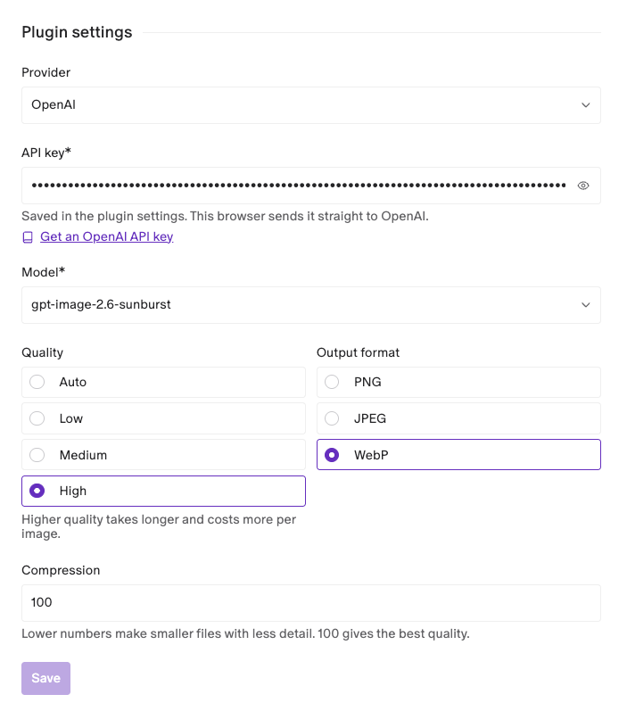
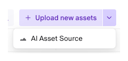
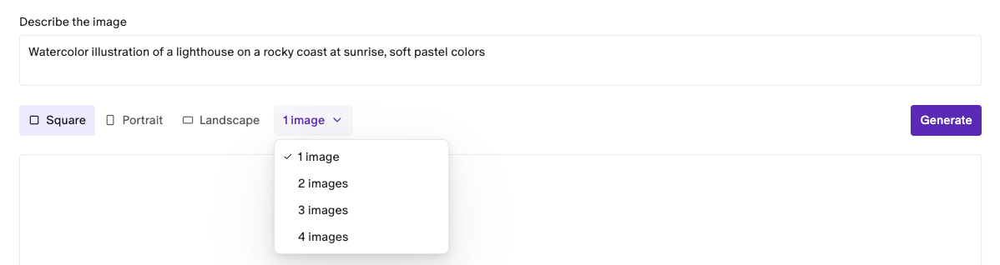
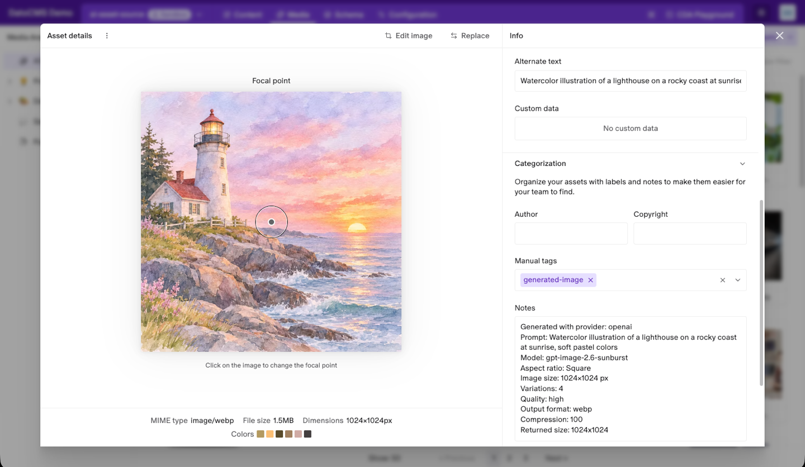

# AI Asset Source

Generate images from a text description with OpenAI or Google Gemini models, and add the ones you like to your DatoCMS Media Area, without leaving the dashboard.


- **Describe it, generate it**: write a prompt, pick a shape, and get up to four variations at once.
- **Choose before you upload**: only the images you select are added to the Media Area.
- **Ready to use**: each image gets its prompt as alt text, a `generated-image` tag and notes that record how it was made.
- **Your provider, your model**: OpenAI or Google Gemini, with the model list loaded from your account.
- **No server in between**: requests go straight from the editor's browser to the provider.

## Installation

1. Install the plugin from the marketplace.
2. In its settings, choose the **Provider** (OpenAI or Google Gemini) and paste an **API key** from that provider.
3. Pick a **Model**. The list is loaded from the provider with your key and only shows models that can make images.
4. For OpenAI image models you can also set **Quality**, **Output format** (PNG, JPEG or WebP) and, for JPEG and WebP, **Compression**. Higher quality takes longer and costs more per image.
5. Click **Save**.



You need API access, not a ChatGPT or Gemini subscription. Some OpenAI models, such as `gpt-image-2`, also ask you to verify your organization on the OpenAI side first. Retired DALL·E and Imagen models can't be used.

The key is stored in the plugin settings and sent only to the provider you chose.

## Generate images

1. In the **Media Area**, click the arrow next to **Upload new assets** and choose **AI Asset Source**.

   

2. Under **Describe the image**, write what you want to see.
3. Pick the shape: **Square**, **Portrait** or **Landscape**.
4. Open the **1 image** menu to ask for up to four images at once.
5. Click **Generate**, or press Cmd+Enter (Ctrl+Enter on Windows).



The dialog shows **Creating 4 images** with a running timer while the provider works. It can take a few minutes; click **Cancel** to stop waiting. After 10 minutes the plugin gives up and says so.

Not happy with the result? Change the description and generate again. The images of your last five generations stay in the grid, newest first, until you close the dialog.

## Add images to the Media Area

Click the images you want (their checkboxes fill in), then click **Add to the Media Area**. The dialog closes and the images are uploaded like any other asset.



Each image is saved with:

| Asset field | Value |
|---|---|
| File name | `image-`, the start of the prompt and the time it was made, plus the image's position when you asked for more than one |
| Alternate text | The prompt, in every locale of the project |
| Manual tags | `generated-image` |
| Notes | The provider, prompt, model, shape, size and the OpenAI output settings used |

## Good to know

- **Costs:** each generation is billed by the provider to your API account, depending on the model, quality, size and number of images. Cancelling, closing the dialog or hitting the 10-minute limit only stops the plugin from waiting: the provider may still finish the job and charge for it.
- **Google Gemini** models make one image per request, so the image count menu doesn't show.
- **Image sizes:** OpenAI makes 1024×1024 (Square), 1024×1536 (Portrait) and 1536×1024 (Landscape) px images. Gemini sizes are close to these and depend on the model.
- **Not set up yet:** without a key or model, the dialog says so. Admins get a button to the plugin settings; other editors are asked to contact an admin.
- **Errors in plain words:** a rejected key, an unverified OpenAI organization, an account over its quota or a prompt that breaks the provider's safety rules each get their own message with the next step.
- **From a record too:** when you pick an image for an asset field, the media picker's **Upload new assets** menu also lists **AI Asset Source**.

## Development

```sh
npm install
npm run dev     # serves the plugin with Vite
npm run check   # lint, type check, tests and build
```

See the [DatoCMS plugin SDK documentation](https://www.datocms.com/docs/plugin-sdk) for how plugins work.
