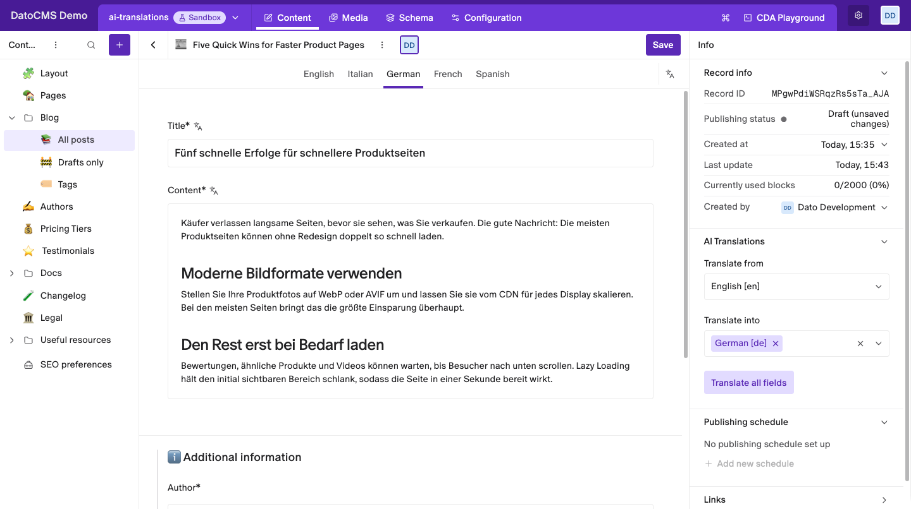
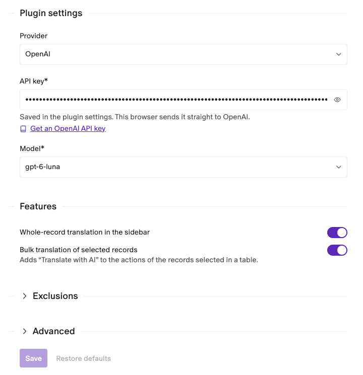
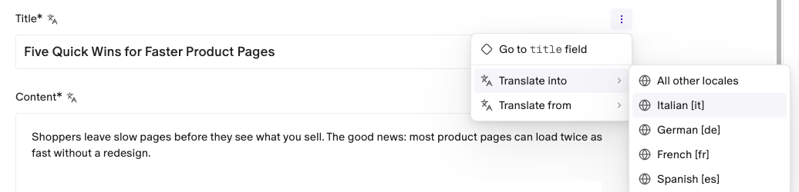
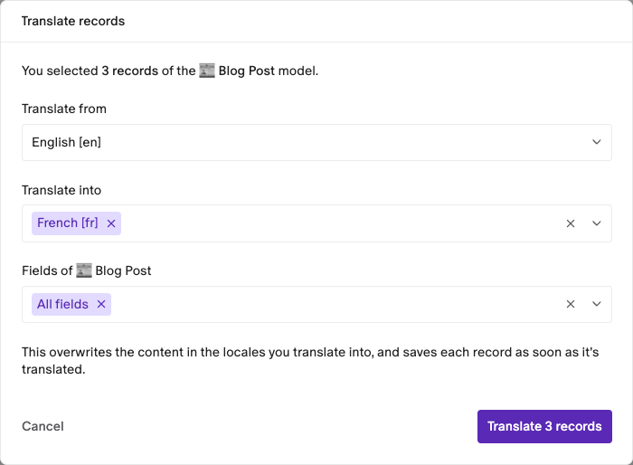
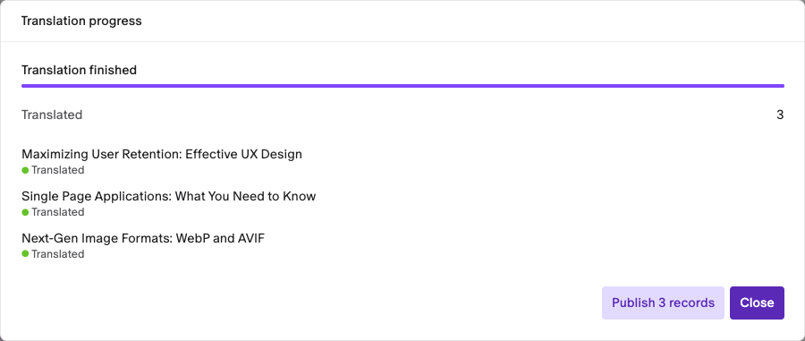
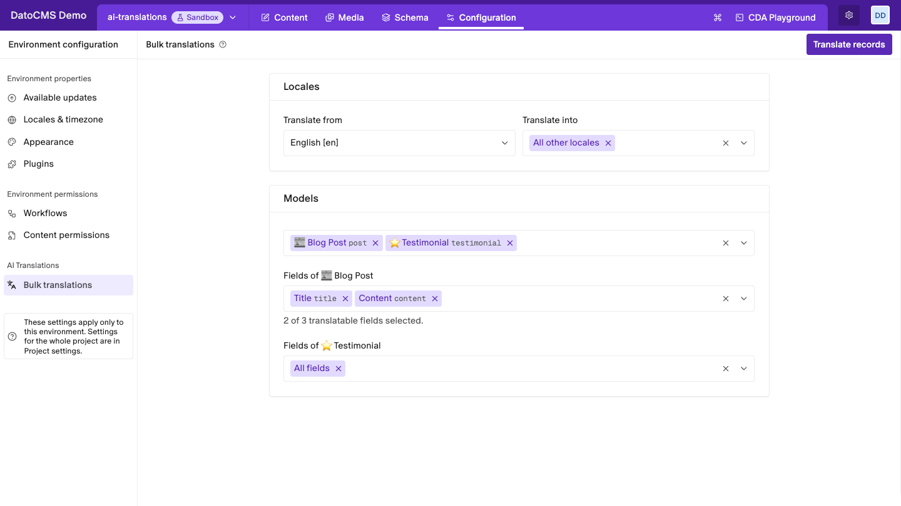

# AI Translations

Translate your content between your project's locales with OpenAI, Google Gemini, Anthropic, DeepL or Yandex Translate, right inside DatoCMS: one field, a whole record, a selection of records or every record of a model.



- **One field or the whole record**: translate a single field from its menu, or every field of a record from the sidebar.
- **Many records at once**: translate the records you select in a table, or every record of the models you pick.
- **Keeps the structure**: Structured Text, Modular Content blocks, SEO fields and media alt text are translated with their formatting in place.
- **Your provider**: five providers to choose from, with your own API key and, for the language models, the model and prompt you prefer.
- **You stay in control**: single records are translated into the form for you to review before saving.

## Installation

1. Install **AI Translations** from the marketplace. It asks for the current user's API token, which bulk translations use to read and save records.
2. In the plugin settings, pick a **Provider** and paste its **API key**.
3. For OpenAI, Google Gemini and Anthropic, pick a **Model**. The list loads from your account once the key is valid.
4. Click **Save**.



Your project needs at least two locales. DeepL is the fastest and cheapest choice for most projects. The language models also get the record's title and short text fields as context, which helps with tone and terminology.

API keys are saved in the plugin settings and used from each editor's browser, so treat them as visible to your team. Use a dedicated key, and restrict it where the provider allows.

The settings also let you turn off the sidebar panel or the table action, exclude models, roles or fields under **Exclusions**, and edit the prompt or limit the translated field types under **Advanced**. See [docs/Providers.md](docs/Providers.md) for each provider's options, DeepL glossaries and the prompt.

## Translate a field

Open a localized field's menu (**⋮** next to its label) and choose **Translate into**, then a locale or **All other locales**. **Translate from** does the reverse: it fills the locale you're on from another locale that has a value.



The translation goes into the form. Review it, then save the record.

## Translate a whole record

The **AI Translations** panel in the record sidebar translates every translatable field at once:

1. Pick the locale to **Translate from** and the locales to **Translate into**.
2. Click **Translate all fields**.
3. Each field shows its progress and turns green when it's done. Click a field to jump to it in the form.
4. Review the translations and save the record.

The menus only offer the locales the record has. To translate into a new locale, add it to the record first with the locale switcher above the form.

## Translate many records

Select records in a table, open **⋮** in the bar at the bottom and choose **Translate with AI**. The same action is in a record's own **⋮** menu.



Pick the source locale, the target locales and the fields of each model, then click **Translate N records**. Each record is saved as soon as it's translated, and a progress window lists every record as it goes. You can cancel at any time; records already translated stay saved.



When the run ends, **Publish N records** publishes the updated records of models that use drafts, in one click.

### Every record of a model

To translate whole models, go to **Configuration → Bulk translations** (users who can edit the schema). Pick the locales and the models, narrow the fields of each model if you like, and click **Translate records**. A summary asks you to confirm before the run starts.



## Good to know

- **Overwrites:** translating into a locale replaces what that locale already has in the selected fields.
- **Localized fields only:** fields that aren't localized are never changed.
- **Links stay as they are:** link fields and the records they point to aren't translated. When a bulk run fills a locale for the first time, it copies the links from the source locale and flags the record, so you can check whether that locale should link elsewhere.
- **SEO lengths:** translated SEO titles longer than 60 characters and descriptions longer than 160 are cut short.
- **Yandex limit:** Yandex Translate fails on a single text longer than 10,000 characters.
- **Costs:** every translation is billed by your provider to your API account. Large runs warn you before they start.

## Development

```sh
npm ci
npm run dev
npm test
npm run lint
npm run build
```

Release history is in the [changelog](https://github.com/datocms/plugins/blob/master/ai-translations/CHANGELOG.md).
