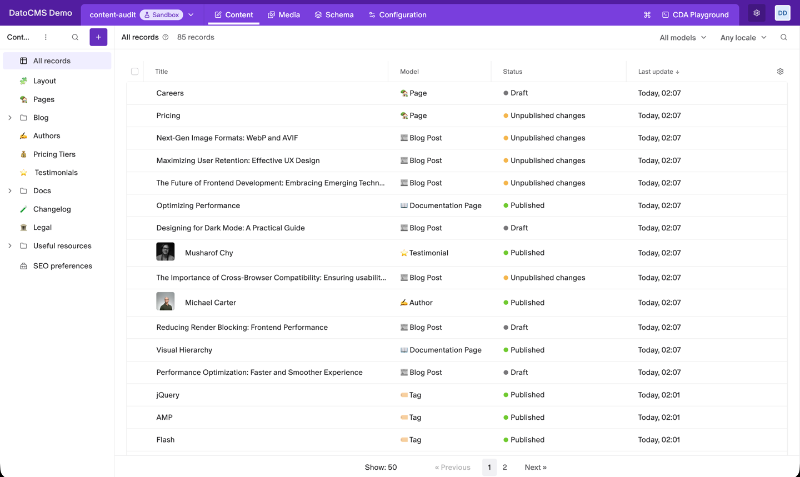
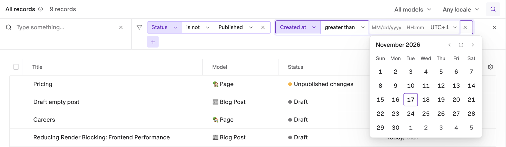
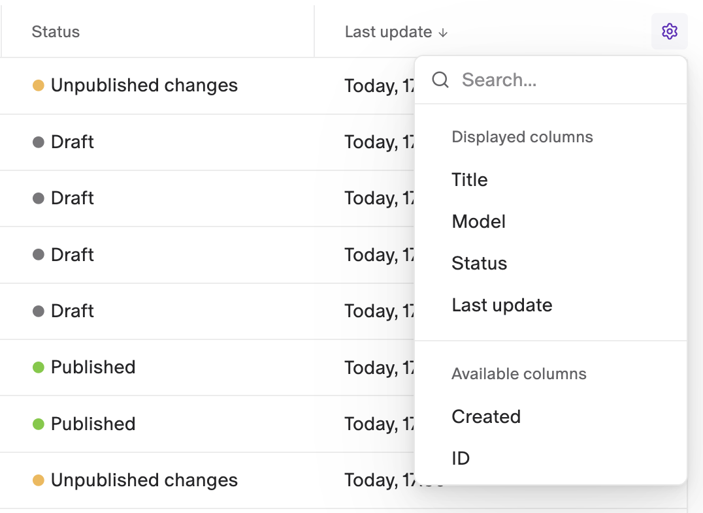
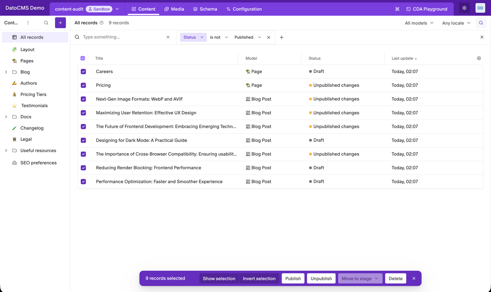
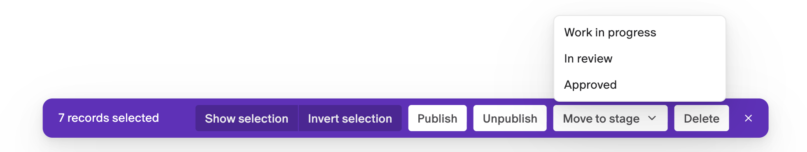

# All Records Viewer

Browse the records of every model in one table. Search and filter across the whole project, then publish, unpublish, delete or move records to a workflow stage in bulk.



- **Every model at once**: one paginated table with the title and image, model, status and last update of each record, as DatoCMS shows them.
- **Search and filter**: full-text search, a model and a locale picker, and the same filters as a model's record list.
- **Bulk actions**: publish, unpublish, delete or move to a workflow stage, on one page of records or on everything that matches.
- **Your own permissions**: the plugin reads and changes records as the person viewing the page.

## Installation

Install **All Records Viewer** from **Configuration → Plugins**. When asked, let it act on behalf of the logged-in user: it reads and updates records with that user's role, so everyone sees and changes only what their role allows. There is nothing to configure.

The plugin adds **All records** at the top of the content sidebar. Without the "Current user access token" permission, the page asks an administrator to turn it on in the plugin settings.

## Find records

Open **Content → All records**. Click a row to open the record.

- **All models** narrows the table to one model, and **Any locale** to the records that have content in a locale (it shows when the project has more than one).
- The magnifier opens the filter row. Type to search the records' content: results come best match first.
- Click **+** and choose what to filter by. The filter appears with its operator and value, ready to change; dates open a calendar. The ✕ on a filter removes it, and the ✕ at the end of the row clears them all. Status, creation, update and publication dates, creator, validity and locales work across every model. Once you pick a model, its fields can be filtered too.
- Click **Last update**, **Created**, **Status**, **Model** or **ID** to sort. With one model picked, **Title** can sort too.



The model, filters, search, sort and page are part of the page address, so you can bookmark a view or share it with your team.

### Choose the columns

The ⚙ button at the end of the header adds the **Created** and **ID** columns, or hides one you don't need. Drag a header by its handle to move the column, or its border to resize it. The layout is remembered in your browser.



## Act on many records

Tick records, or the box in the header to select the whole page. The selection bar then offers what you can do with them:

- **Publish** and **Unpublish**, for models with drafts.
- **Delete**, after a confirmation. It can't be undone.
- **Move to stage**, when every selected record belongs to the same model and that model uses a workflow.



The selection stays while you change the filters, so you can build it up from several searches. **Show selection** lists only the selected records, and **Invert selection** flips the selection on the current page. When the matches don't fit in one page, **Select all matching records** selects every one of them.

Before running, the plugin checks each record against the action and your role. Records it can't act on, like a Tag when you publish, are left out and the confirmation says how many.



### Large selections

Actions run in batches of up to 200 records, with the progress in the selection bar. **Stop** cancels the batches that haven't started; the one in progress still finishes. A notice sums up the result, for example "9 records published."

If a batch fails, its records stay selected. Some of them may have been changed anyway, so check them before running the action again.

## Good to know

- **Other plugins aren't consulted**: bulk actions go straight to the Content Management API, so plugins that check records before they're published or deleted in the editor don't run.
- **Searching sorts by relevance**: while a search is active, the column headers don't sort.
- **Only what you can read**: records your role can't read don't appear, and actions your role can't take are left out.

## Development

```sh
npm ci
npm run dev       # http://localhost:5173
npm test
npm run build
```

To try it in a project, add a private plugin with `http://localhost:5173` as its entry point.
