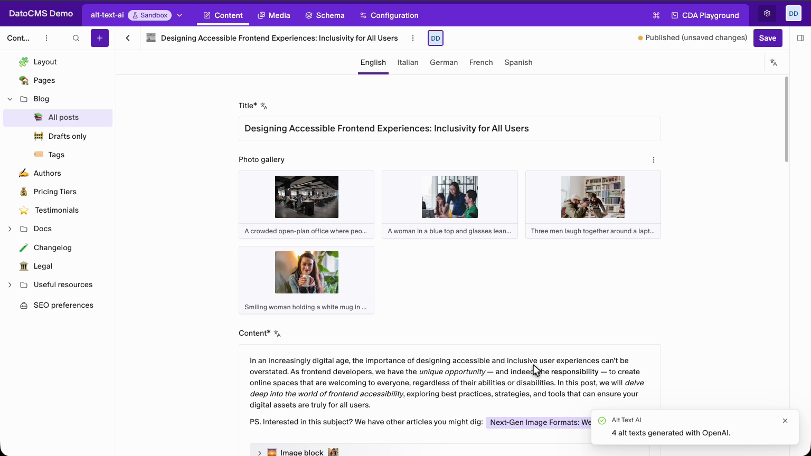
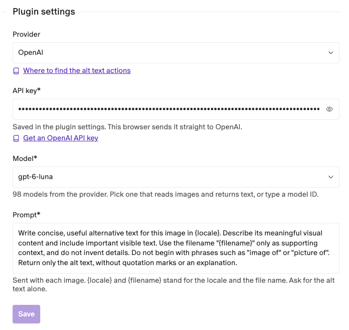
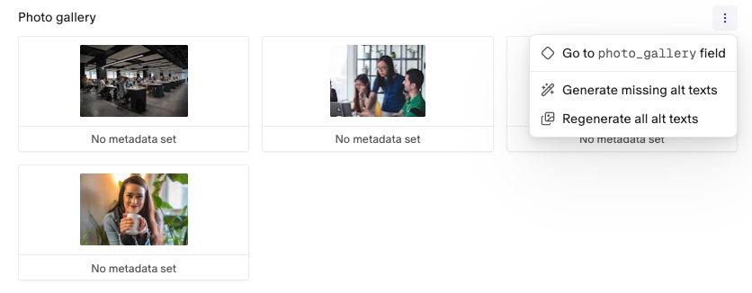
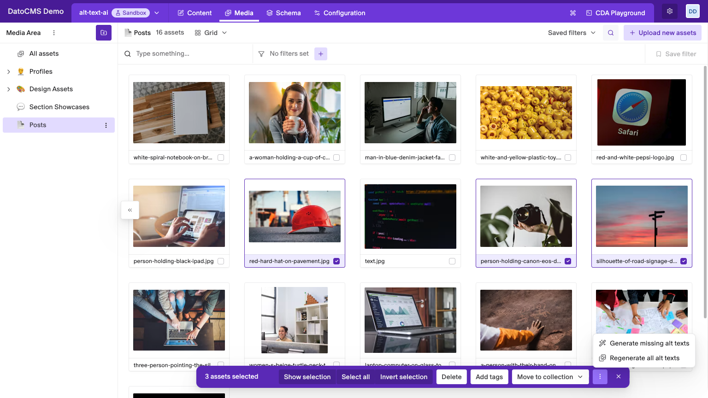
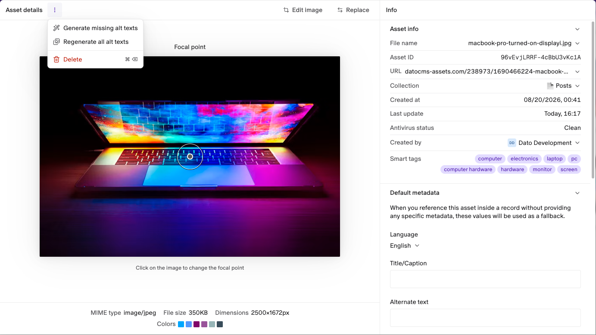
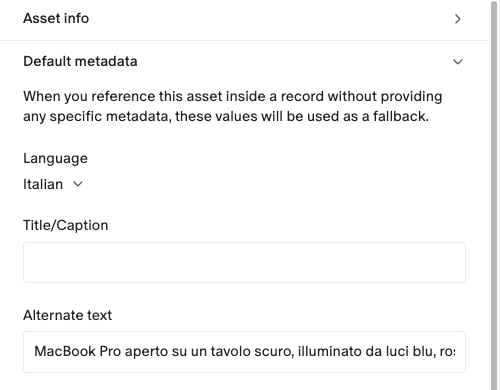

# Alt Text AI

Write alt text for your images in one click. The plugin describes each image with [AltText.ai](https://alttext.ai), OpenAI, Anthropic or Google Gemini, from a record's image field or straight from the Media Area.



- **From a field:** fill the alt text of every image in a single-asset or gallery field, then review it before you save.
- **From the Media Area:** select any number of images, or open one, and save alt text on the asset itself.
- **Every locale:** Media Area runs write alt text in each of your project's languages.
- **Missing or all:** fill only the empty ones, or regenerate everything after a confirmation.
- **Your provider, your prompt:** pick AltText.ai, OpenAI, Anthropic or Google Gemini, choose the model and tune the instructions.

## Installation

1. Install the plugin from the marketplace and grant it the **currentUserAccessToken** permission. The plugin uses it to read the selected images and save their alt text in the current environment.
2. In the plugin settings, choose a **Provider** and paste an **API key** from that provider.
3. For OpenAI, Anthropic and Google Gemini, pick a **Model**. The list is loaded from the provider with your key; choose one that reads images and returns text, or type a model ID.
4. Review the **Prompt** and click **Save**.



| Provider | What you need |
| --- | --- |
| AltText.ai | An [AltText.ai API key](https://alttext.ai/account/api_keys). It uses the generation settings of your AltText.ai account, so there is no model or prompt to set. |
| OpenAI | An [OpenAI API key](https://platform.openai.com/api-keys) and a model that accepts images |
| Anthropic | An [Anthropic API key](https://console.anthropic.com/settings/keys) and a model that accepts images |
| Google Gemini | A [Google Gemini API key](https://aistudio.google.com/apikey) and a model that accepts images |

The prompt is sent with every image. `{locale}` stands for the language being written and `{filename}` for the asset's file name. Keep an instruction that asks for the alt text alone, without quotes or explanations.

Upgrading from an older version? Your saved AltText.ai key keeps working, and AltText.ai stays selected until you pick another provider.

## Where to generate alt text

Every place offers the same two actions:

- **Generate missing alt texts** fills only the images whose alt text is empty.
- **Regenerate all alt texts** writes new alt text for every targeted image and replaces what is there.

### In a record

Open the actions menu (⋮) of a single-asset or gallery field that holds at least one image.



The alt text goes into the field itself, in the language tab you're on, and the record is not saved for you. Read it, fix anything that's off, and save. For a localized field, run the action again in each language tab that needs it. Field actions never change the asset in the Media Area or other records that use the same image.

### In the Media Area

Select one or more images, then open the actions menu (⋮) in the selection bar.



Or open a single image and use the actions menu (⋮) next to **Asset details**.



In the Media Area, the plugin writes the asset's default alt text in every locale of the project and saves it right away. **Regenerate all alt texts** first asks you to confirm, because it replaces saved alt text and can't be undone. Larger runs show a progress notice every few seconds, and the final notice says how many alt texts were generated for how many assets. Files that aren't images are skipped.



Default alt text is the fallback for every record that uses the asset without alt text of its own. Alt text already set inside a record's field stays as it is.

## Good to know

- **Review the results:** generated descriptions can be wrong or miss what matters on your page. Read them where the image appears.
- **Decorative images:** an empty alt text can be on purpose. **Generate missing alt texts** can't tell, so check decorative images before you save.
- **Context:** the same image may need different alt text on different pages. Use the field action for the page, and the Media Area for a sensible default.
- **Waiting and errors:** a slow or busy provider is retried a few times. An image that still fails keeps its alt text, and a message lists what went wrong; a rejected key, a used-up quota or a model that can't be used stops the run and keeps what was already done.
- **Costs:** each image (and, in the Media Area, each locale) is a request billed to your provider account.

## Security and privacy

The API key is stored in the plugin settings and used from the editor's browser, so anyone who can open or inspect the plugin in the project may be able to read it. Use a dedicated key with tight limits and permissions, and rotate it regularly. If your organization doesn't allow keys in the browser, don't set up a direct provider.

Each provider receives only what it needs. AltText.ai gets a resized public image URL, the locale and an ID based on the asset. OpenAI and Anthropic get the resized image URL and the prompt. Google Gemini gets the image itself and the prompt. The prompt includes the locale or file name only if you keep those placeholders. Check your provider's data terms before sending sensitive images.

The editor's DatoCMS access token is used only to read and update assets through the Content Management API of the current environment. It is never sent to the providers.

## Development

```sh
npm install
npm run dev     # serves the plugin with Vite
npm run test    # runs the test suite
npm run build   # type-checks and builds into dist/
```

See the [DatoCMS plugin SDK documentation](https://www.datocms.com/docs/plugin-sdk) for how plugins work.
