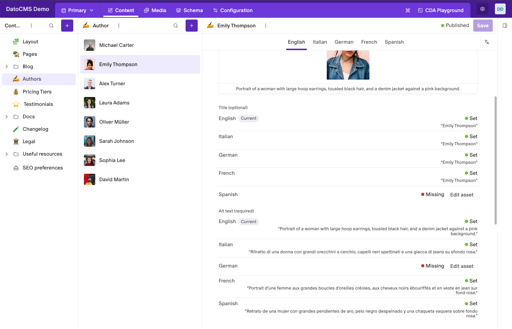
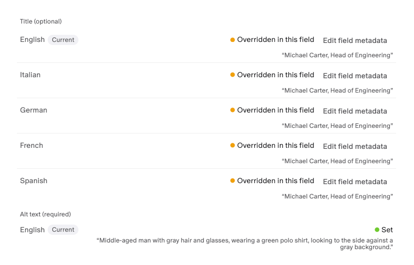

# Asset Localization Checker

See at a glance whether an image has its title and alt text in every language of the record, right under the image field.



- **Every language of the record**: one row per locale, for the title and for the alt text.
- **Set, missing or overridden**: see whether each value comes from the asset, from this field, or is still missing.
- **Fix it on the spot**: open the asset or the field's metadata from the row that needs it.
- **Required or optional**: follows the field's alt text and title validation.
- **No setup**: it appears under every single-asset field.

## Installation

1. Install the plugin. It asks to make API calls on behalf of the current user: it reads the asset's title and alt text with them.
2. There is nothing to configure. The check appears under every **Single Asset** field of the project.

Without that permission, the plugin shows a notice asking a project admin to grant it in the plugin settings.

## Check an image

Open a record and look under its single-asset field. The check lists the record's languages twice: once for the **Title**, once for the **Alt text**. The language you are editing has a **Current** tag.

Each row has one of three statuses:

| Status | What it means |
|---|---|
| **Set** | The asset has a default value for this language. The value shows under the status. |
| **Overridden in this field** | This field gives its own value, which replaces the asset's default. |
| **Missing** | Neither the asset nor this field has a value for this language. |

The group headings say **(required)** or **(optional)**, following the field's **Require alt and/or title** validation. DatoCMS only checks the main language for a field that isn't localized, so the plugin is how you see the others.

## Fix a missing value

- **Edit asset**, next to a missing value, opens the asset's details. Pick the language under **Default metadata**, fill in the title or alt text, and save. The check updates when you close the details.
- **Edit field metadata**, next to an overridden value, opens the metadata of this field, where you can change or clear the override.



## Good to know

- **Single-asset fields only.** Gallery fields (multiple assets) aren't checked.
- **Only the record's languages.** A record that uses fewer languages than the project shows only those.
- **Changes made elsewhere** (for example in the Media area) show the next time the record opens.

## Development

```bash
npm install
npm run dev     # local development server
npm run build   # type check and production build
```

See the [DatoCMS plugin SDK documentation](https://www.datocms.com/docs/plugin-sdk) for how to run a plugin from a local server.
