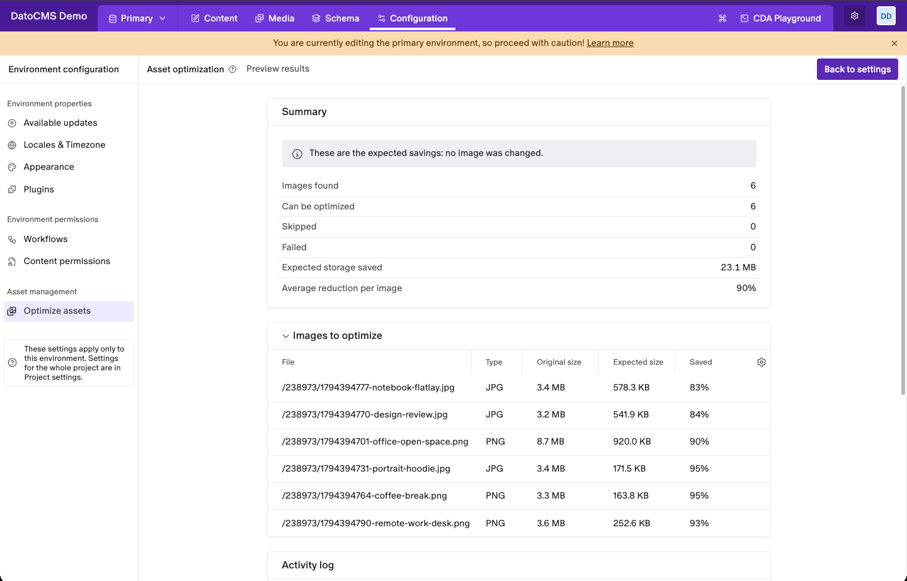
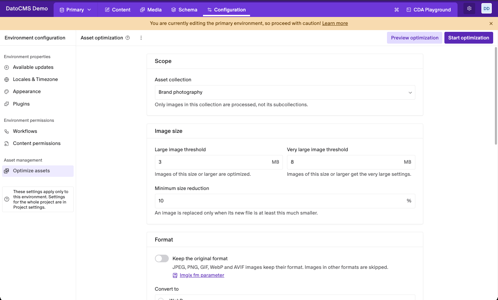

# Asset Optimization

Shrink the large images of your media library in one run. The plugin makes a smaller version of each image with Imgix, using the format, size and quality you choose, and replaces the original with it.



- **Preview first**: see the expected size of every image and the total savings before anything changes.
- **Only large images**: images under the size threshold you set are left alone.
- **Your settings**: keep the original format or convert to WebP or AVIF, resize large images, set the quality, or use lossless compression.
- **One collection or everything**: run it on a single asset collection or on the whole environment.
- **Nothing to relink**: a replaced image keeps its ID, its metadata, its tags and its collection, so the records that use it don't change.

> **Replacing an image is permanent.** The original can't be recovered. Try your settings in a sandbox environment first, and run them on your primary environment once you're happy with the results.

## Installation

1. Install the plugin and allow it to **perform actions and API calls on behalf of the logged-in user**. It uses your API token to find the images and replace them. Without it, the page explains that it isn't allowed and its buttons stay disabled.
2. Open **Configuration › Asset management › Optimize assets**, or click **Open asset optimization** in the plugin's settings.

Only users whose role can edit the schema see the page.

## Choose the settings



The page groups the settings by topic. They save on their own, and the **⋮** menu next to the title has **Restore default settings**.

| Group | What it sets |
|---|---|
| **Scope** | **All assets**, or one **Asset collection**. Subcollections aren't included. |
| **Image size** | The **Large image threshold** (3 MB by default): only images of this size or larger are optimized. Images over the **Very large image threshold** (8 MB) get their own max size and quality. **Minimum size reduction** (10%) skips an image whose new file wouldn't be at least that much smaller. |
| **Format** | **Keep the original format**, or convert to **WebP** or **AVIF** (the default). **Automatic compression** lets Imgix pick the best compression for each image. |
| **Resize** | **Resize large images** scales an image down when its longer side is over the max size: 2,400 px for large images and 2,000 px for very large ones by default. |
| **Compression** | The quality of large and very large images, from 0 to 100 (85 and 80 by default), or **Lossless compression**. |
| **Advanced** | Double pixel density for very large images, higher-quality chroma subsampling for JPEGs, and keeping the color profile of the original. |

Each setting links to the Imgix parameter it uses.

## Optimize your images

1. Click **Preview optimization**. The plugin looks for the large images in the scope and works out their new sizes without changing anything.
2. Read the **Summary**, and open **Images to optimize** to see the original size, the expected size and the saving of each image. Click **Back to settings** to adjust them and preview again.
3. Click **Start optimization** and confirm twice: the plugin replaces the images for good.
4. Keep the page open while it works: leaving it cancels the run. The progress shows the image being processed.
5. When it finishes, the **Summary** shows how much storage was saved.

**Cancel** stops the run, but the replacements already sent still complete. Every run also writes an **Activity log** at the bottom of the page.

## Understanding the results

The results list the images in three groups. Each image has a link to open it and a link to open it in the media area.

| Group | What it means |
|---|---|
| **Optimized images** (**Images to optimize** in a preview) | The image was replaced, or would be, with the size shown. |
| **Skipped images** | The image was left as it is: its new file wasn't at least the **Minimum size reduction** smaller, or **Keep the original format** is on and its format isn't JPEG, PNG, GIF, WebP or AVIF. |
| **Failed images** | The image couldn't be processed. The list shows the error. An image that someone changed during the run isn't replaced. |

## Good to know

- **One environment at a time:** the plugin works on the environment you're in. Running it in a sandbox and promoting the sandbox is the safest way to optimize your primary environment.
- **New file, new URL:** a replaced image keeps its ID, but its file gets a new URL. Records and the GraphQL API pick it up on their own, but a copy of the old URL saved outside DatoCMS won't be updated.
- **Only images:** videos, documents and other files are never touched.

## Development

```bash
npm install
npm run dev     # serves the plugin on http://localhost:5173
npm run check   # lint, typecheck, tests and build
```
