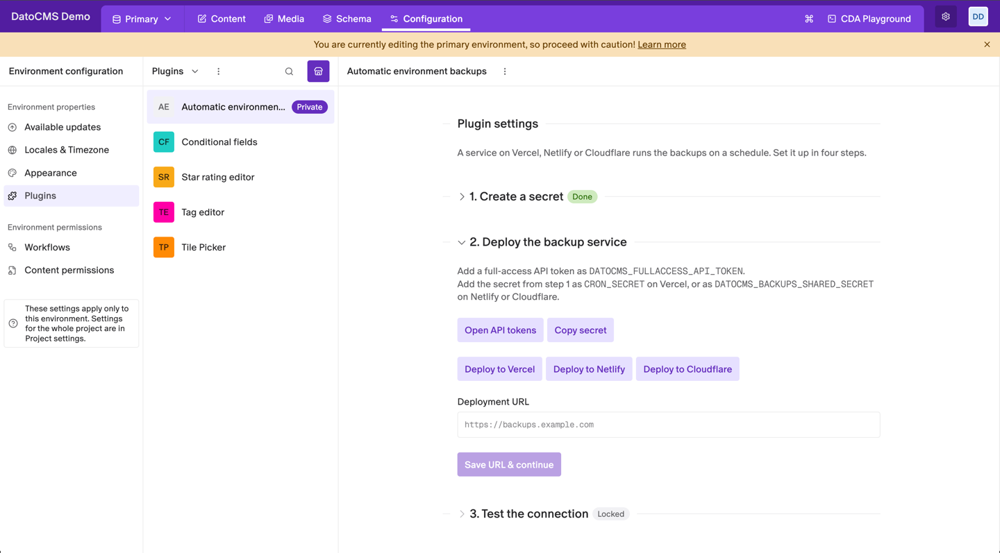
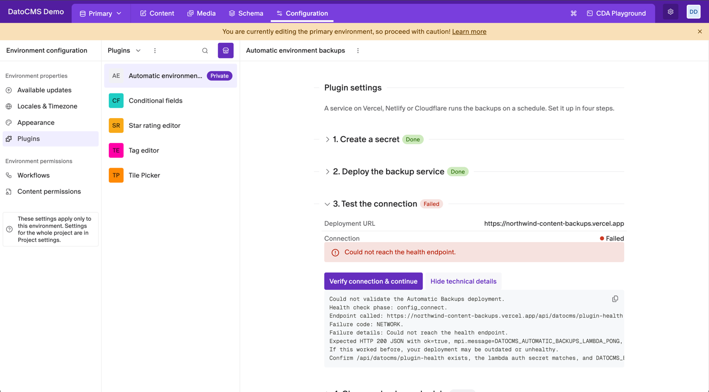

# Automatic Environment Backups

Back up your primary environment on a schedule. A small service that you deploy to Vercel, Netlify or Cloudflare forks your primary environment into a sandbox every day, week, two weeks or month, and the plugin sets it up and shows how the backups are doing.



- **Guided setup**: four short steps, from the shared secret to the schedule. Only the step you're on is open.
- **Backups inside your project**: each backup is a sandbox environment, ready to inspect, promote or fork. Nothing is copied to an outside provider.
- **Four schedules**: daily, weekly, bi-weekly and monthly. Turn on any combination.
- **One backup per schedule**: each new backup replaces the previous one of the same schedule, so sandboxes don't pile up.
- **Status at a glance**: the last and next backup of each schedule, its environment, and a **Back up now** button.

## Before you begin

- An account on **Vercel**, **Netlify** or **Cloudflare** that can deploy a project with serverless functions. The free plan is usually enough.
- A **full-access API token** of your DatoCMS project, which the service uses to fork the environment. Older projects already have one called "Full-access API token"; in newer projects, create a token with an admin role and access to the Content Management API.

The service is open source: [datocms-backups-scheduled-function](https://github.com/marcelofinamorvieira/datocms-backups-scheduled-function).

## Installation

Install the plugin and allow it to **perform actions and API calls on behalf of the logged-in user**: it uses your access to save its settings and to read the project's environments. Then open **Configuration › Plugins › Automatic environment backups**.

Only users whose role can edit the schema can change the setup. Other users see it read-only.

## Set it up

1. **Create a secret.** The plugin generates a shared secret. Click **Save secret & continue** to save it and copy it to the clipboard, or **Generate new** for another value.
2. **Deploy the backup service.** Click **Deploy to Vercel**, **Deploy to Netlify** or **Deploy to Cloudflare**, and set two variables on the deployment:
   - `DATOCMS_FULLACCESS_API_TOKEN`: your full-access API token (**Open API tokens** takes you to them).
   - The secret from step 1: `CRON_SECRET` on Vercel, `DATOCMS_BACKUPS_SHARED_SECRET` on Netlify or Cloudflare (**Copy secret** copies it again).

   Paste the public URL of the deployment, for example `https://my-backups.vercel.app`, and click **Save URL & continue**.
3. **Test the connection.** Click **Verify connection & continue**. The plugin checks that the service answers and accepts the secret.
4. **Choose a backup schedule.** Turn on **Daily**, **Weekly**, **Bi-weekly** or **Monthly**, and click **Save schedule & finish**. The plugin creates the first backup of each schedule you turned on.

Once every step is done, the steps close and **Backup status** appears below them. You can leave the page: the backups run on their own.

### When the test fails



The step shows what went wrong, and **Show technical details** lists the endpoint it called and the error it got. The usual causes:

- **Could not reach the health endpoint**: the URL is wrong, or the deployment isn't finished.
- **An authentication error**: the secret on the deployment doesn't match the plugin's. Update the variable, redeploy, and test again.

## Backup status

Each schedule you turned on gets a row with:

- **Last** and **Next**: when the last backup ran and when the next one is due. An overdue backup shows **Due now**.
- **Its environment**, named `backup-plugin-<schedule>-<date>`, with a link to your environments.
- **Back up now**, to run that schedule's backup right away.

The pill next to the title reads **Active** when everything works, and **Needs attention** when a step needs fixing.

## Change the setup

- Click any finished step to review or change it.
- A new secret means a new connection test: update the variable on the deployment and redeploy first.
- **Remove saved deployment** in step 2 clears the URL. The deployment keeps running until you delete it on your provider.
- Every time the screen opens, the plugin checks the connection again, so a broken deployment shows up right away.
- **Advanced settings › Debug logs** writes the plugin's events and requests to the browser console.

## Good to know

- **Once a day:** the service runs at 02:05 UTC and makes the backups that are due. A missed backup is made on the next run.
- **Sandboxes count toward your plan:** each schedule you turn on keeps one sandbox environment.
- **A backup is a full copy:** the content and schema of the primary environment, as they were when the fork ran.

## Development

```bash
npm install
npm run dev     # serves the plugin at http://localhost:5173
npm run test    # typecheck and unit tests
npm run build
```

See [CHANGELOG.md](CHANGELOG.md) for the release history.
