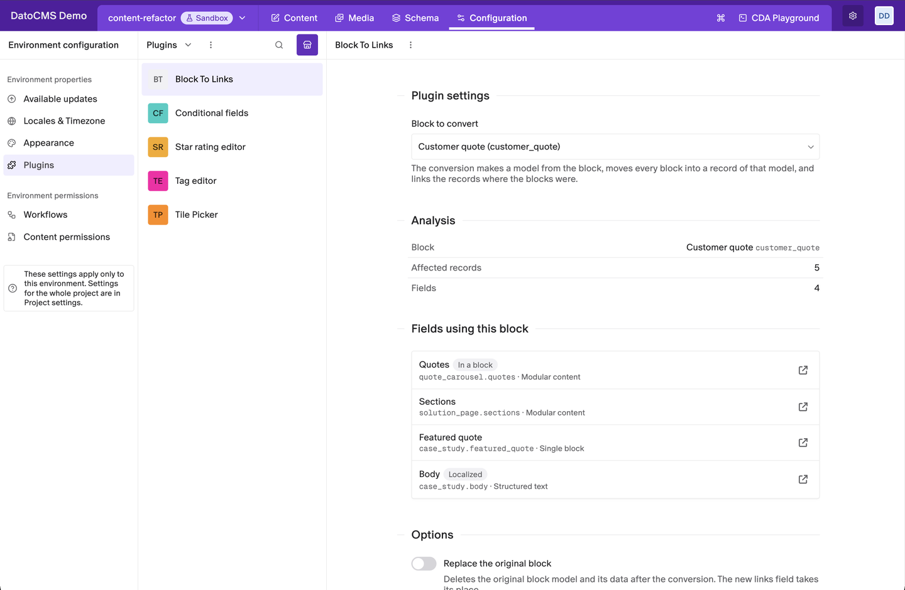
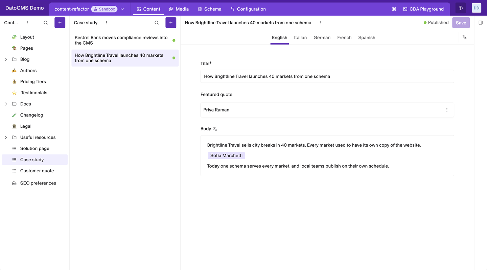
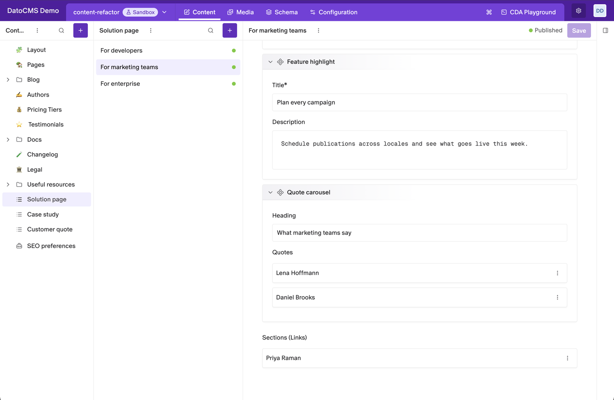

# Block to Links

Turn a block into a model of its own. The plugin moves every copy of the block into a record of the new model and links those records where the blocks were, so content you used to copy from page to page becomes content you can reuse.



- **Analysis first**: see how many records and which fields use the block before anything changes.
- **Every place a block can live**: Modular content, Single block and Structured text fields, blocks nested inside other blocks, and localized fields.
- **Nothing is lost**: each block becomes a record with the same fields and values, in every locale.
- **Keep or replace**: add links next to the blocks and keep the original block, or replace the block for good.
- **Publish in one go**: optionally publish every record the conversion creates or updates.

> **This changes your schema.** Try the conversion in a sandbox environment first, check the result, and update your frontend queries before you run it on your primary environment.

## Installation

Install the plugin and allow it to **perform actions and API calls on behalf of the logged-in user**: it uses your access to read the schema, create the new model and update the records. Without that permission, the settings screen asks you to grant it. Your role must be able to edit the schema and the records involved.

There is nothing to configure. The plugin works from its settings screen: **Configuration › Plugins › Block To Links**.

## Convert a block

1. In **Block to convert**, pick the block. The plugin scans the project and shows the **Analysis**: the number of records that contain the block and the fields that allow it.
2. Check **Fields using this block**. Each field shows its model, its type, and whether it sits **In a block** or is **Localized**. The arrow opens the field in the schema.
3. Choose the **Options** (see below).
4. Click **Convert to model**, or **Convert and replace** when you replace the block, and confirm.
5. Keep the page open while the conversion runs. When it ends, the summary shows the new model, the records migrated and the fields converted.

Click **Convert another block** to start over with a different block.

### Options

| Option | What it does |
|---|---|
| **Replace the original block** off (default) | The plugin creates a model called "*Block* (Converted)", adds a links field labelled "*Field* (Links)" after every Modular content and Single block field that uses the block, and adds an inline link after each block in Structured text. The blocks stay where they are, so you can check the result and delete the block yourself later. |
| **Replace the original block** on | The new model takes the block's name and API key, the links take the place of the blocks, and the original block model is deleted with its data. This can't be undone. |
| **Publish the records after the conversion** | Publishes every record the conversion creates or updates. When it's off, updated records are left with unpublished changes. |

## What changes in your content



Every block becomes a record of the new model. Blocks aren't merged: the same quote used on two pages becomes two records. What happens to each field depends on its type:

- **Single block**: becomes a single link field to the new model.
- **Modular content**: becomes a links field. If the field also allows other blocks, those blocks stay, and the links go to a new "*Field* (Links)" field right after it.
- **Structured text**: each block becomes an inline link to its record, in the same spot of the text. When you keep the original block, the inline link is added after the block.
- **Blocks inside other blocks**: are converted too, inside the parent block.
- **Localized fields**: the fields of the new model are localized, and each block becomes one record that holds its values in every locale.



## Update your frontend

Linked records are queried differently from blocks, so update your GraphQL queries after a conversion:

- **Modular content and Single block fields** now return linked records instead of blocks. If you kept the block, the links are in the new `*_links` fields, so add those to your queries. If you replaced it, the fields keep their API keys, but check the fragments and types your queries use.
- **Structured text**: the records come back in `links` instead of `blocks`, so query `links` and render `inlineItem` nodes in your Structured text renderer.

## Good to know

- **Keep the page open:** closing the settings screen stops the conversion.
- **API keys:** a kept conversion names the model `<block>s_conv` (for example `customer_quotes_conv`) and the links fields `<field>_links`. Rename them in the schema if you want.
- **Large projects:** the plugin reads and updates every record that uses the block, so a block used in thousands of records takes a while.
- **Errors:** if something goes wrong, the screen shows the error. Pick the block again to start over.

## Development

```bash
npm install
npm run dev     # serves the plugin at http://localhost:5173
npm run test
npm run build
```
