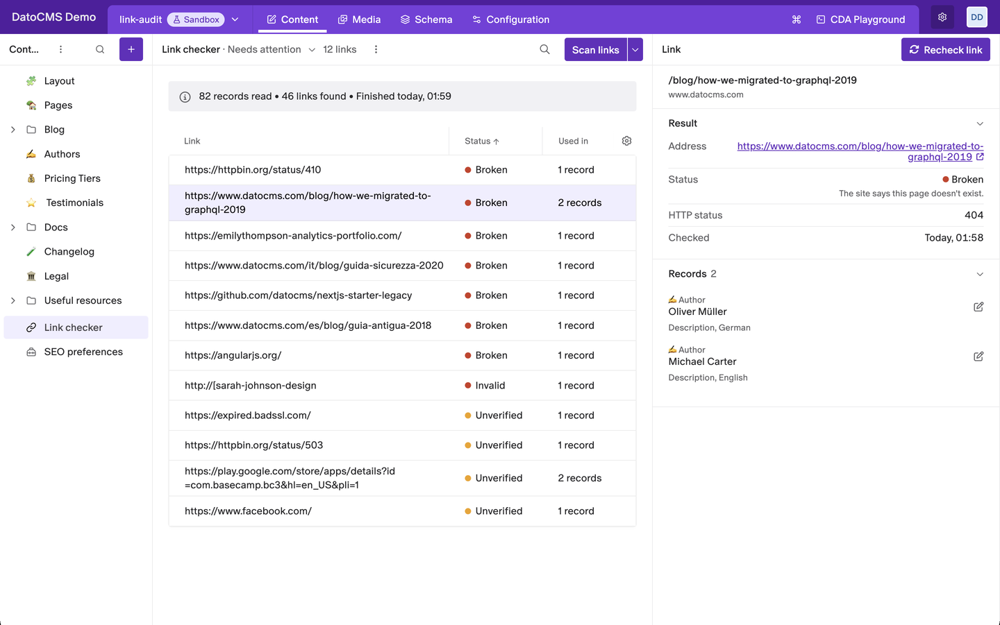
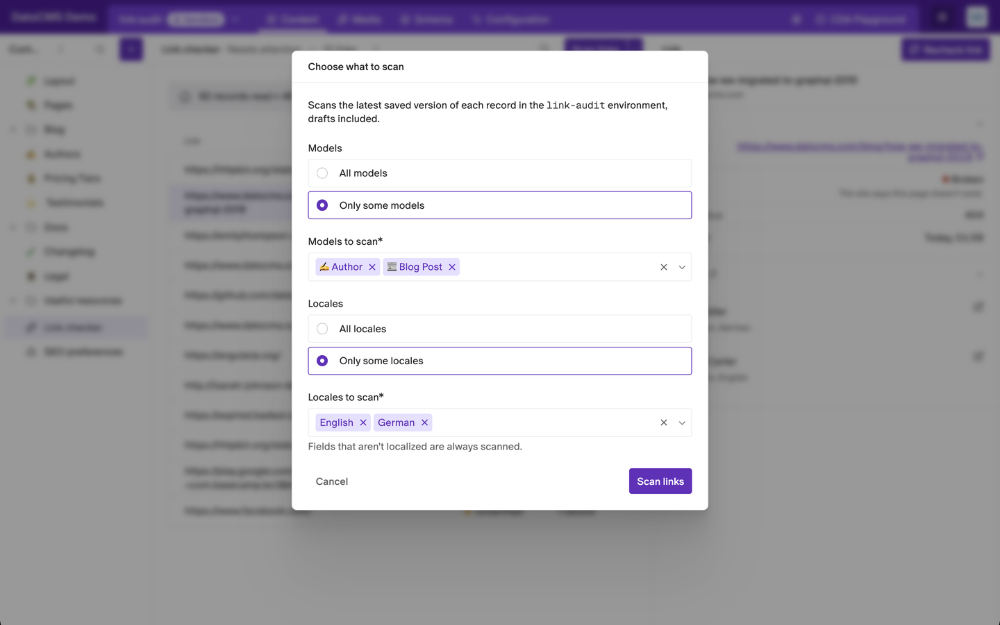
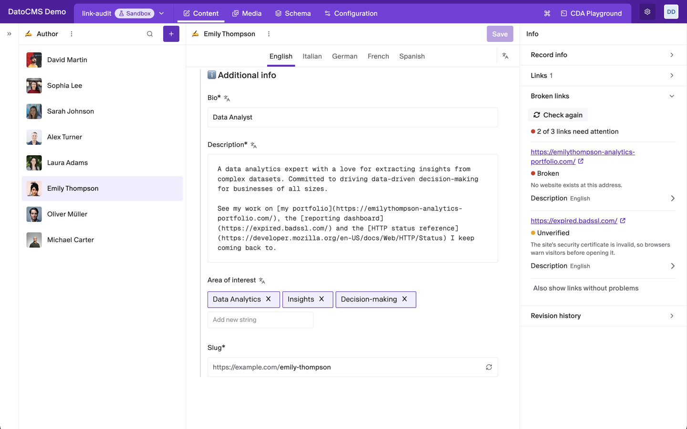

# Broken Link Checker

Finds broken links in your DatoCMS content. Scan the whole project to see every bad link and where it's used, or check a single record from its sidebar. The plugin only reads your content and never changes it.



- **Project scan**: every link in your records, grouped by URL, with each record, field and locale that uses it.
- **Record check**: check the record you're editing, unsaved changes included, and jump to the field that holds a link.
- **Clear results**: each link gets a status and a short explanation in plain words.
- **CSV export**: download the whole report to share it or keep a copy.
- **Read-only**: nothing in your content is ever changed.

## Installation

Install **Broken Link Checker** from **Configuration → Plugins** and, when asked, let it use the current user's API token. The project scan needs it to read your records. Without it, the record check still works but the Link checker page is hidden. There's nothing else to configure.

## Scanning the project

1. Open **Content → Link checker**.
2. Click **Scan links** and keep the page open while the scan runs.
3. Select a link to see the site's answer and every record that uses it.
4. Open a record with its edit button to fix the link, then click **Recheck link**.

The list starts on **Needs attention**. Click the page title to switch to all links or to a single status, and use the search button to filter by URL, model or locale. **Export as CSV** in the **⋮** menu downloads the whole report, whatever the filters. Results disappear when you leave the page, so export them if you want to keep a copy.

The scan reads the latest saved version of every record in the current environment, drafts and invalid records included, but only records your role can read. Anything it couldn't read is listed in the report.

### Choose what to scan

To scan only some models or locales, open the menu next to **Scan links** and pick **Choose what to scan…**, then start the scan from the dialog. Fields that aren't localized are always scanned.



## Checking a single record

Open a record, expand **Broken links** in the sidebar and click **Check links**. Every locale is checked, unsaved changes included. The panel lists the links that need attention, each with its explanation. Click a result to jump to its field, in the right locale. **Also show links without problems** lists the rest.



## Understanding results

| Status | What it means |
|---|---|
| **Broken** | The page doesn't exist (404 or 410), or no website exists at that address. |
| **Invalid** | The address isn't written correctly, for example a missing slash or a stray character. |
| **Unverified** | The check couldn't confirm the link either way: a server error, an invalid certificate, or no response. Open it to check. |
| **Blocked** | The site turned away the automated check. Usually not a problem with the link. |
| **Working** | The page answered normally. |
| **Skipped** | Not a full web address, or a local or private one, so it isn't checked. |

**Needs attention** groups Broken, Invalid and Unverified links.

**Why are some links Blocked?** Links are checked through DatoCMS's link-checking service, and many sites guard against automated traffic with bot protection, rate limits or sign-in pages. A blocked link usually works fine for visitors. Open it yourself to be sure.

## Good to know

- **What's scanned:** single-line text fields holding a URL, multi-paragraph text (plain, Markdown or HTML), Structured Text links, and everything inside Modular Content, Single Block and Structured Text blocks. Assets aren't checked.
- **Anchors:** only the part before `#` is requested, so missing anchors aren't detected.
- **Soft errors:** a login screen or a "not found" message served as a normal page counts as working.
- **Skipped addresses:** `mailto:` links, relative paths, `localhost` and private IP addresses.
- **Edited records:** when you save a record from the report, the page tells you to scan again to refresh it.

## Development

```sh
npm ci
npm run dev
npm test
npm run lint
npm run build
```

Test coverage and the manual validation checklist are in [docs/VALIDATION.md](docs/VALIDATION.md).
