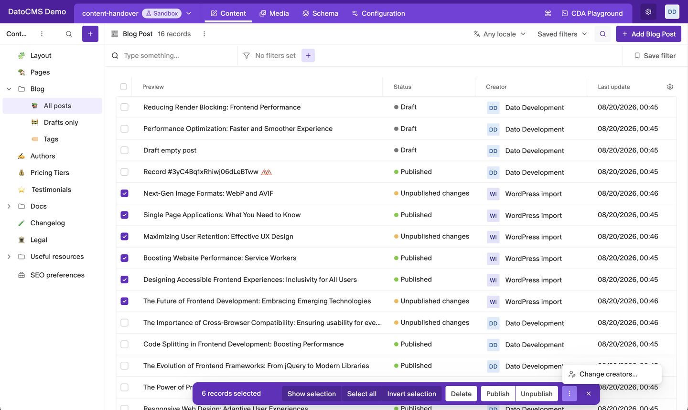
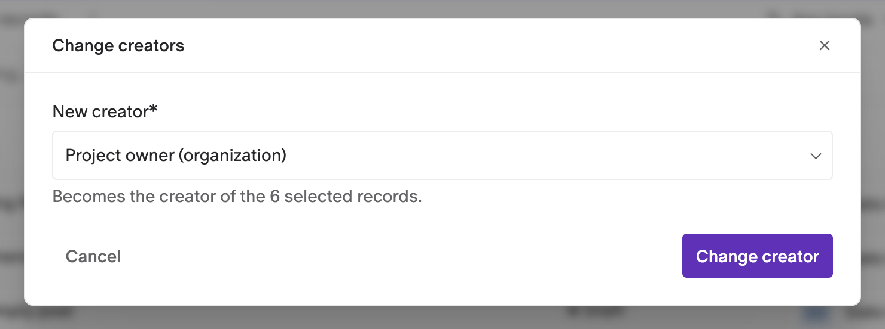
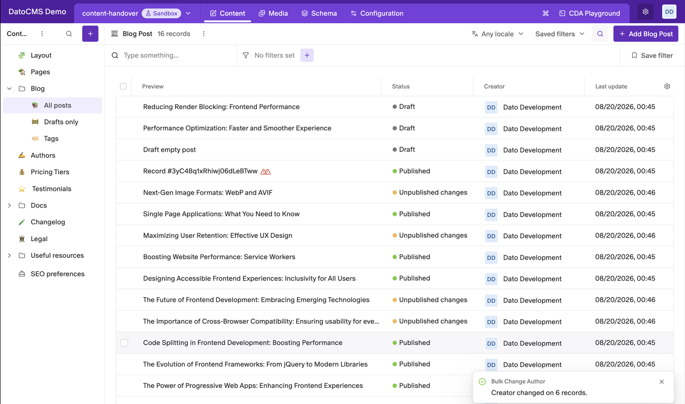

# Bulk Change Author

Change the creator of many records at once, right from a model's record list. Hand imported content over to a person, or move a departing colleague's records to someone else, in a few clicks.



- **A selection action**: select records in any model's list and choose **Change creators…**.
- **Any creator**: a collaborator, an SSO user or the project owner.
- **Only the creator changes**: the content, the publication status and the last update date stay as they are.
- **Large selections**: from 500 records on, the dialog shows the progress and lets you stop.

## Installation

1. Install the plugin. It asks to use your access token: it changes the records as you, so it can do only what your role allows.
2. There is nothing to configure. The **Change creators…** action appears in the record lists of every model.

Your role needs permission to edit the creator of the records you select. Without it, the change fails for those records, usually with an HTTP 403 error.

## Change the creator of records

1. Open a model's record list and select the records.
2. In the selection bar, open the **⋮** menu and choose **Change creators…**.
3. Pick the **New creator** and click **Change creator**.



The list groups the creators: the project owner, the collaborators and the SSO users of the project. When the change is done, a message says how many records got the new creator.



To see who created each record, add the **Creator** column from the column settings (the gear icon at the right of the list's header).

## Large selections

When you select 500 records or more, the change runs inside the dialog. It shows how many records are done, how many changed and how many failed, and a **Stop** button. Stop finishes the requests already started and leaves the remaining records as they are.

A large change can take a long time. Keep the dialog and the browser tab open until it finishes.

## Good to know

- **Errors:** if some records can't be updated, a message says how many, with the ID and the error of the first few. The other records are still changed, unless your session has expired: then the remaining records aren't started.
- **Only from the record list:** the action isn't available on a single record's page. To change one record, select only that one in the list.
- **One change at a time:** while a change is running, starting another one only shows a warning.

## Development

```bash
npm install
npm run dev     # serves the plugin at http://localhost:5173
npm run test
npm run build
```
