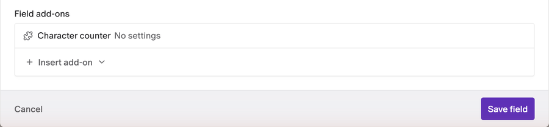

# Character Counter

Show live text statistics under your text fields: characters, words, special characters, sentences and paragraphs, with the most common words one click away.


- **Live counts**: the summary updates as editors type.
- **Automatic**: every text field with a character limit gets the counter, with no setup.
- **Word frequency**: the most common words in the field, with or without stopwords.
- **Character count with or without spaces**.
- **Structured Text included**, along with Slug, Single-line string and Multiple-paragraph text fields.
- **No configuration**: the plugin has no settings.

## Installation

Install the plugin from the marketplace. It needs no settings or permissions.

## Which fields get the counter

The counter shows up on its own under every **Slug**, **Single-line string**, **Multiple-paragraph text** and **Structured Text** field that has the **Limit character count** validation.

To add it to a field without a character limit, open the field's **Presentation** tab, click **Insert add-on** under **Field add-ons**, and pick **Character counter**.



## Reading the counts

Under the field, a one-line summary shows:

- **Characters**, spaces included.
- **Words**.
- **Special characters**: anything that isn't a letter, a digit or a space, like punctuation, symbols and emoji.
- **Sentences** and **paragraphs**.

Slug fields only show the character count.

Click the summary to open the details:

- **Include spaces**: turn it off to count characters without spaces.
- **Filter stopwords**: hide common words like "the", "and" and "your" from the word list.
- **Unique words** and the ten **Most common words**, with how many times each appears.

The counts follow the locale you're editing. The switches reset when you open the record again.

## Good to know

- **The counter doesn't enforce the limit.** DatoCMS's own **Limit character count** validation does that when you save.
- **Filter stopwords is only available in English locales**, like `en` or `en-US`. In other locales the switch is hidden.
- **In Structured Text**, the counter reads the text of paragraphs, headings, lists, quotes and links. The fields inside embedded blocks aren't counted.

## Credit

The interface is inspired by [datocms-plugin-word-counter](https://github.com/voorhoede/datocms-plugin-word-counter) by Voorhoede.

## Development

```bash
npm install
npm run dev     # local dev server, to use with a private plugin pointed at it
npm run test
npm run build
```

See the [DatoCMS plugin SDK docs](https://www.datocms.com/docs/plugin-sdk) to learn how plugins are built.
