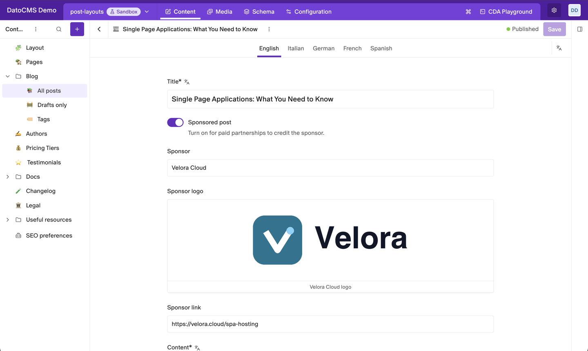
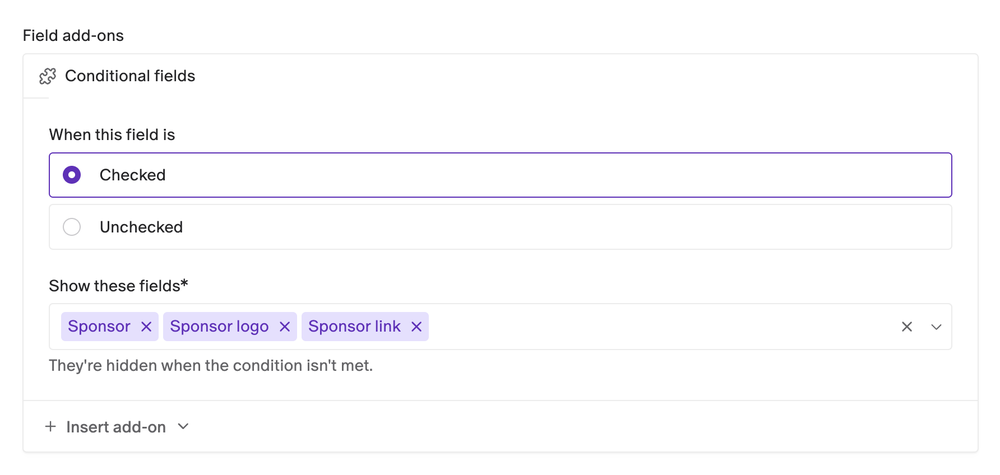
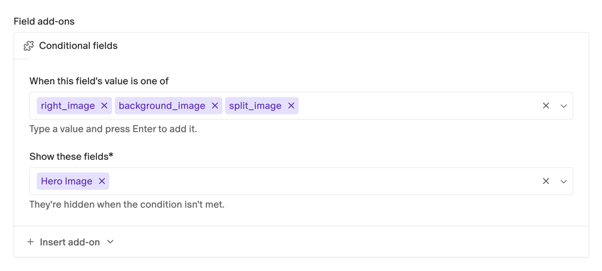
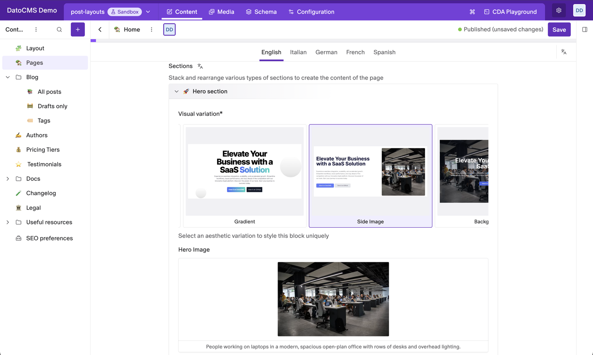

# Conditional fields

Show fields in the record editor only when they're needed. A switch or a value picked in one field decides whether other fields are shown or hidden.



- **Switch-driven**: show fields while a Boolean field is on, or while it's off.
- **Value-driven**: show fields when a Single-line String field holds one of the values you list. Works with any editor, like a dropdown or a tile picker.
- **Live**: fields appear and disappear as editors change the trigger, before they save.
- **Blocks included**: inside a block, the add-on shows and hides fields of the same block.
- **Nothing is lost**: a hidden field keeps its value.
- **No plugin settings**: each field is set up in its own Presentation tab.

## Installation

Install the plugin from the marketplace. It needs no settings or permissions.

## Show fields when a switch is on

1. Open the model and edit the **Boolean** field that should control the others.
2. In its **Presentation** tab, click **Insert add-on** under **Field add-ons** and pick **Conditional fields**.
3. Under **When this field is**, choose **Checked** or **Unchecked**.
4. Under **Show these fields**, pick the fields to control, and save.



With **Checked**, the fields are shown while the switch is on and hidden while it's off. **Unchecked** does the opposite: use it for fields that only make sense when an option is turned off, like a custom image that's only needed while "Use default image" is off.

## Show fields for certain values

Insert the add-on on a **Single-line String** field instead. Under **When this field's value is one of**, type each value that should show the fields and press Enter. For any other value, or no value, the fields are hidden.



Type the values exactly as the field stores them. For a dropdown or a tile picker, that's each option's value, not its label.

In the example above, the Hero section block only asks for a hero image when the editor picks a layout that has one:



## Good to know

- **The fields must be on the same model**, or in the same block when the trigger is inside a block.
- **Hiding is only for the record editor.** A hidden field keeps its value, it's still saved, and the API still returns it.
- **Localized triggers work per locale.** If the trigger field is localized, each locale shows or hides its own copy of the fields, and only localized fields can be controlled. A trigger that isn't localized controls the fields in every locale.
- **Fields are linked by API key.** If you change a controlled field's API key, pick the field again in the add-on.
- **Settings from earlier versions are upgraded automatically** the first time someone who can edit the schema opens the project.

## Development

```bash
npm install
npm run dev     # local dev server, to use with a private plugin pointed at it
npm run build
```

See the [DatoCMS plugin SDK docs](https://www.datocms.com/docs/plugin-sdk) to learn how plugins are built.
