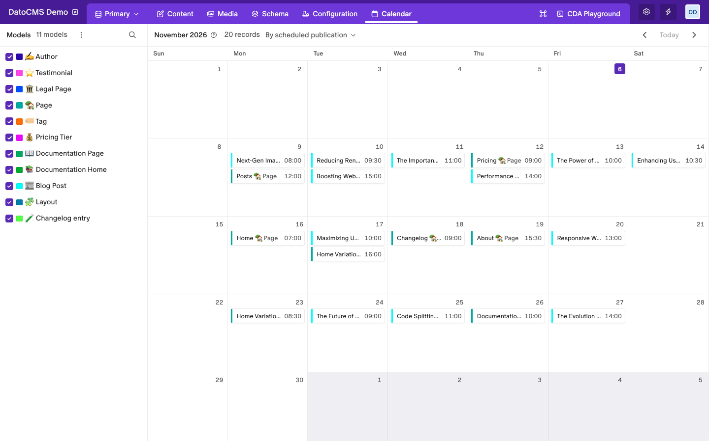
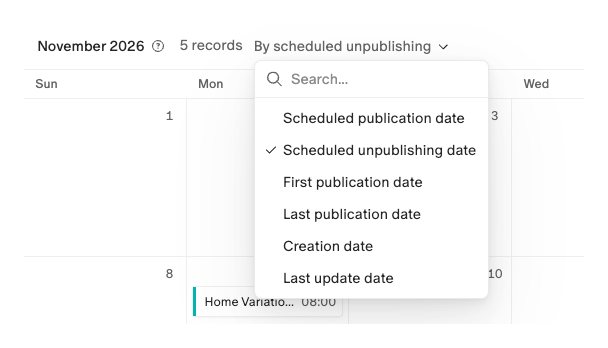
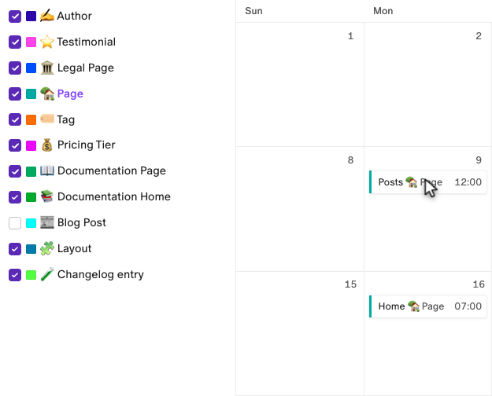

# Content Calendar

See your records on a monthly calendar, right inside DatoCMS: what is scheduled to go live, what was published, and when things were created or changed.



- **A Calendar tab** in the top navigation, one month at a time.
- **Six dates to choose from**: scheduled publication, scheduled unpublishing, first publication, last publication, creation and last update.
- **Color-coded models**: pick which models to show, and see each record in its model's color.
- **One click to edit**: click a record to open it.
- **Read-only**: the plugin never changes your content.

## Installation

1. Install the plugin. It asks to use your access token: it reads the records with it, so the calendar shows only what your role can read.
2. There is nothing to configure. A **Calendar** tab appears in the top navigation.

## Use the calendar

1. Open the **Calendar** tab.
2. Choose a date from the menu next to the month, for example **By scheduled publication**.
3. Move between months with the arrows. **Today** brings you back to the current month.

Each record sits on the day of the chosen date, with its title, its model and the time. Click it to open the record.

### Choose the date



| Date | Shows each record on |
|---|---|
| **Scheduled publication date** | The day it is scheduled to be published |
| **Scheduled unpublishing date** | The day it is scheduled to be unpublished |
| **First publication date** | The day it was published for the first time |
| **Last publication date** | The day it was last published |
| **Creation date** | The day it was created |
| **Last update date** | The day it was last changed |

Only models with draft/published records can be scheduled, so the two scheduled dates show records of those models.

### Choose the models



The list on the left has every model whose records you can read. Untick a model to hide its records, and tick it again to bring them back. The square next to each name is the color of its records in the calendar.

- Point at a record in the calendar to highlight its model in the list.
- The **⋮** menu shows or hides all the models at once, and the search icon filters the list.
- On a narrow screen, the list opens over the calendar from the left edge.

## Good to know

- **Up to 500 records per month.** When a month has more, the calendar says so and shows the first 500. Show fewer models to see the others.
- **Your choices stay in this browser.** The date and the models you pick are saved for each project and environment, but other collaborators don't see them.
- **Times use your browser's time zone**, with the 12 or 24 hour clock of your DatoCMS settings.

## Development

```bash
npm install
npm run dev     # serves the plugin at http://localhost:5173
npm run build
```
