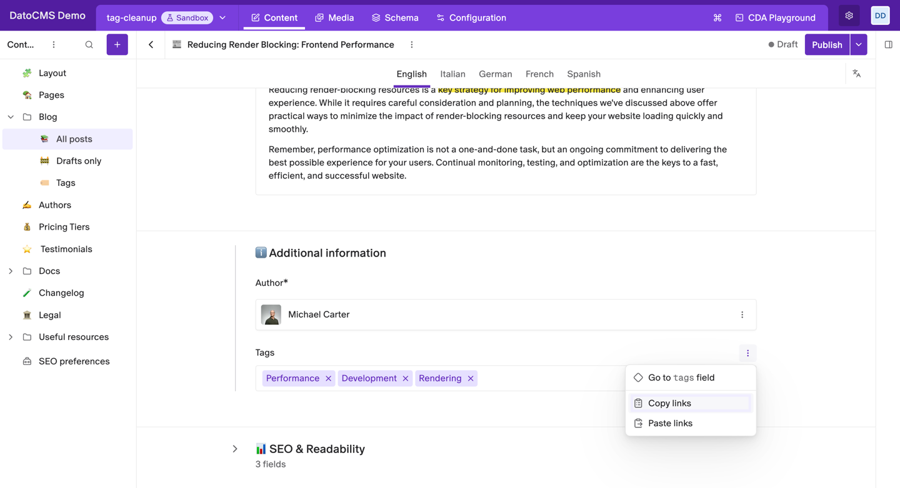
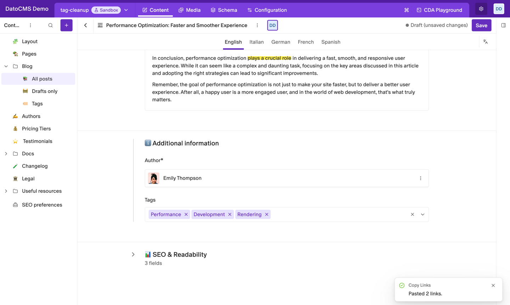
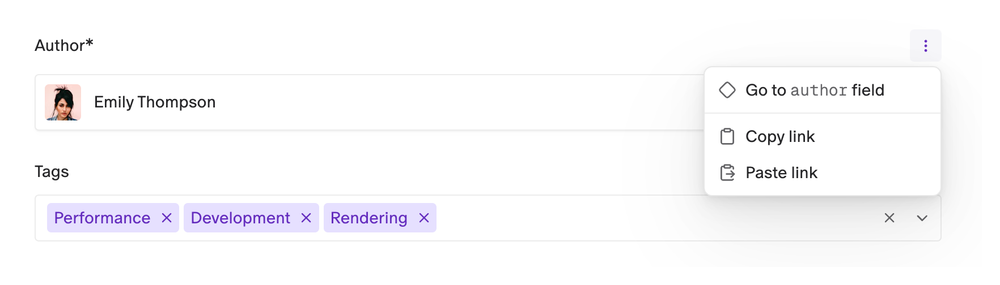

# Copy Links

Copy the records linked in one field and paste them into another, in the same record or a different one, from the field's menu.



- **Copy and paste linked records** between Single link and Multiple links fields.
- **Across records**: copy in one record, open another, paste.
- **No duplicates**: pasting into a Multiple links field only adds the records that aren't there yet.
- **Inside blocks too**: link fields inside blocks get the same actions.
- **No configuration**: the plugin has no settings.

It copies references to records, not URLs. To copy a web address, use your browser as usual.

## Installation

Install the plugin from the marketplace. It needs no settings or permissions.

## Copy and paste links

1. Point at the label of a **Single link** or **Multiple links** field and click the **⋮** on its right.
2. Click **Copy link** (Single link fields) or **Copy links** (Multiple links fields). A message confirms how many links were copied.
3. Go to the field you want to fill, in this record or another one, open its **⋮** menu and click **Paste link** or **Paste links**.
4. Save the record.



Pasting changes the form only, like editing the field by hand. Nothing is saved until you click **Save**.

## What a paste does

| Copied from | Pasted into | Result |
|---|---|---|
| Single link | Single link | Replaces the field's record |
| Single link | Multiple links | Adds the record at the end, unless it's already there |
| Multiple links | Multiple links | Adds the records that aren't there yet, at the end, in the copied order |
| Multiple links | Single link | Works only when you copied exactly one record |



## Messages

| Message | What it means |
|---|---|
| **Copied 3 links.** | The links are ready to paste. |
| **Pasted 2 links.** | That many records were added to the field. |
| **This field already has all the copied links.** | Nothing to add: every copied record is already in the field. |
| **Nothing to copy. "Tags" is empty.** | The field you copied from has no links. |
| **Nothing to paste. Copy links first.** | Nothing has been copied in this browser tab yet. |
| **Cannot paste 3 links into a single-link field.** | A Single link field holds one record. Copy a single record instead. |

## Good to know

- **Copied links stay in the browser tab** where you copied them, until you copy something else or close the tab. Other tabs and other people don't see them.
- **The plugin doesn't check which models a field accepts.** If you paste a record the field doesn't allow, DatoCMS's own validation flags it when you save.
- **Localized fields** copy and paste the locale you're editing.

## Development

```bash
npm install
npm run dev     # local dev server, to use with a private plugin pointed at it
npm run build
```

See the [DatoCMS plugin SDK docs](https://www.datocms.com/docs/plugin-sdk) to learn how plugins are built.
