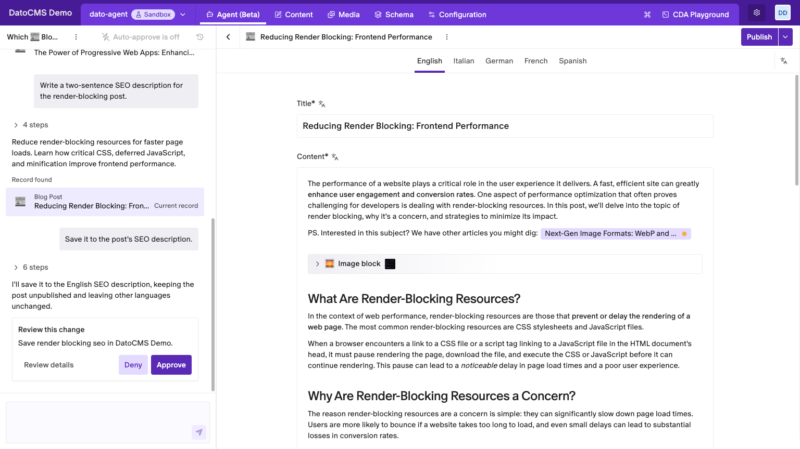
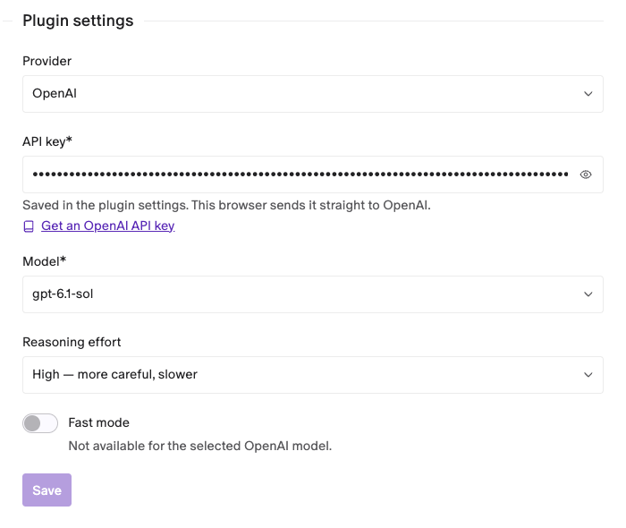
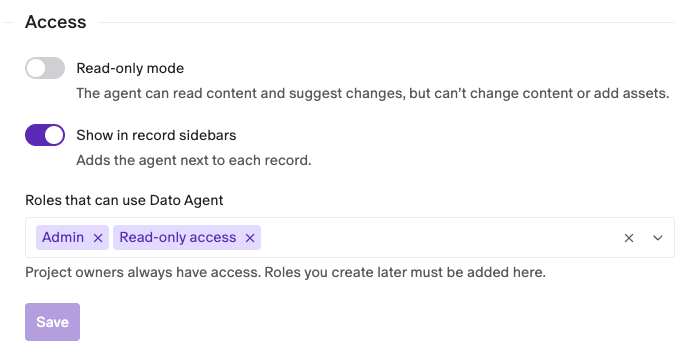
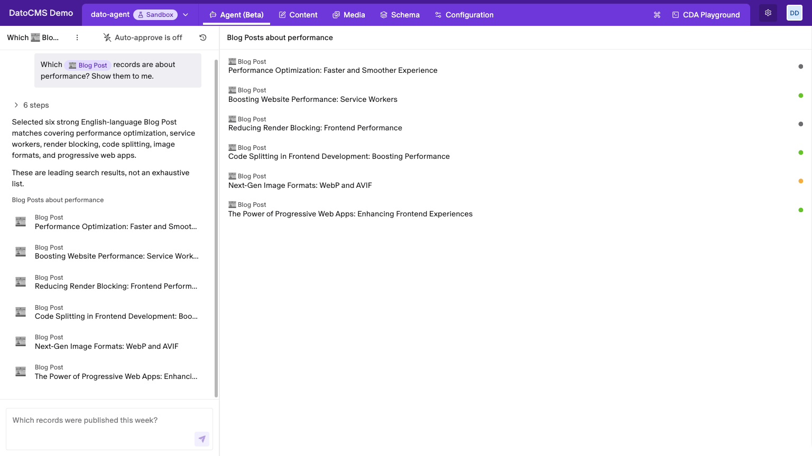
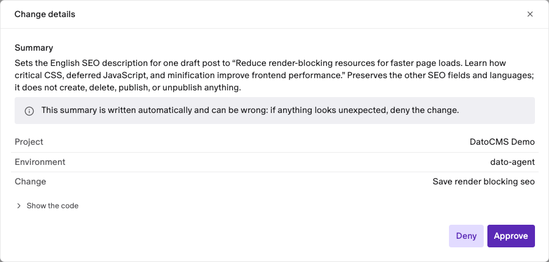
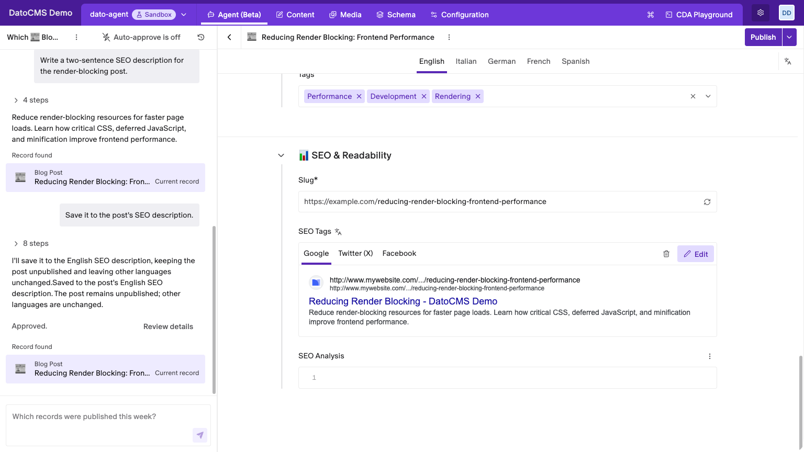
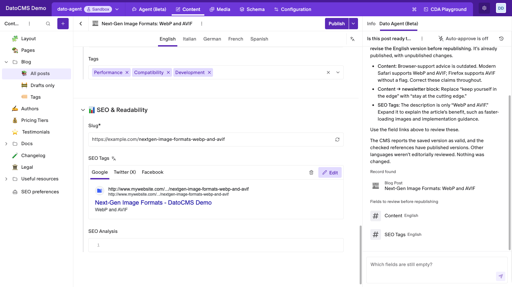

# Dato Agent (Beta)

Work with DatoCMS in plain words. Ask Dato Agent to find records, explain how your project is set up, answer questions about your content or prepare changes, and it opens what it finds right next to the chat.



- **Plain-language requests:** ask questions, look things up or describe the change you want.
- **Native navigation:** records the agent finds open in DatoCMS's own record list and editor, next to the chat.
- **Changes wait for you:** every write shows what it will do, in which project and environment, before you approve it.
- **In every record:** a sidebar chat that knows the record you're editing and points you to its fields.
- **Your role, your limits:** the agent can never do more than your DatoCMS role allows, and admins can make it read-only.
- **Bring your own model:** OpenAI or Anthropic, with the model and reasoning effort you pick.

## Before you use it

Dato Agent is in beta. It works through the DatoCMS [MCP server](https://www.datocms.com/docs/mcp-server) with the connected user's account, so it isn't limited to the record you have open. Within that user's permissions it can read and change data anywhere in the environment you're in, and it can run destructive operations that may be hard or impossible to undo.

For now, use it on a sandbox environment or a test project, never on production content you can't replace. Read every change before approving it and keep backups you can restore.

## Installation

1. Install the plugin from the marketplace and grant it the **currentUserAccessToken** permission. The plugin uses it to list the project's roles in its settings and to look up the records, assets and models you mention in a message.
2. In the plugin settings, pick a **Provider** (OpenAI or Anthropic), paste an **API key** and choose a **Model** from the list the provider returns. **Reasoning effort** trades speed for care, and **Fast mode** appears for the models that offer it.
3. Click **Save**.



The API key is shared by the whole project and sent from each user's browser straight to the provider. Only users who can edit the schema can change these settings.

### Agent behavior and access

- **Additional instructions** are added to the built-in project and safety instructions, for example a house style for public copy.
- **Read-only mode** lets the agent read content and suggest changes, but never change content or add assets, for everyone.
- **Show in record sidebars** adds the agent next to each record.
- **Roles that can use Dato Agent** limits who sees it. Project owners always have access; roles you create later must be added here.



## Connect your DatoCMS account

Each user connects once. Open **Agent (Beta)** in the top navigation, or the agent in a record sidebar, and follow the **Agent setup** steps:

1. **Choose AI provider & model** is done when the plugin settings above are saved.
2. **Connect AI to DatoCMS MCP** opens a DatoCMS sign-in window. When it asks which projects to allow, select only the project where the plugin is installed, then choose an access level: **Read content only**, **Read and edit content**, or **Same as your role**.

The connection and your recent chats are stored in your browser. The **⋮** menu next to the chat title shows your current access level and has **AI settings**, **Reconnect to change access…** and **Disconnect from DatoCMS…**.

## Ask in the Agent tab

Type your request and press **Send**. The toolbar above the message box inserts mentions, so the agent knows exactly what you mean: a person, a record (pick its model first), an asset, a model, or a file from your computer. You can also type `/` followed by `record`, `asset`, `model` or `user`.



When the agent finds records, it lists them in the chat and fills the right-hand pane with DatoCMS's own record list. Click any of them to edit it there, without leaving the chat. **6 steps** above an answer expands into what the agent did to get it. **Open chats** (the clock icon) lists your earlier chats; **New chat** starts over.

## Review and approve changes

When the agent wants to change something, it stops and asks first. **Review details** shows a summary of the change, the project and environment it runs in, and the code it will run.



**Approve** runs it, **Deny** cancels it. The summary is written automatically, so open **Show the code** when something looks unexpected, and deny anything you don't fully understand.



**Auto-approve is off** in the chat header is the safety switch. Turning it on, after a confirmation, lets changes run without asking you first. It applies to you, in this environment, in this browser, and it stays off while Read-only mode is on. Approving an operation without reading it is just as risky.

## Ask about the record you're editing

Open the **Dato Agent (Beta)** tab in a record's sidebar. The agent knows which record you're on and reads its fields, including changes you haven't saved yet. It won't change a record with unsaved edits: save or discard them first.



Field links in an answer scroll the form to that field. Use the **#** button in the message box, or type `/field`, to mention a field of the record.

## Good to know

- **Permissions:** the agent can never do more than your role allows, the access level you chose when connecting applies on top (**Read content only** blocks every write), and Read-only mode turns writes off for everyone.
- **Access checks:** if the plugin can't verify your access, reads keep working and writes pause until you click **Check access again**. If the connection expires, click **Connect again**; your chats are kept.
- **Limits:** a single request stops after 100 model steps or 200 tool calls. The agent often works from samples of your content, so treat lists and counts it gives you as possibly incomplete. Operations over 200,000 records or 10,000 assets may not finish within the MCP server's time and usage limits.
- **Nothing is rolled back:** stopping a request, hitting a limit or losing the connection never undoes changes already made, and the agent won't retry a write it couldn't confirm. Check the affected content before asking again.
- **Fields in collapsed fieldsets:** a field link can only scroll to a field whose fieldset is expanded.
- **Reporting a problem:** **Copy error details** under a failed request copies what support needs, and first asks you to review any value that looks like a secret. Email it to [support@datocms.com](mailto:support@datocms.com) with your request and what you expected to happen.

## Development

```sh
npm install
npm run dev
npm run lint
npm run typecheck
npm test
npm run build
```
