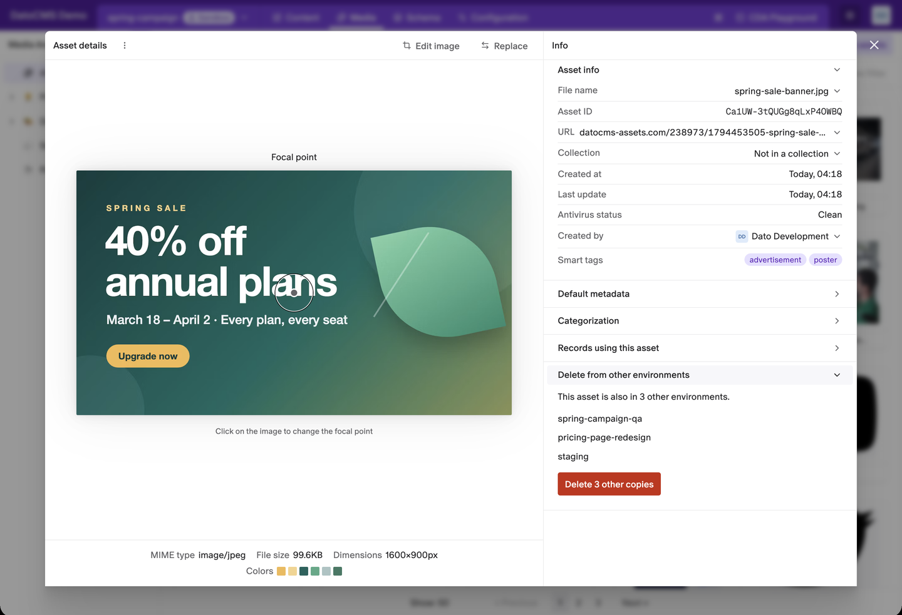
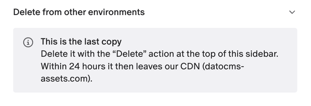

# Delete Asset From Other Environments

Find the copies of an asset in your other environments and delete them all at once, so the asset can leave the DatoCMS CDN (datocms-assets.com) for good.

This is a special-purpose plugin. Use it only when DatoCMS Support asks you to, or when you know an asset must disappear from the CDN completely. It won't save storage or bandwidth: DatoCMS already shares one file between all the environments that have the asset.



- **Finds every other copy**: checks all your environments for an asset with the same ID.
- **Deletes them in one go**: one button, one confirmation, for every environment listed.
- **Leaves your copy alone**: the copy in the environment you're in is never deleted by the plugin.
- **Reports what went wrong**: environments it couldn't check or copies it couldn't delete are listed with the reason.

## Installation

1. Install the plugin. It asks to use your access token: it reads and deletes assets as you, so it can only do what your role allows.
2. There is nothing to configure. The **Delete from other environments** panel appears in the sidebar of every asset.

Your role needs access to every environment, and permission to delete assets in each of them. Without access to all environments, the panel says so and does nothing.

## Delete the other copies of an asset

1. Open the asset in the media library and expand the **Delete from other environments** panel in its sidebar.
2. Wait while it looks for other copies. It then lists the environments that have one. Click an environment to open its copy.
3. Click **Delete N other copies** and confirm with **Delete all**.
4. When the copies are deleted, a message confirms how many, and the panel shows **This is the last copy**.



Keep the panel open until it finishes: closing it stops the check or the deletion.

## Delete the last copy

The plugin doesn't delete the copy in the environment you're in. Delete it yourself: open the **⋮** menu next to **Asset details**, choose **Delete** and confirm. Once every copy is gone, the asset disappears from the CDN within 24 hours.

## When something fails

- **Some environments weren't checked**: other copies may still exist there. The panel lists those environments with the error and offers **Check again**.
- **Some copies weren't deleted**: they stay in the list with the reason. The most common one is a record in that environment that still uses the asset. Remove it from those records, then try again.

## Good to know

- **Same ID only**: the plugin matches the exact asset ID. It doesn't look for the same file uploaded again, or for similar images.
- **Primary included**: when you work in a sandbox, the primary environment is one of the "other" environments. If it has the asset, it is listed with a **Primary** label and deleted too.
- **No undo**: deleted copies can't be restored.

## Development

```sh
npm ci
npm run dev     # serves the plugin locally for "Point to local server"
npm run check   # lint, typecheck, tests and build
```
