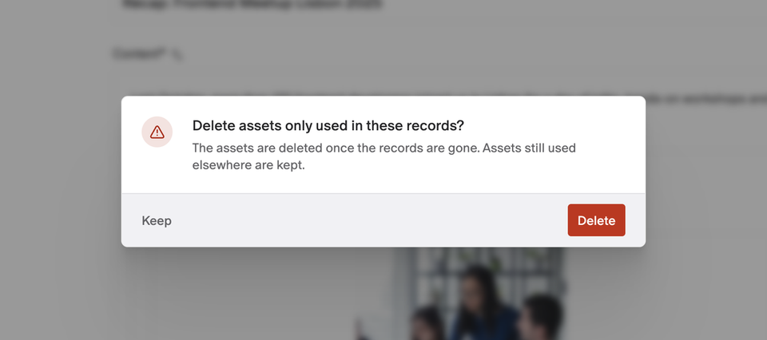
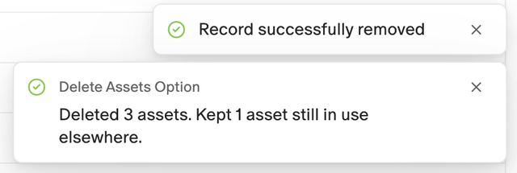

# Delete Assets Option

When you delete records, the plugin asks whether to also delete the assets that only those records use, so old photos and files don't pile up in your media library.



- **One question per deletion**: delete records as usual and choose **Keep** or **Delete** for their assets.
- **Finds every asset**: asset and gallery fields, SEO images and assets inside blocks, in every locale.
- **Keeps shared assets**: an asset still used by another record is never deleted.
- **Records first**: assets are only deleted once the records are really gone.
- **Works on bulk deletions**: the same question appears when you delete several records from a list.

## Installation

1. Install the plugin. It asks to use your access token: it reads the records you delete and deletes their assets as you, so it can only do what your role allows.
2. There is nothing to configure. The question appears the next time you delete a record.

Without access to your token, the plugin can't clean up: records are deleted and their assets are kept.

## Delete a record and its assets

1. Delete a record as usual: open the **⋮** menu next to its title, choose **Delete** and confirm.
2. The plugin asks **Delete assets only used in these records?**
3. Choose **Delete** to clean up the record's assets too, or **Keep** to delete only the record.
4. Once the record is deleted, a message tells you how many assets were deleted and how many were kept.



To delete several records at once, select them in the record list and delete them. The plugin asks once, for all of them, and only deletes the assets that none of the other records in your project use.

## Which assets count

The plugin looks at the current and the published version of each record, in every locale, and collects the assets in:

- single asset and gallery fields;
- the image of SEO fields;
- blocks, including blocks nested in Modular Content and Structured Text fields.

An asset is kept when anything else still uses it: another record, or a setting of the environment. This also applies to records you can't see.

## When something goes wrong

The plugin never deletes assets while it isn't sure the records are gone. If it can't read the records' assets, or can't confirm that the records were deleted, it shows a message and keeps every asset. The records are deleted either way. If some assets can't be deleted, a message says so.

## Good to know

- **No undo**: deleted assets can't be restored.
- **Asset URLs in text aren't assets**: URLs pasted into text, Markdown or JSON fields are ignored.
- **Stay on the page**: the cleanup runs in your browser after the records are deleted. Reloading, logging out or switching environments before the message appears can stop it.
- **Bulk limit**: the dashboard deletes at most 200 records at a time. The plugin doesn't change that.
- **Dashboard only**: records deleted through the API or by scripts don't trigger the plugin.

## Development

```sh
npm ci
npm run dev     # serves the plugin locally for "Point to local server"
npm run check   # lint, build and tests
```
