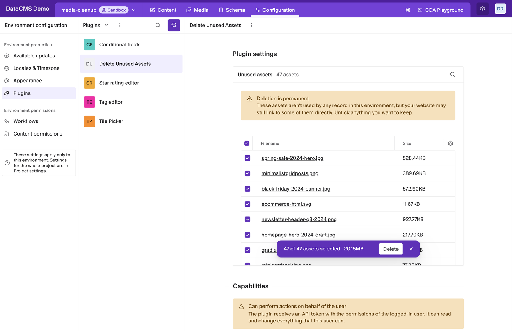
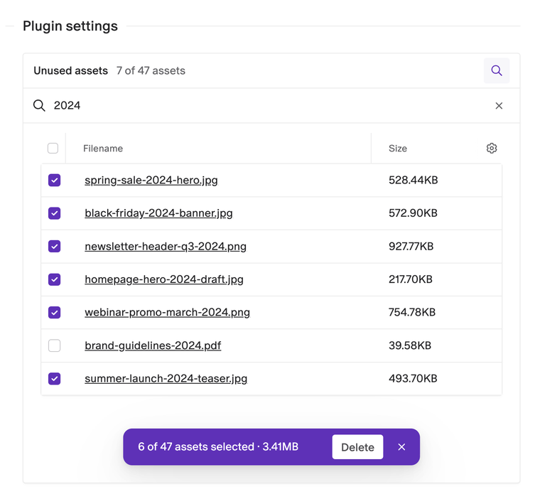
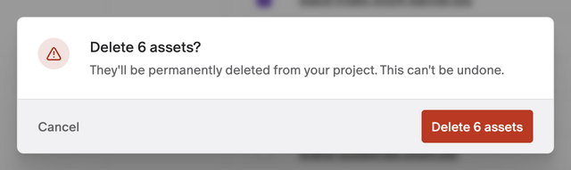
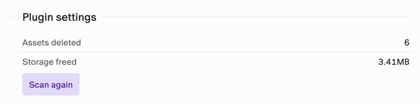

# Delete Unused Assets

Media libraries fill up with old banners, drafts and files nobody uses anymore. This plugin finds every asset that no record uses, lets you review the list, and deletes the ones you select, right from its settings screen.



- **One scan, one list**: every unused asset of the environment, with its file size.
- **You choose**: everything starts selected; untick what you want to keep, or search by filename.
- **Checked twice**: right before deleting, each asset is checked again, so anything a record started using in the meantime is kept.
- **Storage freed**: when it's done, you see how many assets were deleted and how much space that freed.

## Installation

Install the plugin and allow it to make API calls on your behalf. It lists and deletes assets as you, so it can only do what your role allows. There is nothing to configure.

Without that permission, the settings screen only shows a message asking for it.

## Find and delete unused assets

1. Open **Configuration → Plugins → Delete Unused Assets** in the environment you want to clean up.
2. Click **Scan for unused assets**. The list shows every unused asset, all selected.
3. Untick anything you want to keep. Click a filename to open the file in a new tab.
4. Click **Delete** in the selection bar, then confirm.

### Pick assets by filename

Click the search icon above the list to filter it by filename. While a search is active, the checkbox in the header selects or deselects only the matching assets. To delete only those, clear the whole selection first with the **×** in the selection bar, then search and tick the header checkbox.



Assets that are selected but hidden by the search are still deleted. The selection bar always counts every selected asset, so check it before you click **Delete**.

### Confirm and wait

DatoCMS asks you to confirm before anything is deleted.



The plugin deletes assets in batches of 100 and shows its progress: how many were deleted, skipped and failed so far. Stay on the page until it finishes. Leaving it, or clicking **Stop** (shown for more than 100 assets), ends the run after the current batch.

## Understanding the results

When the deletion finishes, a message confirms it and the screen shows what happened. Click **Scan again** to look for more.



| Line | What it means |
|---|---|
| Assets deleted | Assets that are now gone. |
| Storage freed | The total size of the deleted assets. Marked "estimated" when a batch only partly succeeded. |
| Skipped | Assets a record started using after the scan, or that someone else deleted in the meantime. They are kept. |
| Failed | Assets DatoCMS couldn't delete. |
| Not processed | Assets left untouched because the run was stopped or ended with an error. |

Skipped, Failed and Not processed only appear when they aren't zero. A stopped or incomplete run also shows a message explaining what was left.

## Good to know

- **No undo**: deleted assets can't be restored.
- **"Unused" means unused by records**: an asset you only link to from outside DatoCMS (a hard-coded URL on your website, for example) or from an old record version still shows up in the list. Untick it.
- **One environment at a time**: the scan only covers the environment you're in. Sandbox environments have their own copies of the assets, so deleting in one environment doesn't touch the others.
- **Large libraries**: the list shows 100 assets per page, and the scan shows how many it has loaded so far.

## Development

```sh
npm ci
npm run dev     # serves the plugin locally for "Point to local server"
npm run check   # lint, build and tests
```

See [docs/technical-notes.md](docs/technical-notes.md) for how the scan and deletion work.
