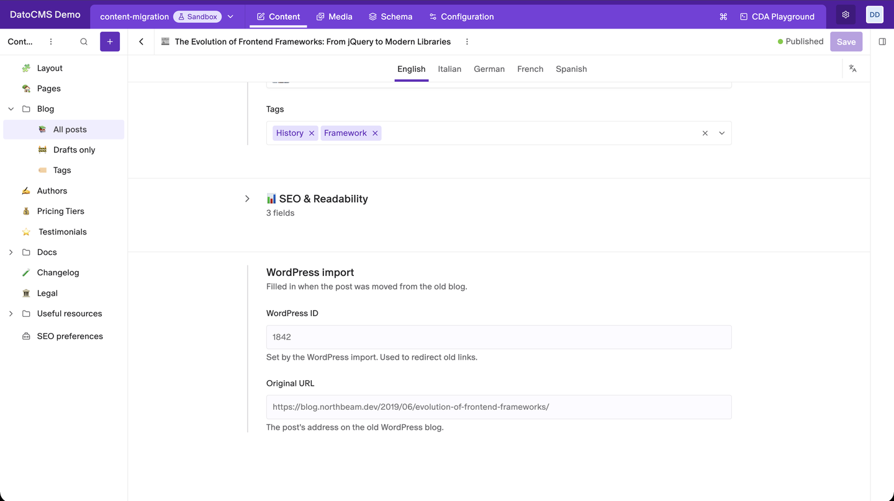
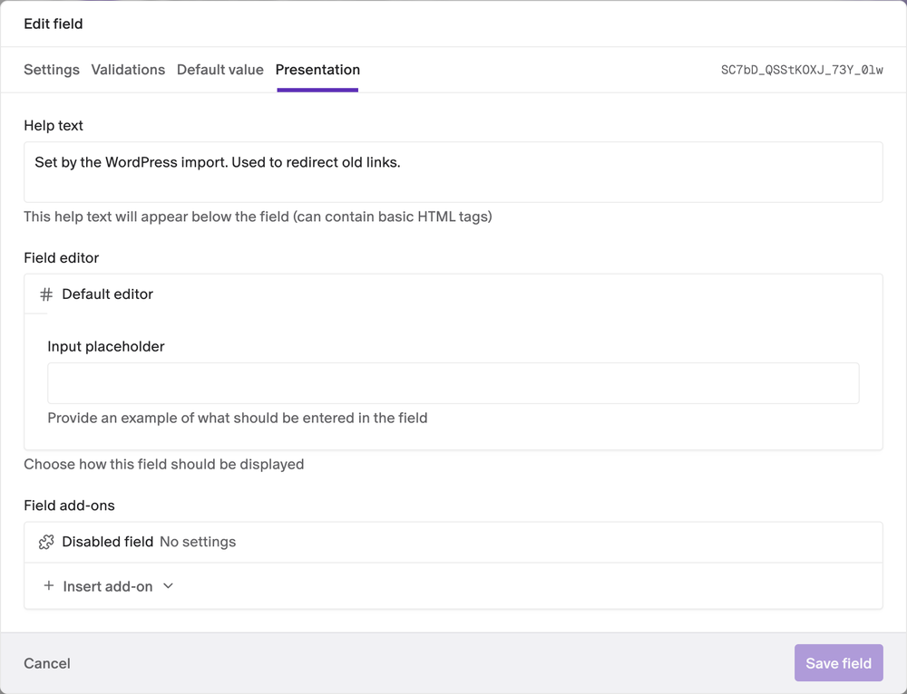

# Disabled Field

Lock the fields editors shouldn't change. Add the **Disabled field** add-on to a field, and the record editor shows its value as read-only.



- **Any field type**: text, numbers, dates, booleans, JSON, links, assets, Structured Text and more.
- **You choose the fields**: lock exactly the fields you want, in any model or block.
- **Values stay visible**: editors can still read the value, they just can't change it.
- **No configuration**: the plugin has no settings and needs no permissions.

## Installation

Install the plugin from the marketplace. Nothing changes until you add the add-on to a field.

## Lock a field

1. Go to **Schema**, open the model and click the field.
2. Open the **Presentation** tab.
3. Under **Field add-ons**, click **Insert add-on** and pick **Disabled field**.
4. Click **Save field**.



The next time anyone opens a record, the field is greyed out. To unlock it, open the same tab and delete the add-on.

The plugin's page in **Configuration → Plugins** lists every field that uses it under **Fields using this plugin**.

## Good to know

- **It locks the field for everyone**, administrators included.
- **It only affects the record editor.** The API, imports, scripts and other plugins can still change the value. It isn't a permission setting.
- **New records can't fill the field by hand.** Give it a **Default value** in the field's settings, set it through the API, or remove the add-on while you edit.
- **Upgrading from an older version:** fields you already locked stay locked. The plugin updates their settings the first time someone who can edit the schema opens the project.

## Development

```bash
npm install
npm run dev     # local dev server, to use with a private plugin pointed at it
npm run build
```

See the [DatoCMS plugin SDK docs](https://www.datocms.com/docs/plugin-sdk) to learn how plugins are built.
