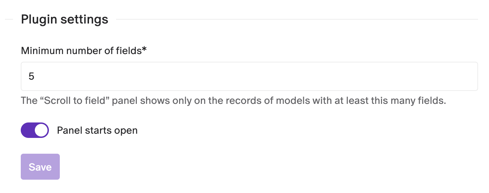

# Scroll to Field

Add a table of contents to long records: a sidebar panel lists every field of the record, and a click scrolls the form straight to it.

(This plugin was formerly called "Field Anchor Menu".)


- **One click to any field**: no more scrolling past long Structured Text or Modular Content fields.
- **Follows your form**: fields appear in the same order as in the form, grouped under their fieldsets.
- **Automatic**: the panel appears on every model with enough fields, with no per-model setup.
- **Stays out of the way on short models**: you choose the minimum number of fields.

## Installation

Install the plugin from the marketplace. It works straight away with the default settings: the panel shows on models with at least 5 fields and starts open.

## Jump to a field

1. Open a record of a model with at least the minimum number of fields.
2. Find the **Scroll to field** panel in the record sidebar, under **Record info**.
3. Click a field. The form scrolls to it.

Fields that belong to a fieldset are listed under the fieldset's title, so the panel mirrors the sections of the form. Collapse the panel with its arrow when you don't need it.

## Settings

Open **Configuration → Plugins → Scroll to field**:



- **Minimum number of fields**: the panel only shows on records of models with at least this many fields. Fieldsets don't count.
- **Panel starts open**: turn it off to show the panel collapsed when a record opens.

Click **Save** to apply the changes.

## Good to know

- **Collapsed fieldsets**: the form can't scroll to a field inside a collapsed fieldset. Expand the fieldset first, or turn off **Display fieldset as collapsed initially** in the fieldset's settings.
- **Settings apply to the whole environment**: every model with enough fields gets the panel.
- **Upgrading from an early version**: early versions were added to a dedicated field. The first time an admin opens the project after the upgrade, the plugin detaches from those fields and shows a notice with a link to each one, so you can delete them.

## Development

```bash
npm install
npm run dev     # local dev server, to use with a private plugin pointed at it
npm run build
```

See the [DatoCMS plugin SDK docs](https://www.datocms.com/docs/plugin-sdk) to learn how plugins are built.
