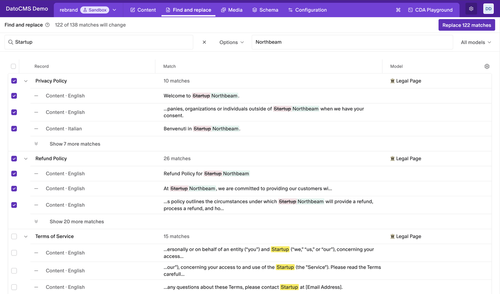
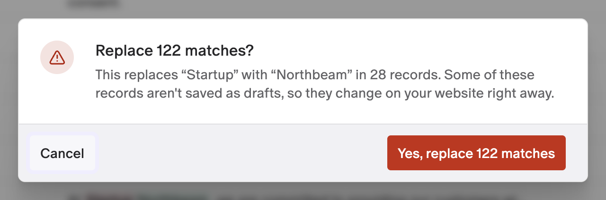
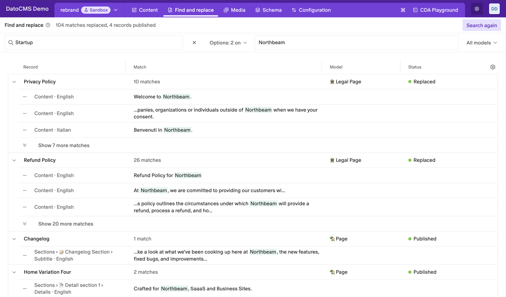
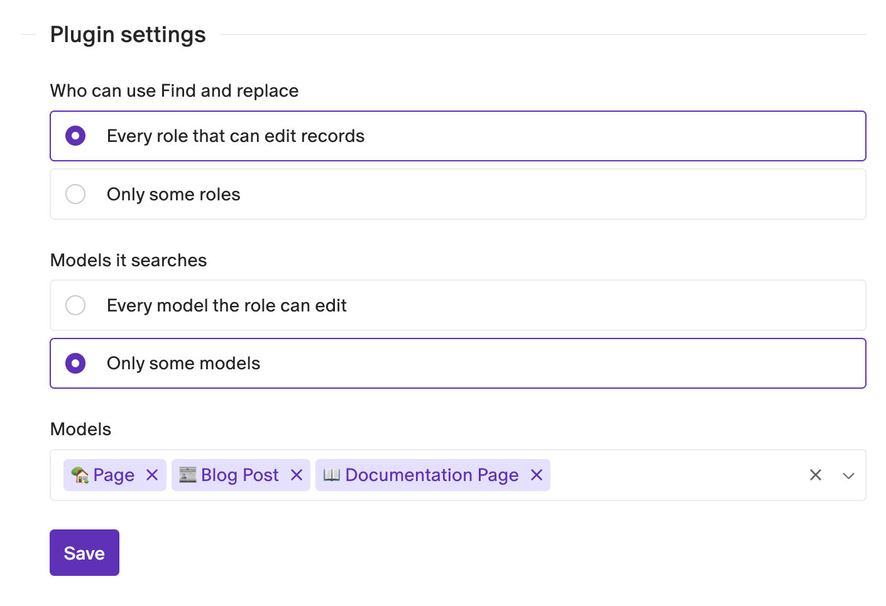

# Find and Replace

Find a word or pattern in every record of your project and replace it in one go. You see each change before it's made, leave out anything you want to keep, and publish when you're ready.



- **Searches everything with text**: titles, text, slugs, Structured Text, SEO fields and text inside blocks at any depth, in every locale.
- **Preview first**: every match shows the old and new text side by side before anything is saved.
- **You choose what changes**: leave out whole records or single matches.
- **Safe by default**: slugs are left out unless you pick them, and records edited after your search are skipped instead of overwritten.
- **Drafts stay drafts**: changes to models with draft/published are saved as drafts, and you publish them when you're ready.

## Installation

Install **Find and Replace** from **Configuration → Plugins** and, when asked, let it act on behalf of the logged-in user: it reads and updates records with your own permissions. A **Find and replace** tab then appears in the top navigation.

By default every role that can edit records can use it, on every model that role can edit. You can narrow this down in the [plugin settings](#settings).

## Find text

Type in **Find**. Matches show up as you type, grouped by record, with the field, the language and a line of context. Each record shows its first three matches; **Show N more matches** reveals the rest.

Open **Options** to narrow the search:

- **Match case**: "Startup" no longer matches "startup".
- **Match whole word**: "Startup" no longer matches inside "Startups".
- **Use regular expression**: JavaScript syntax. In **Replace with**, `$1` inserts the first group, `$<name>` a named group and `$&` the whole match.

The **All models** menu shows how many matches each model has, and limits the results to one model. Only the model you pick is replaced.

## Replace

1. Type the new text in **Replace with**. Every match turns into a before-and-after preview.
2. Uncheck the records or single matches you want to keep. The count next to the title says how many matches will change.
3. Click **Replace N matches** and confirm.



Records are updated one at a time, and each one shows its status as it goes. Keep the page open until it finishes, or click **Stop** to finish after the record in progress.

To delete the matched text, turn on **Replace with nothing** in **Options**. An empty **Replace with** never deletes anything on its own.

Slug matches start unchecked and are marked **Changes the URL**, because changing a slug changes the record's address. In Structured Text, the text of a link is replaced, but the link itself and any linked record are left alone.

### When a record isn't replaced

- **Skipped**: someone edited the record after your search. Click **Search again** to see its current text.
- **Failed**: the new value breaks one of the field's validations (for example a length limit or a slug format), or your role can't edit the record. The reason is shown under the record, and you can try those records again.

## Publish

In models with draft/published, replacing saves a draft and nothing goes live yet. When the run ends, click **Publish N records** (shown if your role can publish) and confirm.



Only records whose sole unpublished change is your replacement are offered, so publishing never puts someone else's pending edits live. Records that already had unpublished changes, or were never published, stay drafts and say why.

In models without draft/published, records change on your website as soon as they're replaced. The confirmation tells you before you start.

## Settings

Open **Configuration → Plugins → Find and Replace** to limit who can use the plugin and what it changes:



- **Who can use Find and replace**: every role that can edit records, or only the roles you pick. Other roles don't see the tab.
- **Models it searches**: every model the role can edit, or only the models you pick.

The plugin never goes beyond a role's own permissions: a model the role can't edit is never searched.

## Good to know

- **Large projects**: when the models hold more than 10,000 records, typing doesn't start a search. Press Enter to start it.
- **10,000 matches per search**: a search stops there. Replace those matches, then search again for the rest.
- **Recent searches are reused**: for a few minutes, new searches reuse the records already read, so they show up instantly. **Search again** reads everything fresh. Replacing always reads each record fresh first.
- **Sandboxes**: the plugin works in the environment you're in, so you can try a big rename in a sandbox before doing it in your primary environment.

## Development

```sh
npm ci
npm run dev       # local dev server, to use with a private plugin pointed at it
npm test
npm run build
```

`npm run harness` opens a local preview of the page with sample content, without a DatoCMS project.
