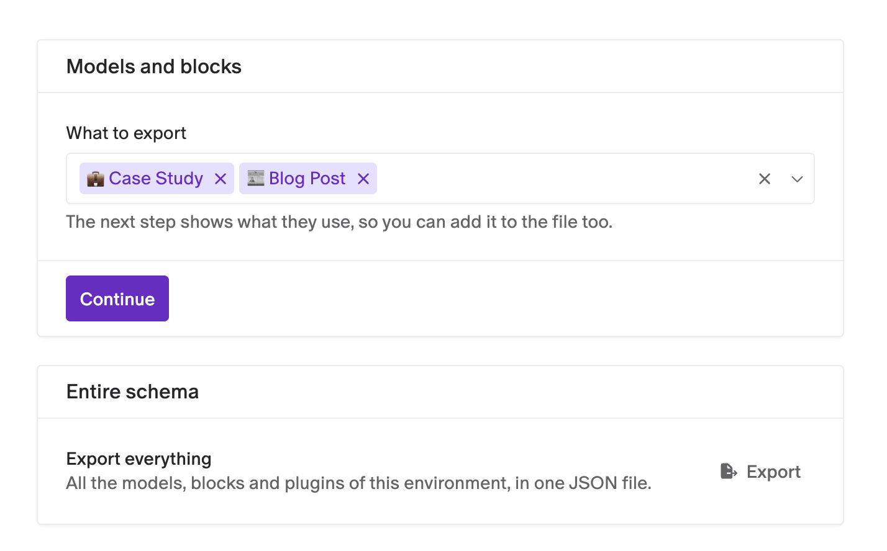

# Schema Import/Export

Move models, blocks and the plugins their fields use from one DatoCMS project or environment to another. Export them to a JSON file, then import that file wherever you need them. When something in the file already exists there, you decide how to handle it before anything is created.


- **See what goes in the file**: a graph shows everything your selection links to, and marks what's exported and what's left out.
- **Dependencies in one click**: **Add what it uses** adds every model, block and plugin the selection needs.
- **Files that work on their own**: links to models you leave out are removed, so the file always imports cleanly.
- **Conflicts resolved up front**: reuse what already exists, or import it under another name.
- **Imports only add**: nothing that already exists in the target is changed or deleted.
- **Schema only**: records and assets are never exported or imported.

## Installation

Install **Schema Import/Export** from **Configuration → Plugins** and, when asked, let it act on behalf of the logged-in user: it reads and creates schema with your own permissions. An **Import** and an **Export** page then appear under **Schema** in the **Configuration** sidebar. There's nothing to configure.

## Export

To export a single model or block, open it in the **Schema** tab, click the three dots next to its name and pick **Export as JSON…** in the menu.

To start from several, go to **Configuration → Schema → Export**, pick them in **What to export** and click **Continue**. The first one you pick is the starting point of the export.



To export the whole environment at once, click **Export** next to **Export everything**.

### Choose what goes in the file

The next step shows a graph of the starting models and everything they link to: models, blocks and the plugins their fields use.

- **Tinted boxes** are in the file. Their pill says why: **Starting point**, **Included** (you added it) or **Included as dependency** (added by **Add what it uses**).
- **Dashed boxes** say **Not exported**.
- **Solid links** connect two exported boxes. **Dashed links** go to or from a box that's left out.

Click a box, or press Enter on it, to include or exclude it. The switches in the **Schema overview** on the right do the same. **Add what it uses** includes everything the selection links to, and **Remove what was added** takes it out again. The toolbar sums up the file, for example "3 models, 2 blocks will be exported · 1 not exported".

Click **Export as JSON** and the file downloads as `export.json`.

To keep the file self-contained, fields that link to a model you leave out lose that link, and fields whose editor plugin isn't exported fall back to a built-in editor.

## Import

1. Go to **Configuration → Schema → Import** in the project or environment that should receive the schema.
2. Drop the export file anywhere on the page, or click **Choose a file**. The plugin compares it with what's already there and shows the same graph.
3. Resolve each **Conflict**: click its box, or find it in the **Schema overview**, and choose how to import it.
4. When the toolbar says **Ready to import**, click **Import**.


A conflict means the target already has a model or block with the same API key, or the same plugin installed:

| Conflict | Your options |
|---|---|
| Model or block | **Use the existing model** (or block): nothing is created, and the imported fields link to it. Or **Create it with another name** and API key. |
| Plugin | **Use the installed plugin**, or **Skip the plugin** (its fields get the default editor). |

The import only creates things: new models, blocks, fields, fieldsets and plugins. Field validations and editors are pointed at the matching models and plugins of the target, and localized defaults are filled in for every locale it has. When it's done, you'll see "Schema imported from “export.json”."

Keep the page open while an import runs. You can stop it, but there's no rollback: whatever was already created stays in the project.

### Share an export with a link

Host the file somewhere and link to the import page with `?recipe_url=<file URL>` (and optionally `&recipe_title=<title>`). The plugin loads the file and opens it ready to import. The file's host must allow the request from the browser (CORS).

## Good to know

- **Large schemas**: past 60 models, blocks and plugins, the graph isn't drawn. Use the **Schema overview** to choose what to export or to resolve conflicts, or click **Show the diagram anyway**.
- **Sandboxes made from the same environment**: a fork keeps the IDs of its models and fields. When you create a copy under another name there, turn on **Gets a new ID** for each ID that's taken, or use the overview's ⋮ menu to replace them all at once.
- **Missing plugin dependencies**: if the installed plugins can't be read, a warning says the export may miss some. Reload the page and click **Add what it uses** again.
- **Permissions**: the plugin works with your role's permissions, so importing needs a role that can change the schema.

## Development

```sh
npm ci
npm run dev     # local dev server, to use with a private plugin pointed at it
npm run check   # lint, type check, tests and build
```
