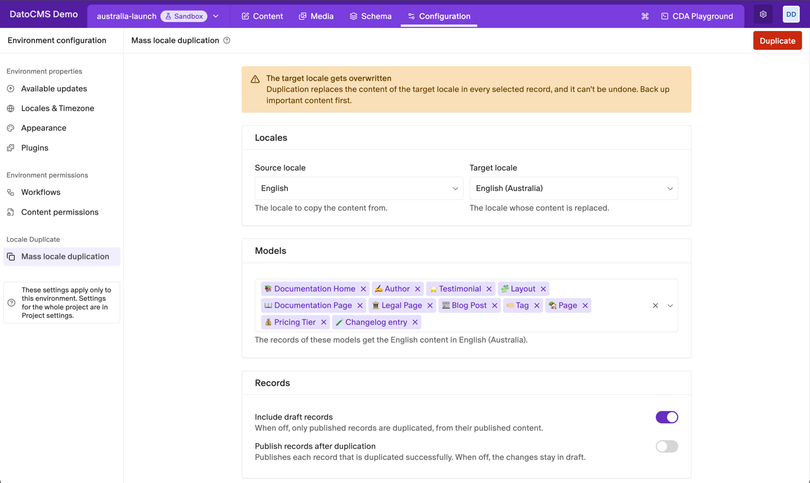
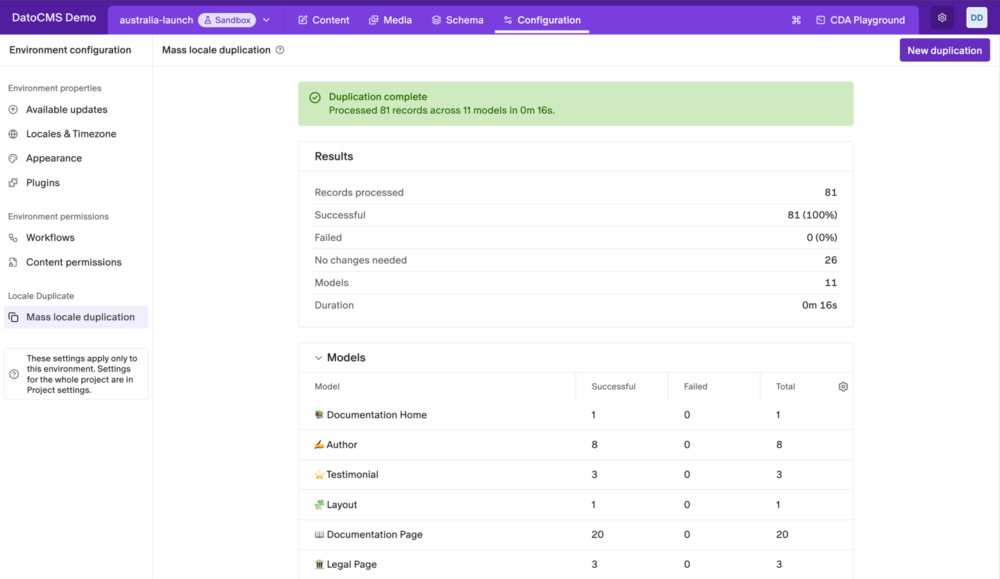
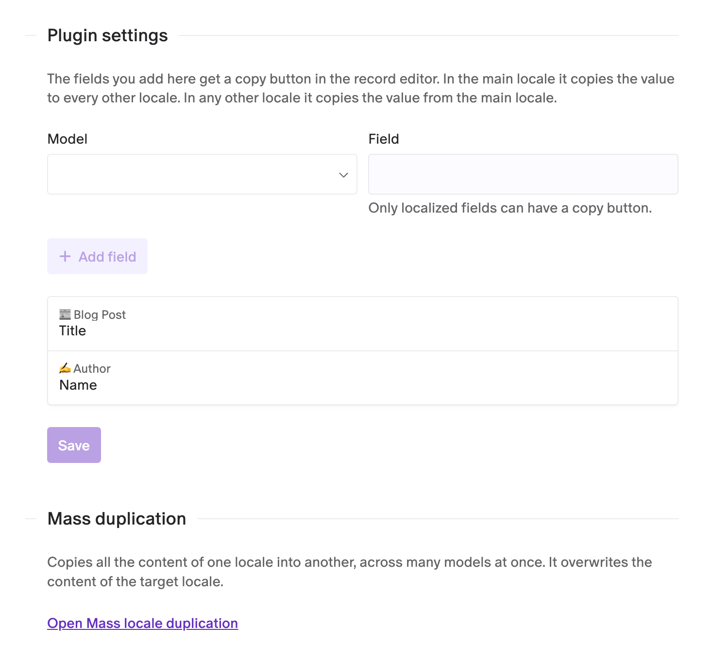
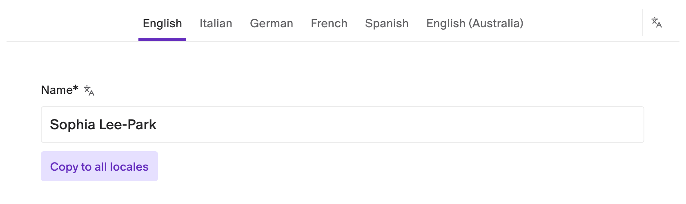

# Locale Duplicate

Copy the content of one locale into another, across every record of the models you pick, or one field at a time from the record editor. It's the quickest way to start a new locale from a similar one, like English (Australia) from English, or to rename a locale.



- **Copy a whole locale**: every localized field of every record in the models you choose, blocks included.
- **Drafts or published content**: copy the latest drafts, or only what's published.
- **Publish as you go**: optionally publish each record once its copy is saved.
- **Copy buttons on fields**: a button under the fields you choose copies their value to the other locales.
- **Clear results**: follow each record as it's copied, then see a summary per model and every error.

## Installation

Install **Locale Duplicate** from **Configuration → Plugins** and, when asked, let it act on behalf of the logged-in user: it reads and updates records with your own permissions. A **Locale Duplicate** group then appears in the **Configuration** sidebar.

Your project needs at least two locales. To start a new one, add it in **Configuration → Locales & Timezone** first: it starts empty in every record.

## Copy a whole locale

1. Open **Configuration → Mass locale duplication**.
2. Pick the **Source locale** to copy from and the **Target locale** to fill.
3. Choose the **Models** to include. All of them are selected at first.
4. Click **Duplicate** and confirm twice. The second confirmation reminds you that the target locale is overwritten.

Every localized field of each record gets the source locale's value in the target locale, and blocks are copied with them. Other locales are left alone.

**Include draft records** is on by default, so the latest content of every record is copied. Turn it off to copy only published records, from their published content. Turn on **Publish records after duplication** to publish each record once its copy is saved; when it's off, the changes stay in draft.

### Follow the progress

The page shows each record as it's copied. Keep it open until the run finishes: leaving it stops the duplication after the operations in progress. **Stop** does the same, and the records already updated keep the new content.



When it ends, the summary shows how many records were processed, succeeded and failed, the result for each model, the errors and the full log. **No changes needed** counts records whose target locale already matched, or that have no localized fields. **New duplication** takes you back to the form.

A record fails when the copied content doesn't pass the model's validations (for example a required field that is empty in the source locale), or when it goes over the [record size and block limits](https://www.datocms.com/docs/content-management-api/technical-limits). Fix it and run the duplication again: records that already match are skipped.

## Copy buttons on fields

To copy a single field without touching the rest of the record, add a copy button to it. Open **Configuration → Plugins → Locale Duplicate**, pick a **Model** and one of its localized **Field**s, click **Add field**, then **Save**.



The button shows under the field in the record editor. In the record's first locale it reads **Copy to all locales** and copies the value into every other locale. In any other locale it reads **Copy from** followed by the first locale's code, and pulls that value in. Save the record as usual afterwards.



String, text, Structured Text, JSON, SEO and slug fields can have a button. Records with a single locale don't show it.

## Good to know

- **It can't be undone**: back up important content first, or try the duplication in a sandbox environment and promote it.
- **One environment at a time**: the plugin works in the environment you're in.
- **Edits during a run**: avoid editing the selected models while a duplication runs. A record saved while it's being copied is copied again from its latest version, and one that keeps changing is reported as failed instead of overwritten.
- **Publishing**: only records whose draft hasn't changed since the copy are published.

## Development

```sh
npm ci
npm run dev       # local dev server, to use with a private plugin pointed at it
npm run check     # typecheck, tests and build
```
