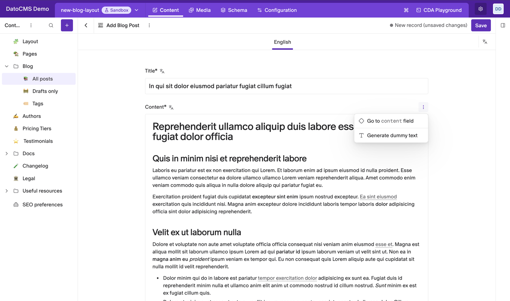
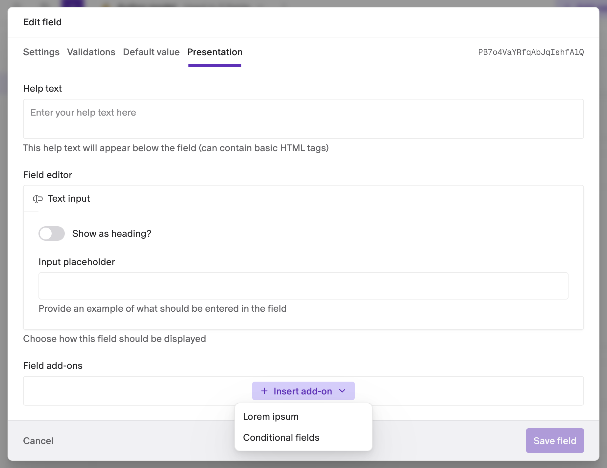
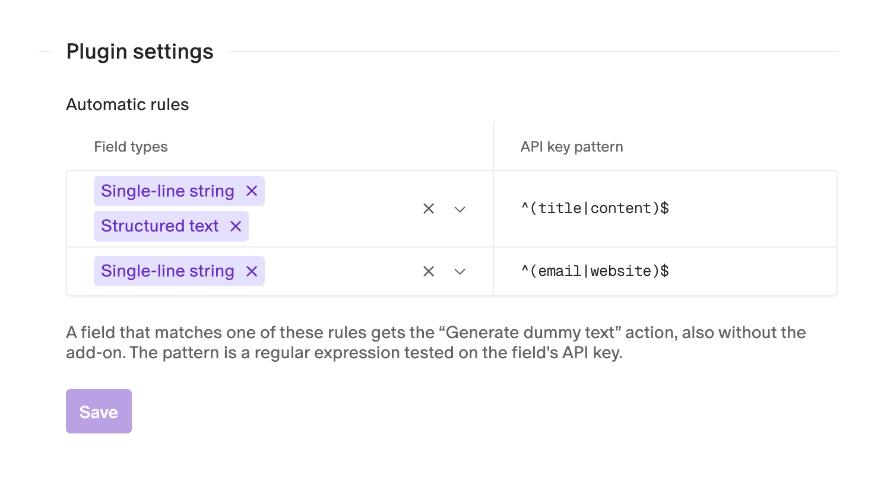

# Lorem Ipsum Generator

Fill text fields with placeholder content in one click, while you design a page or build a new model. The text fits the field: a short line for titles, a full article for rich text.



- **One click**: **Generate dummy text** in the field's menu fills the field.
- **Fits the field**: titles, emails, URLs, Markdown, HTML and Structured Text each get the right kind of text.
- **Respects the editor**: rich text only uses the formatting the field's toolbar allows.
- **Per field or by rule**: add it to single fields, or turn it on for every field whose API key matches a pattern.

## Installation

Install the plugin from the marketplace. It needs no permissions. Then choose the fields that get the action, with an add-on, a rule, or both.

## Generate text

1. Open a record and point at the label of a field that uses the plugin.
2. Click the **⋮** on the right of the label.
3. Click **Generate dummy text**.

The field fills in and a message says **Dummy text generated.** Whatever was in the field is replaced. Nothing is saved until you click **Save**. In localized fields it fills the language you're editing.

## What you get

| Field | Generated text |
|---|---|
| Single-line string | A short lorem ipsum sentence |
| Single-line string with the **Email** format | An email address, like `charlotte@lavabit.com` |
| Single-line string with the **URL** format | A web address, like `https://alexander.us/` |
| Multiple-paragraph text, **Markdown** or **HTML** editor | An article with headings, paragraphs, a bulleted list and a quote |
| Multiple-paragraph text, any other editor | Three plain paragraphs |
| Structured Text | An article with headings, paragraphs, a bulleted list and a quote |

Articles only use what the field's editor offers. If the toolbar has no headings, there are no headings. The same goes for lists, quotes, bold, italic and links.

## Add it to a field

1. Go to **Schema**, open the model and click the field.
2. Open the **Presentation** tab.
3. Under **Field add-ons**, click **Insert add-on** and pick **Lorem ipsum**.
4. Click **Save field**.



The add-on works on Single-line string, Multiple-paragraph text and Structured Text fields. The plugin's page in **Configuration → Plugins** lists the fields that use it under **Fields using this plugin**.

## Turn it on with rules

Rules give the action to many fields at once, without adding the add-on to each one. Open **Configuration → Plugins → Lorem ipsum generator**:

1. Add a row: click the **No rules yet** box the first time, then the **+** under the last rule.
2. Pick one or more **Field types**.
3. Type an **API key pattern**, a regular expression tested on each field's API key.
4. Click **Save**.



A field gets the action when it matches one rule. In the example above, `^(title|content)$` matches fields whose API key is exactly `title` or `content`, in every model and block. A pattern without `^` and `$` matches anywhere in the API key: `name` also matches `reviewer_name`.

## Good to know

- **A pattern that isn't a valid regular expression** is skipped, so a typo never breaks the record editor.
- **Links in generated text point to `#`.** Replace them before you publish.
- **Generated headings are levels 1 and 2.** If a Structured Text field doesn't allow those levels, change them before saving.

## Development

```bash
npm install
npm run dev     # local dev server, to use with a private plugin pointed at it
npm run build
```

See the [DatoCMS plugin SDK docs](https://www.datocms.com/docs/plugin-sdk) to learn how plugins are built.
