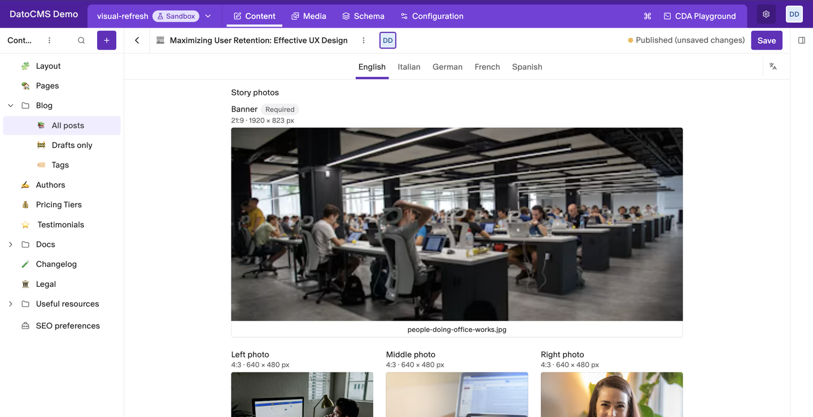
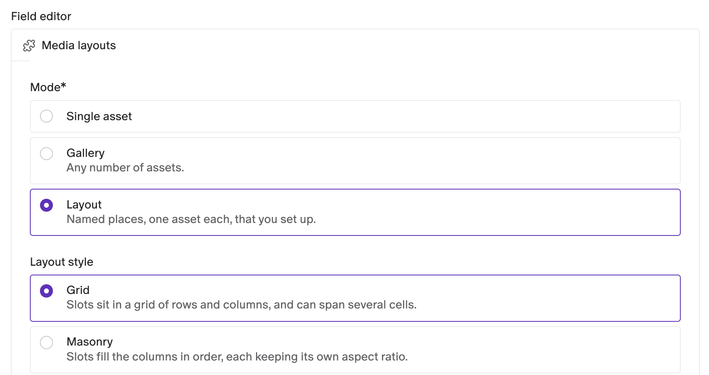
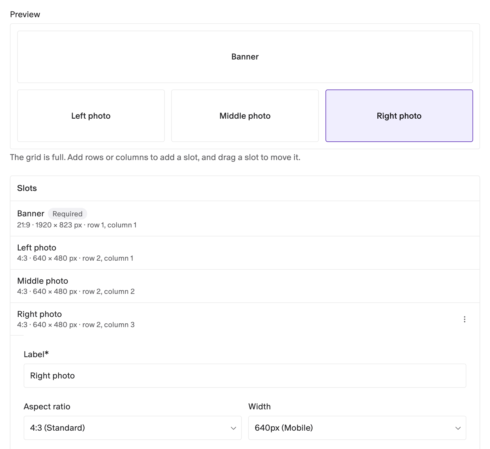
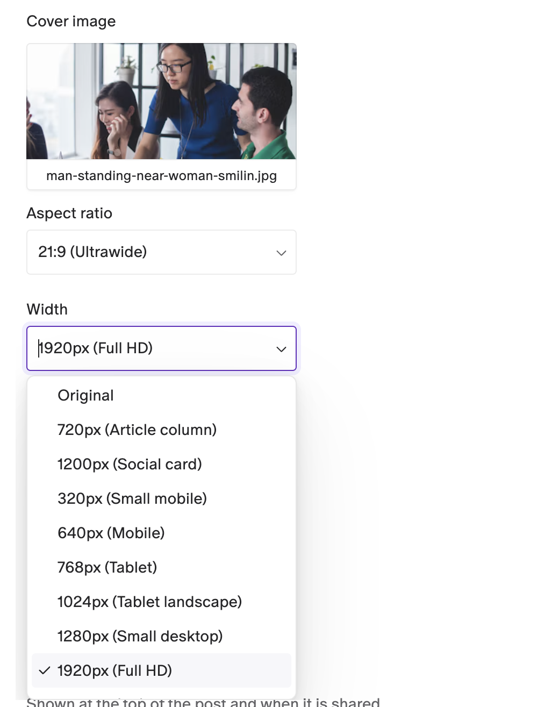
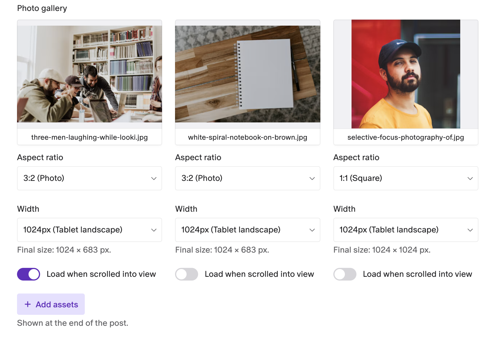
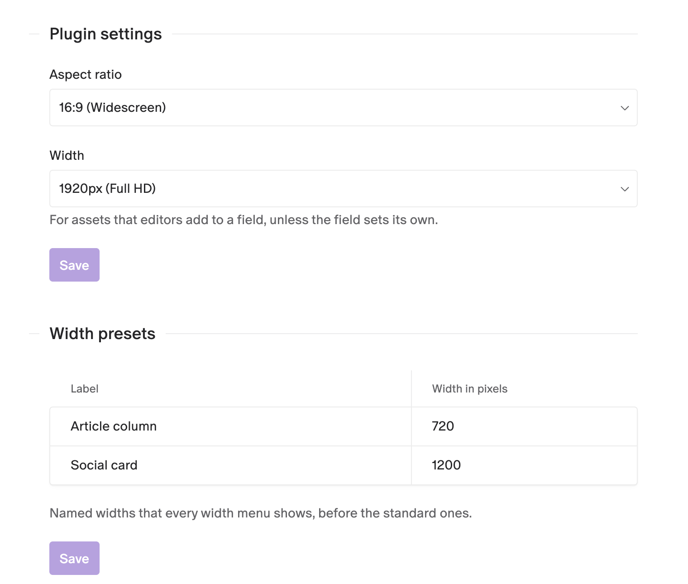

# Media Layouts

Pick images together with the crop and the size your website shows them at. Editors choose an aspect ratio and an output width for each image, right in the record, and your frontend gets everything it needs to render it in one JSON value.



- **Three modes**: a single image, a gallery, or a layout of named slots you design.
- **Crop and size per image**: 9 aspect ratios plus custom ones, standard widths plus your own named presets, with the final size in pixels.
- **See the crop**: each image shows at its aspect ratio, centred on its focal point.
- **Layout builder**: set up grid or masonry layouts in the field's settings, with slots that span several cells.
- **Ready to render**: the field stores the URL, size, focal point, alt and title of each image, so no extra API call is needed.

## Installation

Install the plugin from the marketplace. It asks to act on behalf of the user: it uses that access to load the details of an asset that a stored value misses, such as its original size.

Then add the editor to a JSON field (below). The plugin settings are optional.

## Set up a field

1. Go to **Schema**, open the model and add a **JSON** field, or click an existing one.
2. Open the **Presentation** tab and pick **Media layouts** as the **Field editor**.
3. Choose a **Mode**:
   - **Single asset**: one image.
   - **Gallery**: any number of images.
   - **Layout**: named places, one image each, that you set up.
4. Click **Save field**.



For a single asset or a gallery, **Default aspect ratio** and **Default width** set what new images start with. Leave them on **Plugin default** to use the plugin settings. Two switches add per-image options for editors: a **CSS class**, and **Load when scrolled into view** (lazy loading).

### Design a layout

In **Layout** mode, the field settings show a layout builder:

- **Layout style**: **Grid** places slots in rows and columns, and a slot can span several cells. **Masonry** fills the columns in order, each slot keeping its own aspect ratio.
- **Columns** and **Rows** size the grid. Click a free cell in the **Preview** to add a slot there, and drag a slot to move it.
- Click a slot to set its **Label**, **Aspect ratio**, **Width**, **Column span** and **Row span**. **Size from aspect ratio** picks the spans that best match the slot's ratio. **Required** marks the slot for editors.
- **Layout aspect ratio** and **Layout width** describe the whole composition, if your frontend needs them.



## Add images to a record

Click **No asset yet** (or **Add assets** in a gallery) and pick from the media library. Each image shows at its crop, with:

- **Aspect ratio**: the crop. **Original (no crop)** keeps the image's own shape, and **Custom ratio** takes any ratio, like `2.35:1`.
- **Width**: the output width. **Original** keeps the image's own width, and **Custom width** takes any width from 1 to 10000 px.
- **Final size**: the width and height your frontend should request.



Point at an image to get **Edit metadata**, and **Replace** outside a gallery. Its **⋮** has **Remove**. **Edit metadata** changes the alt text, title and focal point stored in this field, not in the media library. New images take their alt text and title from the media library, in the language you're editing.

In a layout, each slot has a fixed aspect ratio and width, set in the field's settings. In a gallery, each image has its own:



## Plugin settings

Open **Configuration → Plugins → Media Layouts**:

- **Aspect ratio** and **Width**: what new images start with, unless the field sets its own. The defaults are 16:9 and 1920 px.
- **Width presets**: named widths, like *Article column, 720*, that every width menu shows before the standard ones. To add one, point just under the last preset and click the **+** that appears on its left, or click the **No width presets yet** box when the list is empty. Then click **Save**.



## Use the data on your website

The field returns JSON. A single asset is one object, a gallery is an array of them, and a layout is `{ layout, assignments }`, where each assignment has the `slotId` of its slot.

```json
{
  "uploadId": "abc123",
  "url": "https://www.datocms-assets.com/12345/team.jpg",
  "alt": "Three colleagues around a laptop",
  "title": null,
  "focalPoint": { "x": 0.5, "y": 0.3 },
  "aspectRatio": "21:9",
  "width": 1920,
  "height": 823,
  "originalWidth": 2500,
  "originalHeight": 1875
}
```

Add imgix parameters to the URL to get the crop:

```js
const params = new URLSearchParams({ w: width, h: height, fit: 'crop' });
if (focalPoint) {
  params.set('crop', 'focalpoint');
  params.set('fp-x', focalPoint.x);
  params.set('fp-y', focalPoint.y);
}
const src = `${url}?${params}`;
```

Each image also has its `filename`, `format` and `size` in bytes. `width` is `"original"` when the editor kept the image's own width: use `originalWidth` then.

## Good to know

- **A record keeps the layout it was filled with.** Once a layout field has a value, changing the field's slots doesn't change that record.
- **Required slots aren't enforced.** They are marked for editors, but the record saves without them.
- **Gallery images stay in the order you add them.** To reorder, remove an image and add it again.
- **The media library doesn't count these images as used**, because they live inside a JSON value.
- **An asset that can't load** (for example, deleted) shows a warning with a **Remove** button.

## Development

```bash
npm install
npm run dev     # local dev server, to use with a private plugin pointed at it
npm run build
```

See the [DatoCMS plugin SDK docs](https://www.datocms.com/docs/plugin-sdk) to learn how plugins are built.
