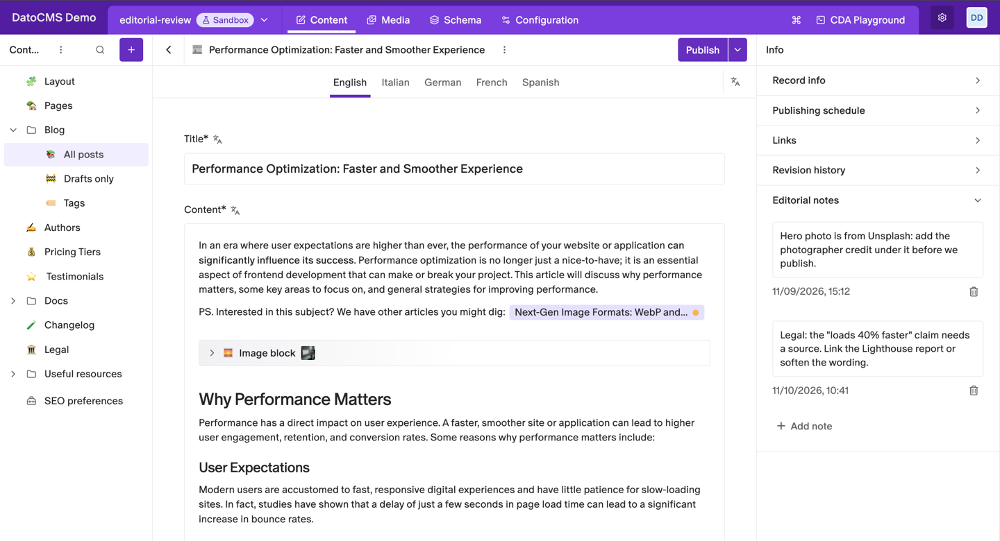
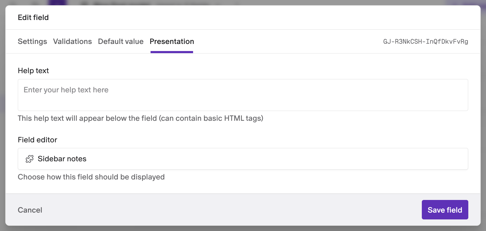

# Sidebar notes

Leave notes for your team on any record. The plugin turns a JSON field into a panel of notes in the record's sidebar, so reminders and review comments stay next to the content they're about.



- **Notes next to the content**: they show in the record sidebar, not in the form.
- **Dated**: every note shows when it was added.
- **Per record**: each record keeps its own notes, saved with the record.
- **No configuration**: the plugin has no settings and needs no permissions.

## Installation

Install the plugin from the marketplace, then add a notes field to the models where you want notes.

## Add notes to a model

1. Go to **Schema**, open the model and add a **JSON** field, for example "Editorial notes". Leave **Enable localization on this field?** off.
2. Open the field's **Presentation** tab.
3. Under **Field editor**, click **Change** and pick **Sidebar notes**.
4. Click **Save field**.



Records of that model now show a panel named after the field in their sidebar. The field itself no longer appears in the form.

## Write notes

- Click **Add note** at the bottom of the panel and type. The note keeps the date and time it was added.
- Click into any note to change it.
- Click the trash icon under a note to delete it.

Notes are part of the record, so **save the record** to keep them. Leaving the record without saving discards the changes, like any other field.

## Good to know

- **Notes are record content.** They're stored in the JSON field as a list of notes with their text and date, so they show up in API responses and in the record's revision history.
- **Saving notes changes the record.** Adding or deleting a note on a published record leaves it with unpublished changes until you publish it again.
- **Everyone who can open the record sees its notes.** Anyone who can edit the record can change or delete them.
- **Use a field without localization.** The panel holds a single list of notes per record.
- **Upgrading from an older version:** fields that already used the plugin switch to the new editor the first time someone who can edit the schema opens the project. Existing notes are kept.

## Development

```bash
npm install
npm run dev     # local dev server, to use with a private plugin pointed at it
npm run build
```

See the [DatoCMS plugin SDK docs](https://www.datocms.com/docs/plugin-sdk) to learn how plugins are built.
