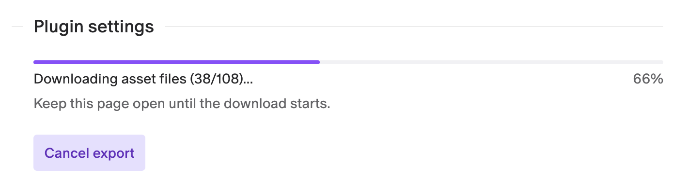
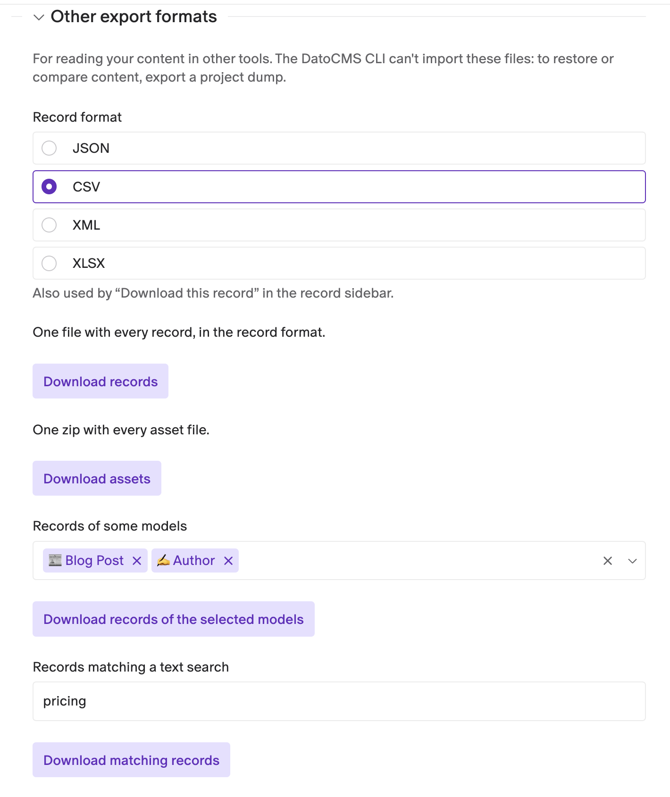
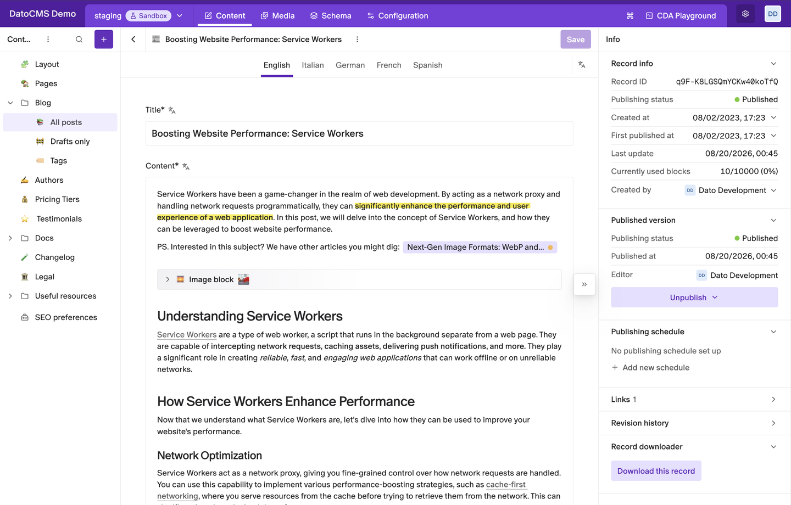

# Project Exporter

Export a DatoCMS environment straight from the dashboard: as a project dump the DatoCMS CLI can compare with any environment and restore from, or as JSON, CSV, XML or XLSX files and an asset ZIP for reading your content in other tools.


- **Project dumps for the CLI**: every record (current and published versions), asset and asset folder in one zip, in the format `datocms content:export` writes.
- **With or without asset files**: store each asset's file too, so a dump can bring back deleted assets.
- **Other formats**: every record as JSON, CSV, XML or XLSX, every asset as a ZIP, or only the records of some models or of a text search.
- **One record at a time**: download a record from its own sidebar.
- **Large exports**: files are assembled on disk, not in the browser's memory.
- **Read-only**: the plugin never changes your content.

## Installation

Install **Project Exporter** from **Configuration → Plugins** and, when asked, let it act on behalf of the logged-in user: it reads your content with your own permissions. Its settings page holds the exports, and every record gets a **Record downloader** panel in its sidebar. There's nothing to configure.

## Export a project dump

1. Open **Configuration → Plugins → Project Exporter** in the environment you want to export.
2. Under **Asset files**, choose **Without asset files** or **With asset files**.
3. Click **Export project dump** and keep the page open until the download starts.

The progress bar shows each step, and **Cancel export** stops it without downloading anything.



When it's done, the dump downloads as one zip, such as `1791556200_main.dump-records.zip`, and a notice sums it up: "Project dump … exported: 82 records and 108 assets." Without asset files, the dump holds asset metadata and URLs only, so it can't bring back an asset deleted from the project.

Use the dump as the source of a content diff with any environment that has the same schema (the same locales, models and fields):

```sh
npx datocms content:diff restore --source-dump=./1791556200_main.dump-records.zip --destination=main
```

See the [DatoCMS CLI readme](https://github.com/datocms/cli#readme) for the commands that read dumps.

## Export in other formats

Open **Other export formats**, below the dump, to export files for other tools. The DatoCMS CLI can't import them: to restore or compare content, export a project dump.



- **Record format**: JSON, CSV, XML or XLSX. Your choice is saved, and the record sidebar uses it too.
- **Download records**: one file with every record.
- **Download assets**: one zip with every asset file.
- **Records of some models**: pick the models, then click **Download records of the selected models**.
- **Records matching a text search**: type the text, then click **Download matching records**.

A notice tells you how many records each file holds, for example "Completed export: 21 records in allDatocmsRecords.2026-11-12T09-30-29.054Z.csv."

## Download a single record

Open a record and click **Download this record** in the **Record downloader** panel of its sidebar. The file uses the record format chosen in the plugin settings. Save a new record before you download it.



## What's in the files

A project dump is a zip of JSON Lines, the same `content:export` writes:

```
1791556200_main.dump-records-assets.zip
├── manifest.json             format, plugin version, project, environment, locales, counts
├── schema.json               the site with its models and fields, and the workflows, as the CMA returns them
├── records/000001.jsonl …    one record per line: {"id", "current", "published"}
├── uploads/000001.jsonl …    one upload per line
├── upload-collections/…      one folder per line
└── assets/<id>/<filename>    asset files, only in a dump with asset files
```

Record versions are the CMA's resources exactly as `GET /items?nested=true` returns them, with scheduled publication and unpublishing in the current version's `meta`. Asset files are the originals, checked against their MD5.

The other formats are not dumps. A JSON file holds the `records` as the Content Management API returns them, nested blocks included, plus:

- `manifest`: the source project, environment, locales and filters used;
- `schema`: models, fields, and maps from their IDs to API keys;
- `projectConfiguration`: site settings, fieldsets, menus, model filters, plugins, workflows, roles, webhooks, build triggers and scheduled publications;
- `referenceIndex`: every link, asset, block and Structured Text reference in the records, with its JSON path.

CSV, XML and XLSX files hold only the records. In CSV and XLSX, each top-level record property gets a column, and localized values, blocks and other nested data are stored as JSON inside the cell.

Big record exports are split into parts and download as one ZIP with every part and a `.manifest.json` listing them. In a split JSON export, every part repeats the schema and configuration, and reference paths point into that part's `records`. Configuration the plugin couldn't read is listed in `projectConfiguration.warnings`.

The asset ZIP names files `u_<uploadId>__<filename>` and includes a `manifest.json` that maps every file to its upload ID, filename and metadata. Assets that can't be downloaded are left out and listed in its `failedAssets`. To rebuild a project from these files, import the assets first and map old upload IDs to new ones, then create the records, then resolve links with `referenceIndex`.

## Good to know

- **Permissions**: a dump needs a role that can read every record and asset of the environment. The plugin refuses to write a dump that would be incomplete.
- **Disk space**: exports are assembled in the browser's private storage for the plugin, so their size isn't limited by memory. Leave free disk space for about twice the export: the browser copies the finished file to your downloads, and the plugin's copy is removed when the next export starts.
- **Keep content still**: the plugin reads live data, so avoid editing content while an export runs. A dump stops with an error when it notices a change, such as a record count that moves, rather than writing an inconsistent dump.
- **Never-published records**: the files in other formats leave out records that were never published. A project dump and **Download this record** include them.
- **XLSX limit**: a cell can't hold more than 32,767 characters. If a record has a longer value, the XLSX export stops with an error rather than cut it: use another format.
- **Browsers**: exports need a recent version of Chrome, Edge, Firefox or Safari. A cancelled or failed export downloads nothing.

## Development

```sh
npm ci
npm run dev       # local dev server, to use with a private plugin pointed at it
npm run test:ci
npm run build
```

## License

MIT
