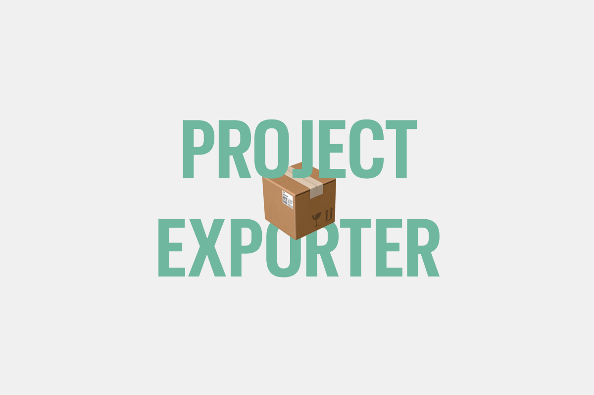

# Project Exporter

Exports a DatoCMS environment, straight from the dashboard, as a project dump the DatoCMS CLI can compare with any environment and restore from. It can also export records as JSON, CSV, XML or XLSX and assets as a ZIP file, for reading your content in other tools.



## Usage

Install the plugin (package name `datocms-plugin-project-exporter`) and allow it to use the current user's API token. Then open **Configuration → Plugins → Project Exporter**.

**Export project dump** writes the current environment to one zip: every record with its current and published versions, every asset and every asset folder, in the format `datocms content:export` writes, so the CLI can compare it with any environment that has the same schema (the same locales, models and fields). Choose **With asset files** to store each asset's file as well; without them, the dump holds asset metadata and URLs only, so it cannot bring back an asset deleted from the project. Use the dump as the source of a content diff:

```sh
npx datocms content:diff restore --source-dump=./1791556200_main.dump-records.zip --destination=main
```

A dump needs a role that can read every record and asset of the environment. The plugin refuses to write one that would be incomplete.

**Other export formats**, collapsed below the dump, are for reading your content in other tools: the CLI cannot import them. Pick a record format there (it's saved, and the record sidebar uses it too), then click **Download all records** or **Download all assets**, or export only the records of some models or the records matching a text search.

To export one record, open it and click **Download this record** in the **Record Downloader** sidebar panel.

## Large exports

Every export is assembled on disk, in the browser's private storage for the plugin, and downloaded as one file once complete, so its size isn't limited by the browser's memory. Keep the plugin open until the download starts, and leave free disk space for about twice the export: the browser copies the finished file to your downloads, and the plugin's own copy is removed when the next export starts. A cancelled or failed export downloads nothing. Exports need a recent version of Chrome, Edge, Firefox or Safari.

The plugin reads live data, so avoid editing content while an export runs. A dump stops with an error when it notices a change, such as a record count that moves or a record listed twice, rather than writing an inconsistent dump.

XLSX cells can't hold more than 32,767 characters. If a record has a longer value, the XLSX export stops with an error rather than truncating it, so use another format.

## Export format

A project dump is a zip of JSON Lines, the same `content:export` writes:

```
1791556200_main.dump-records-assets.zip
├── manifest.json             format, plugin version, project, environment, locales, counts
├── schema.json               the site with its models and fields, and the workflows, as the CMA returns them
├── records/000001.jsonl …    one record per line: {"id", "current", "published"}
├── uploads/000001.jsonl …    one upload per line
├── upload-collections/…      one folder per line
└── assets/<id>/<filename>    asset files, only in a dump with asset files
```

Record versions are the CMA's resources exactly as `GET /items?nested=true` returns them, with scheduled publication and unpublishing in the current version's `meta`. Asset files are the originals, checked against their MD5.

The other formats are not dumps. A JSON file contains the `records` as the Content Management API returns them, nested blocks included, plus:

- `manifest`, with the source project, environment, locales and filters used
- `schema`, with models, fields, and maps from their IDs to API keys
- `projectConfiguration`, with site settings, fieldsets, menus, model filters, plugins, workflows, roles, webhooks, build triggers and scheduled publications
- `referenceIndex`, listing every link, asset, block and Structured Text reference in the records with its JSON path

CSV, XML and XLSX files contain only the records. In CSV and XLSX each top-level record property gets a column, and localized values, blocks and other nested data are stored as JSON inside the cell.

Big record exports are split into parts, and download as one ZIP holding every part and a `.manifest.json` listing them. In a split JSON export, every part repeats the schema and configuration, and reference paths point into that part's `records`. Configuration the plugin couldn't read is listed in `projectConfiguration.warnings`.

The asset ZIP names files `u_<uploadId>__<filename>` and includes a `manifest.json` mapping every file to its original upload ID, filename and metadata. Assets that can't be downloaded are left out and listed in its `failedAssets`. To rebuild a project from these files, import the assets first and map old upload IDs to new ones, then create the records, then resolve links with `referenceIndex`.

## Development

```sh
npm ci
npm run dev
npm run test:ci
npm run build
```

## License

MIT
