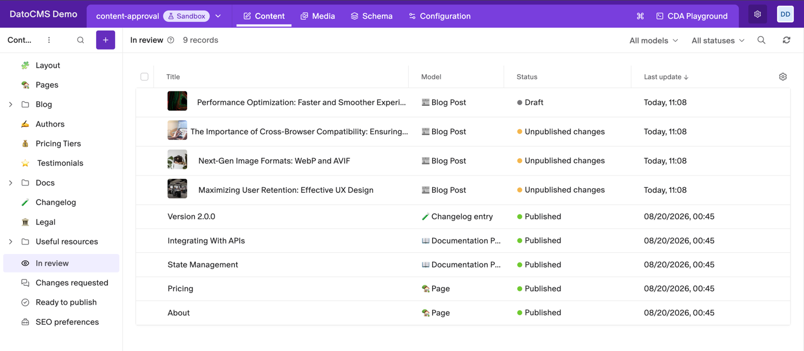
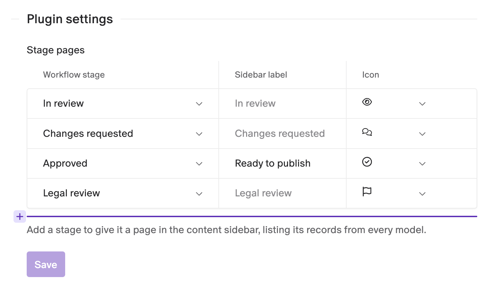
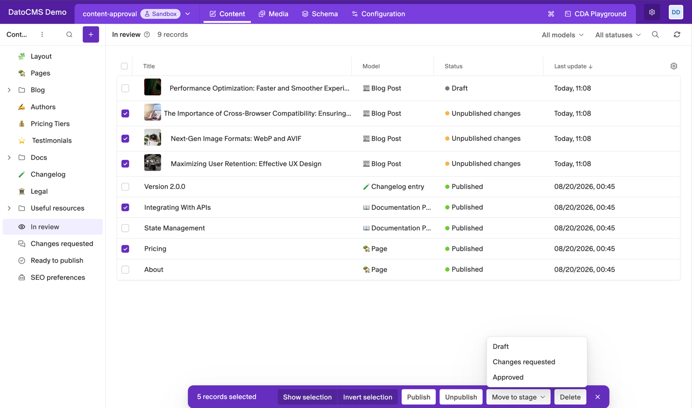
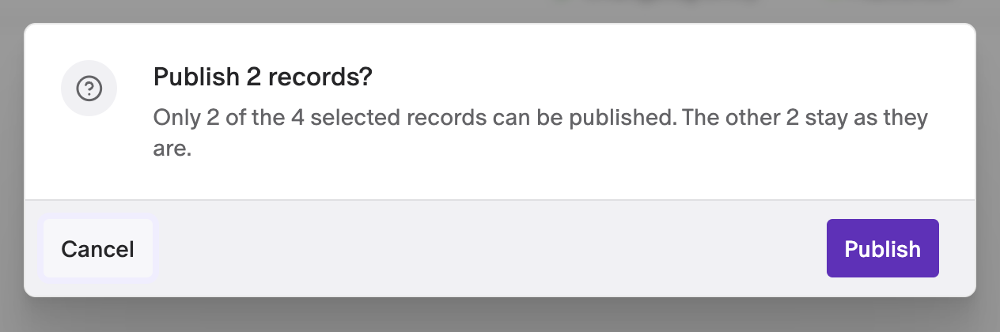

# Workflow Stage View

See every record sitting in a workflow stage, whatever its model, in one table. Pin the stages your team works from to the content sidebar, then publish, unpublish, delete or move their records in bulk.



- **One page per stage**: each pinned stage gets its own entry in the content sidebar, with its own label and icon.
- **Every model at once**: the records of all the models that use the stage's workflow, in one list.
- **Find records fast**: filter by model and status, search by title, model or record ID, sort and choose the columns.
- **Bulk actions**: publish, unpublish, delete or move many records to another stage in one go.
- **Your own permissions**: the plugin reads and changes records as the person viewing the page.

## Installation

You need at least one workflow assigned to a model. Create workflows in **Configuration → Workflows** and assign one in the model's settings.

1. Install **Workflow Stage View** from **Configuration → Plugins**. When asked, let it act on behalf of the logged-in user: it reads and updates records with that user's role, so everyone sees and changes only what their role allows.
2. In the plugin settings, under **Stage pages**, pick a stage in the **Workflow stage** column. To add another row, hover just below the last one and click the **+** (**Add stage**).
3. Optionally give each stage a **Sidebar label** (it defaults to the stage name) and an **Icon**.
4. Click **Save**. The stages appear in the content sidebar, below your menu items.



The **Workflow stage** list groups the stages by workflow and marks the ones already added. Only users whose role can edit the schema can change these settings.

## Open a stage

Click a stage in the content sidebar. The page lists the records currently in that stage, from every model that uses its workflow, with their model, status and last update. Click a row to open the record.

- **All models** and **All statuses** narrow the list to one model or to Draft, Unpublished changes or Published records.
- The search icon opens a search by title, model or record ID.
- Click a column header to sort, and use the gear at the end of the header row to show or hide columns, such as **Created** and **ID**.
- A warning icon after a title marks a record that doesn't pass validation.

The table doesn't update live. Click the reload icon to see changes made elsewhere.

## Act on several records

Select records with their checkboxes, or with the checkbox in the header for the whole page. The bar at the bottom shows what you can do with them:

- **Select all N records** extends the selection beyond the current page, to every record that matches the filters.
- **Show selection** lists only the selected records, and **Invert selection** swaps the selected and unselected ones on the page.
- **Publish**, **Unpublish** and **Delete** act on the selection after you confirm.
- **Move to stage** lists the stages the selected records can move to and moves them there. It asks first only when some of them can't move.



An action applies only to the selected records it can change. Publishing and unpublishing only apply to models that use drafts, and your role's permissions decide which records you can publish, delete or move, and to which stages. When some selected records are left out, the confirmation says how many:



Large selections run in batches, with their progress in the page header and a **Stop** button that cancels the batches that haven't started. A notice sums up the result, for example "4 records moved to Approved." Records that were deleted or left the stage since the page loaded are skipped.

## Good to know

- **Other plugins aren't consulted**: bulk actions go straight to the Content Management API, so plugins that check records before they're published or deleted in the editor don't run.
- **Same stage name in two workflows**: the sidebar adds the workflow name after the label, for example "In review (Legal sign-off)".
- **Deleted stages**: if a pinned stage or its workflow is deleted, its page says so. Remove it from the plugin settings.
- **Missing permission**: without "Current user access token", the stage pages ask an administrator to turn it on in the plugin settings.

## Development

```sh
npm ci
npm run dev       # http://localhost:5173
npm run harness   # screens with mock data at http://localhost:5287
npm test
npm run lint
npm run build
```

To try it in a project, add a private plugin with `http://localhost:5173` as its entry point.

## License

Released under the [MIT License](LICENSE).
