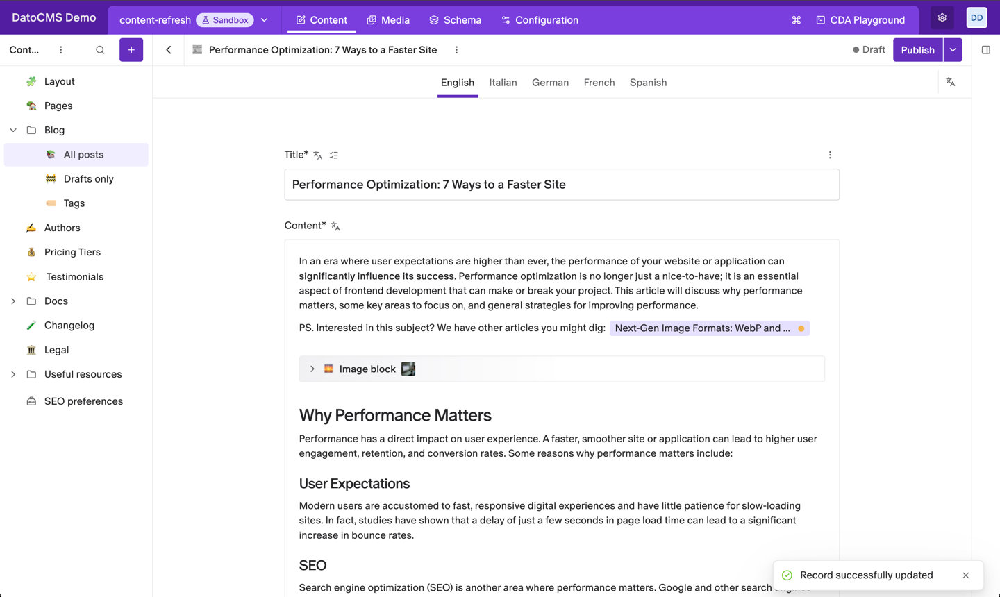
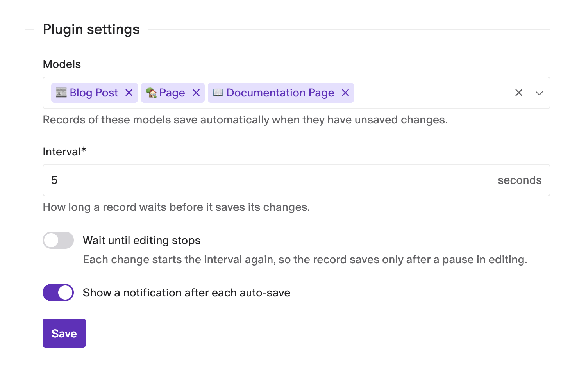

# Record auto-save

Never lose an edit to a forgotten Save click. Record auto-save saves records of the models you choose on its own, a few seconds after they get unsaved changes.



- **Per model**: turn auto-save on only for the models that need it.
- **Your interval**: choose how many seconds a record waits before it saves.
- **Save after a pause**: optionally wait until editors stop typing.
- **Optional notification**: show a message after each auto-save, or save silently.
- **Nothing new to learn**: editors work as usual, and the plugin adds nothing to the form.

## Installation

Install the plugin from the marketplace, then open its settings and pick the models where auto-save should run. Until you pick a model, the plugin does nothing. It needs no permissions.

## Settings



- **Models**: records of these models save automatically. Blocks aren't listed, since they're saved with the record that holds them.
- **Interval**: how long a record waits, in seconds, before it saves. It must be 1 or more, and starts at 5.
- **Wait until editing stops**: when off, the record saves one interval after its first unsaved change, even if you keep typing. When on, every change starts the interval again, so the record saves only once you pause for that long.
- **Show a notification after each auto-save**: shows "Record successfully updated" after every save. When off, the record still saves, and only its status in the header changes.

Click **Save** to apply the settings. They're per environment, like the plugin itself, and apply to everyone who edits those models.

## How it works

Open a record of a chosen model and change something. The header shows the status with **(unsaved changes)**, as it always does. Once the interval has passed, the plugin saves the record exactly as if you had clicked **Save**, and the status goes back to normal.

## Good to know

- **Saving isn't publishing.** On a published record, an auto-save leaves it with unpublished changes, like a manual save. Publish when you're ready.
- **The usual checks still apply.** A record with an invalid field doesn't save until you fix it.
- **Each auto-save is a regular save,** so it shows in the record's revision history. A short interval with **Wait until editing stops** off can create many versions while someone types; turn it on, or raise the interval, to save less often.
- **Leaving the record early:** changes made less than one interval before you leave the record aren't saved yet, and DatoCMS asks you about them as usual.

## Development

```bash
npm install
npm run dev     # local dev server, to use with a private plugin pointed at it
npm run test
npm run build
```

See the [DatoCMS plugin SDK docs](https://www.datocms.com/docs/plugin-sdk) to learn how plugins are built.
