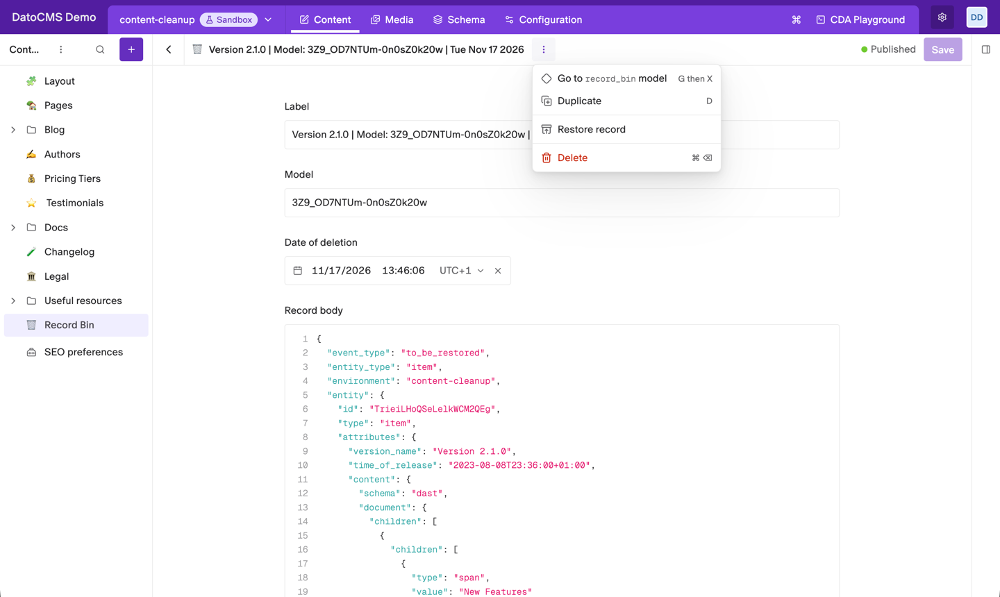
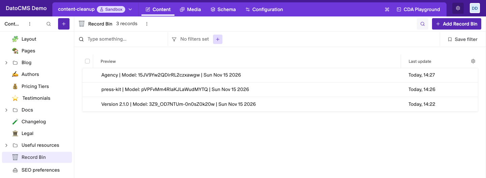
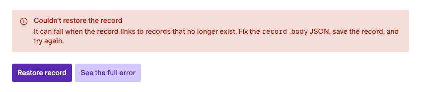
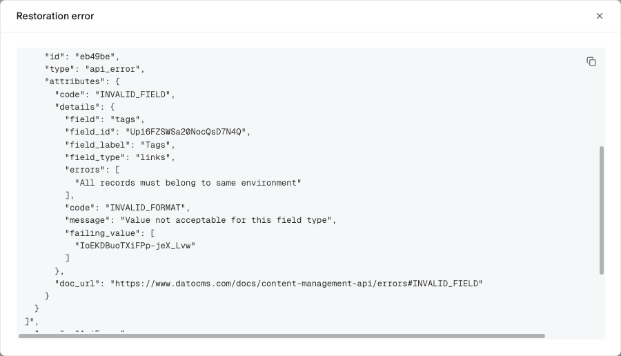
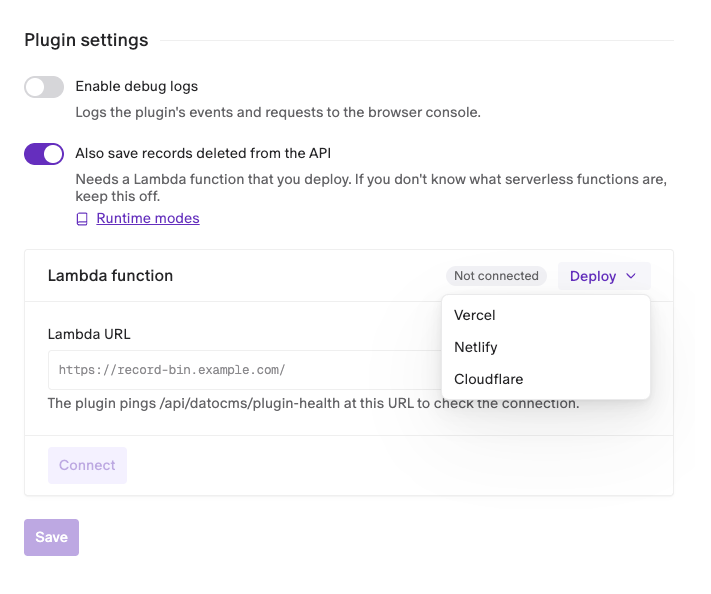

# Record Bin

Deleted a record by mistake? Record Bin keeps a copy of every record deleted from the dashboard in a "🗑 Record Bin" model, so you can put it back from the copy's ⋮ menu.



- **A copy before every deletion**: the record is saved to the bin first, and only then deleted.
- **Restore from the menu**: **Restore record**, in the copy's ⋮ menu, puts it back in its model with its original ID.
- **Safe by default**: if the copy can't be saved, the deletion is cancelled and the record stays where it was.
- **Nothing to set up**: the bin model is created the first time you delete a record.
- **Optional API capture**: also keep records deleted through the API, with a small serverless function you deploy.

## Installation

Install the plugin from the marketplace and accept its permission to act on behalf of the signed-in user: it saves and restores records with that user's own access. There's nothing to configure for records deleted from the dashboard.

The first deletion creates the "🗑 Record Bin" model, so make it as someone who can edit the schema. After that, editors only need permission to create records in that model.

## The bin

Delete records as usual, one at a time or in bulk. Each one gets a copy in **🗑 Record Bin**, in the content navigation.



A copy is named after the record's first text value, its model ID and the date of deletion. It holds the whole record, its blocks included, as JSON in **Record body**. Large records are stored compressed.

## Restore a record

1. Open the copy in **🗑 Record Bin**.
2. Open the ⋮ menu next to its title and choose **Restore record**.

The record comes back in its model with the same ID, so links to it from your website keep working. You see "The record has been restored.", DatoCMS opens the record and the copy leaves the bin. In a model with drafts, it comes back as a draft: publish it again if it was live.

### When a restore fails

A restore fails when the record links to something that no longer exists, like a deleted tag or author. The copy stays in the bin and an alert says the record could not be restored.



**See the full error**, in the alert, opens the API's answer, with the field and the IDs it couldn't find.



To fix it, restore the missing record first, then try again. You can also remove the missing ID from **Record body**, save the copy and choose **Restore record** again.

## Settings



- **Enable debug logs**: writes the plugin's events and requests to the browser console, to help with troubleshooting.
- **Also save records deleted from the API**: see [Runtime modes](#runtime-modes).

## Runtime modes

By default, Record Bin only sees deletions made in the dashboard: it saves each copy before the record is deleted. Records deleted through the Content Management API, by scripts, integrations or developers, aren't caught. You don't need anything else unless you delete records through the API.

To catch those too, turn on **Also save records deleted from the API** and connect a Lambda function that receives a "record deleted" webhook from DatoCMS:

1. In the **Lambda function** group, open **Deploy** and pick Vercel, Netlify or Cloudflare. This copies the [Record Bin Lambda function](https://github.com/marcelofinamorvieira/record-bin-lambda-function) to your account.
2. Follow the provider's setup. The function needs a DatoCMS API token with full access.
3. Paste the deployed URL into **Lambda URL** and click **Connect**. The status changes from **Not connected** to **Connected**.
4. Click **Save**.

Connecting creates a project webhook called "🗑️ Record Bin" that points to your function, so your role needs permission to manage webhooks. In this mode every copy, including those of dashboard deletions, is made by the webhook after the record is deleted, so a failed copy can't stop the deletion. Turning the setting off and saving removes the webhook.

## Good to know

- **Up to 200 records at a time:** larger bulk deletions are cancelled with a message. Delete in smaller selections.
- **Copies use your record quota:** each copy is a record. Delete copies you no longer need; deleting a copy removes it for good.
- **Records edited during the deletion** are kept, and the deletion is cancelled, so the copy always matches what was deleted.
- **Very large records** (over 1 MB of data) can't be copied, so their deletion is cancelled.
- **What a restore doesn't bring back:** assets are referenced, not copied, so they must still exist. Links from other records to the deleted one aren't added back.
- **Per environment:** each environment has its own bin, and the plugin must be installed there.

## Development

```bash
npm ci
npm run dev
npm run check
```

Release history is in [CHANGELOG.md](CHANGELOG.md).
