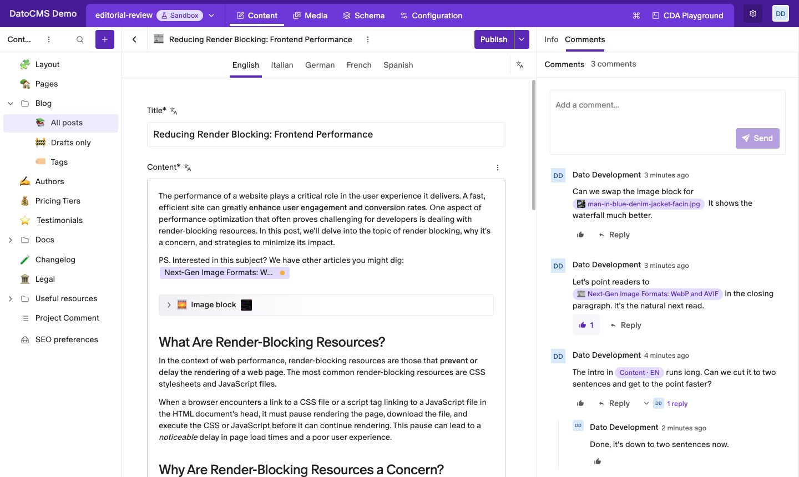
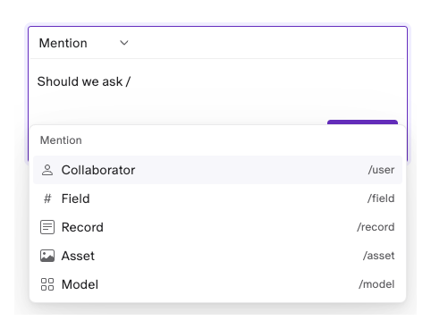
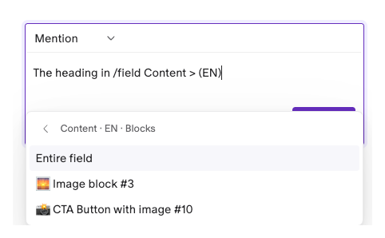

# Record comments

Discuss a record right where you edit it. The plugin adds a **Comments** tab to the record sidebar, where your team can leave comments, reply in threads and point at fields, records and assets with mentions.



- **Comments next to the content**: every record has its own discussion in the sidebar.
- **Threads and upvotes**: reply to a comment, or upvote it to agree without adding noise.
- **Mentions**: type `/` to mention a collaborator, a field (even a single block), another record, an asset or a model.
- **Click to follow**: a mention takes you to the field, record or asset it names.
- **Optional real-time updates**: see comments from others as they're posted.

## Installation

Install the plugin from the marketplace and accept its permission to act on behalf of the signed-in user: it reads and saves comments with that user's own access.

The first time the plugin runs, it creates a **Project Comment** model that stores the comments of every record. Make sure the first person to open the project after installing can edit the schema. After that, editors need permission to create and update records in that model.

Real-time updates are on by default and need a token, so set them up right away:

1. Go to **Project settings → API tokens** and create a token with read-only access to the Content Delivery API.
2. In the plugin settings, paste it into **Content Delivery API token** and click **Save**.

If you'd rather not use a token, turn **Real-time updates** off and save. Comments still work: other people's new comments show up when you reopen or reload the record. Until you do one or the other, people who can change the settings see a **Real-time updates need a token** message in the sidebar.

## Comment on a record

1. Open a record and click **Comments** at the top of the sidebar.
2. Type in **Add a comment…** and press **Enter**, or click **Send**. **Shift + Enter** starts a new line.

New comments appear at the top. To answer one, click **Reply** under it: replies stay grouped under the comment, and **N replies** shows or hides them. Click the thumbs-up to upvote; hover over the count to see who upvoted.

Use the **⋮** menu of your own comments to **Edit** or **Delete** them. A new record needs to be saved once before it can be commented on.

## Mention fields, records and assets

Type `/` in a comment, or open the **Mention** menu above it, and pick what to mention.



| Command | Mentions | Clicking it |
|---|---|---|
| `/user` | A collaborator or SSO user of the project | Opens the project's users |
| `/field` | A field of this record, in a given language | Scrolls the form to the field |
| `/record` | Any record you can read (pick its model first) | Opens the record |
| `/asset` | An asset from the media library | Opens the asset |
| `/model` | A model or block model (for people who can edit the schema) | Opens the model's schema |

For a localized field, `/field` asks for the language. In a Modular Content or Structured Text field, you can mention the whole field or a single block.



## Moving comments from older versions

Older versions of the plugin kept comments in a `comment_log` field on each model. To move them to the comments sidebar:

1. In the plugin settings, expand **Legacy comments** and click **Find**. The plugin lists the models with old comments.
2. Click **Move comments** and keep the screen open until it finishes.
3. Check the result. When every record was moved, a **Danger zone** section offers **Delete fields** to remove the old `comment_log` fields.

Run it as the project owner, or as someone who can read every record in those models: role restrictions can hide comments and stop the move. Ask your team not to edit comments while they're being moved. A record whose discussion is larger than the [300 KB record limit](https://www.datocms.com/docs/content-management-api/technical-limits) can't be moved; it's listed under **Records not moved** and keeps its old field.

## Good to know

- **Where comments live:** all comments of a record are saved in one record of the **Project Comment** model. Don't edit or delete those records by hand, or the discussion is lost.
- **Per environment:** each environment has its own comments, and the plugin creates the model in every environment where it runs.
- **Debug logging** in the plugin settings writes sync details to the browser console, for troubleshooting.
- **"Couldn't check where comments are stored":** the person who loaded the plugin can't edit the schema. Ask an administrator to open the project once so the model can be created.
- **Comments don't save:** check that the role can create and update records in **Project Comment**.

## Development

```bash
npm install
npm run dev        # local dev server, to use with a private plugin pointed at it
npm run test:unit
npm run build
```

Report issues at [github.com/datocms/plugins](https://github.com/datocms/plugins/issues).
