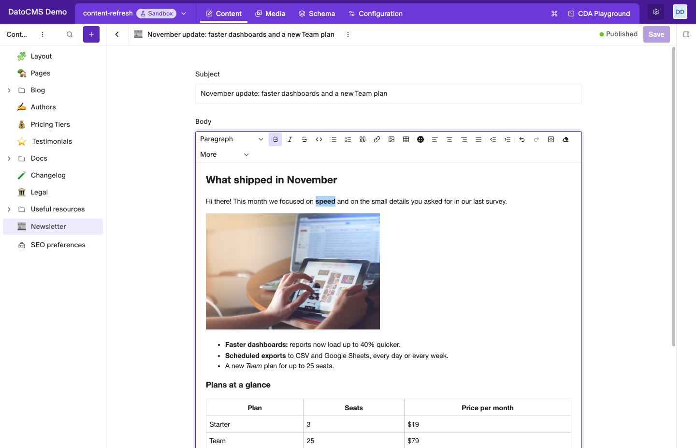
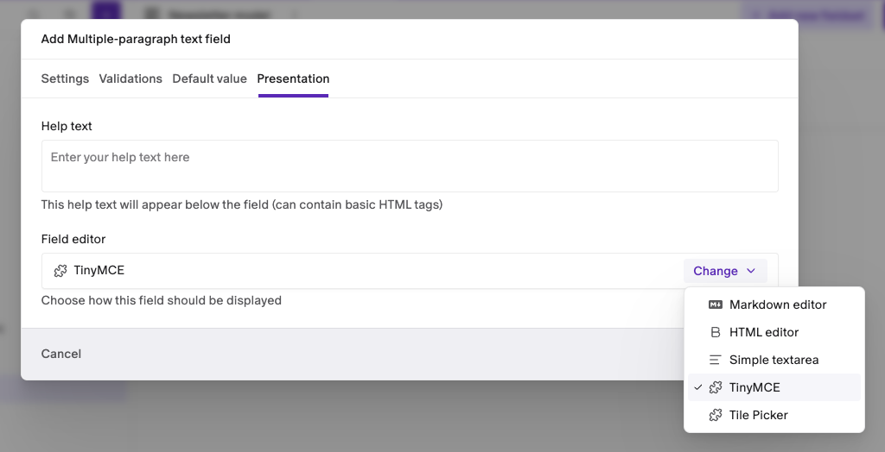
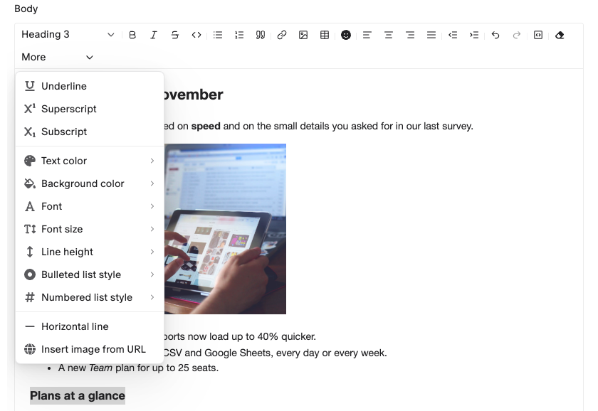
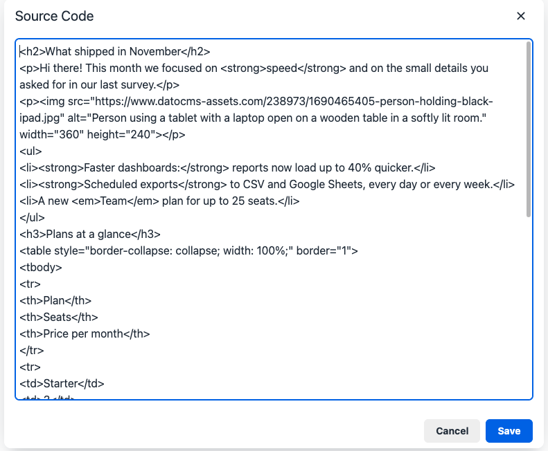

# TinyMCE Editor

Edit Multiple-paragraph text fields with [TinyMCE](https://www.tiny.cloud/docs/), a visual HTML editor: editors format text, add images from the media library, build tables and edit the HTML source, and the field stores the HTML.



- **Visual HTML editing**: headings, bold, italic, lists, quotes, links, alignment and indentation.
- **Images from the media library**, with their alt text and title filled in from the asset.
- **Tables, emoji and colors** for richer content.
- **HTML source** one click away, to check or fine-tune the markup.
- **Native look**: the toolbar matches the other DatoCMS editors and follows the light or dark theme.
- **No setup and no API key**: TinyMCE ships with the plugin.

## Installation

Install the plugin from the marketplace. It has no settings.

During installation, DatoCMS asks you to let the plugin act on behalf of the logged-in user. The plugin uses this permission only to upload images that editors paste or drop into the editor to your media library.

## Use TinyMCE on a field

Open a **Multiple-paragraph text** field in any model or block. In its **Presentation** tab, under **Field editor**, click **Change** and pick **TinyMCE**.



The field stores its content as HTML. Existing HTML opens as it is; existing Markdown isn't converted and shows up as plain text.

## Writing and formatting

Click into the field to show the toolbar. From left to right, it has:

- the block format: **Paragraph**, **Heading 1** to **Heading 6** or **Preformatted**;
- **Bold**, **Italic**, **Strike-through** and **Mark as code**;
- **Bulleted list**, **Numbered list** and **Quote**;
- **Add link**, **Add image**, **Add table** and **Emoji**;
- the four alignments, **Decrease indent** and **Increase indent**;
- **Undo**, **Redo**, **Edit HTML source** and **Remove formatting**.

The usual shortcuts work too: `Cmd/Ctrl + B`, `I` and `K` for bold, italic and links, `Cmd/Ctrl + Z` to undo and `Cmd/Ctrl + Shift + Z` to redo.

The **More** menu holds the rest: underline, superscript and subscript, text and background colors, font, font size, line height, bullet and number styles, horizontal lines and images from a URL.



## Adding images

- **Add image** opens the media library. Pick one or more assets and they are inserted at the cursor, with the alt text and title the asset has for the locale you're editing.
- **Paste or drop an image** into the editor to upload it to the media library and insert it.
- **Insert image from URL**, in the **More** menu, adds an image hosted elsewhere.

Click an image in the editor to replace it with another asset, or to change its size, alt text and other properties.

## Editing the HTML source

**Edit HTML source** opens the field's HTML. Change it and click **Save** to update the editor.



## Good to know

- **Multiple-paragraph text only.** The editor is available on Multiple-paragraph text fields, in models and in blocks.
- **Images link to the original file.** An image from the media library is inserted at its full size. Click it to set the width and height it shows at.
- **Upgrading from an older version** of the plugin: fields that used it switch to the new editor on their own the first time someone who can edit the schema opens the project, and a "TinyMCE editor upgraded" message confirms it.

## Development

```bash
npm install
npm run dev     # local dev server, to use with a private plugin pointed at it
npm run build
```

See the [DatoCMS plugin SDK docs](https://www.datocms.com/docs/plugin-sdk) to learn how plugins are built, and the [TinyMCE docs](https://www.tiny.cloud/docs/) for the editor itself.
