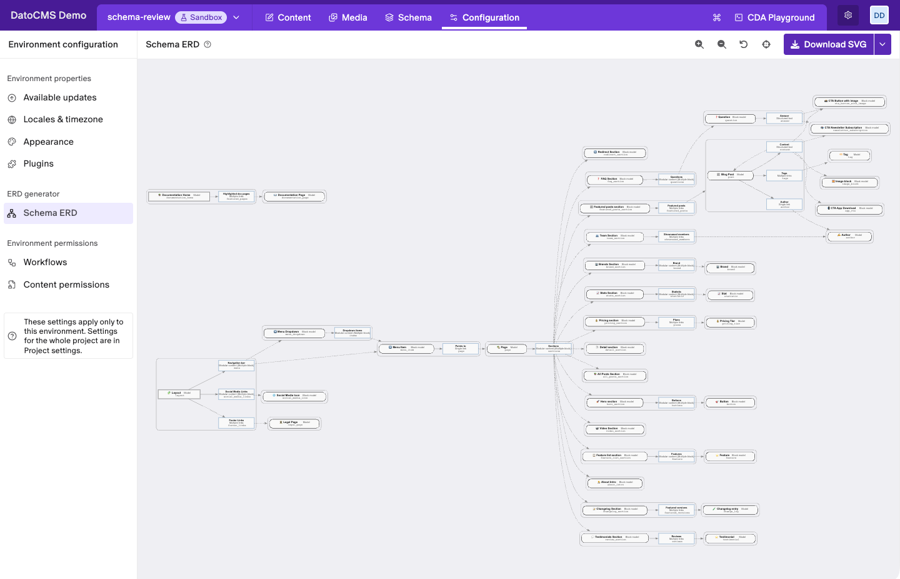
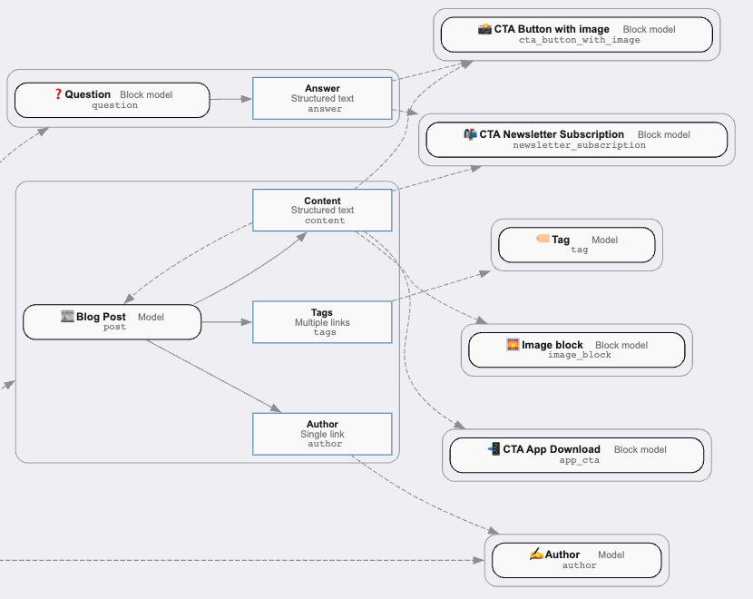
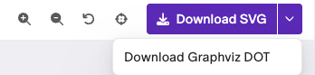

# Schema ERD

See how your DatoCMS schema fits together. Schema ERD draws every model and block model of an environment as an entity-relationship diagram, with the link, modular content and Structured Text fields that connect them, and lets you download it as SVG or Graphviz DOT.



- **The whole schema at a glance**: every model and block model, drawn straight from the environment you're in.
- **Only the connections**: link, modular content and Structured Text fields, with an arrow to every model or block they accept.
- **Move around freely**: drag to pan, scroll to zoom, or use the toolbar.
- **Download it**: as an SVG for docs and slides, or as Graphviz DOT to restyle it.
- **Read-only**: the plugin never changes your schema, and there's nothing to configure.

## Installation

Install **Schema ERD** from **Configuration → Plugins**. It adds an **ERD generator** group to the **Configuration** sidebar of every environment, with a **Schema ERD** page. There are no settings.

## Explore the diagram

Open **Configuration → Schema ERD**. The plugin loads the fields of every model, counting them as it goes ("12 of 45 models and block models loaded"), then draws the diagram to fit the page.

- **Drag** the diagram to move it, and **scroll** to zoom in on a part of it.
- **Zoom in** and **Zoom out** step the zoom, **Reset zoom** goes back to the whole diagram, and **Center the diagram** brings it back to the middle of the page.

The diagram shows the environment you're in, so open the page in a sandbox to review a schema change before you promote it.

## Reading the diagram



- **Rounded boxes** are models and block models: the name, **Model** or **Block model**, and the API key. A singleton model has square corners.
- **Boxes with a blue border** are fields that connect to other models, inside the frame of the model that owns them: the label, the field type and the API key.
- **Solid arrows** go from a model to its connecting fields.
- **Dashed arrows** go from a field to every model or block model it accepts.

The diagram includes **Single link**, **Multiple links**, **Modular content** (single and multiple block) and **Structured text** fields. Structured text points to both the blocks and the records it accepts. Other fields, such as text, numbers and assets, are left out to keep the diagram readable. A model with no connecting fields still shows up, on its own.

## Download the diagram



- **Download SVG** saves `schema.svg`, the diagram as you see it, ready for documentation and slides.
- **Download Graphviz DOT**, in the menu next to it, saves `schema.dot`, the source of the diagram. Open it with [Graphviz](https://graphviz.org/) to change the layout or the styling, or to export it in other formats such as PDF or PNG (`dot -Tpdf schema.dot -o schema.pdf`).

## Good to know

- **Light and dark**: the diagram follows the dashboard theme. A file downloaded in the dark theme has light text on a transparent background, so switch to the light theme first for a diagram on a white page.
- **Big schemas**: the plugin loads the fields of every model before it draws, which takes a few seconds on a schema with many models.
- **Always current**: the diagram is drawn each time you open the page, so it shows the schema as it is now.

## Development

```sh
npm ci
npm run dev       # local dev server, to use with a private plugin pointed at it
npm run build
```
