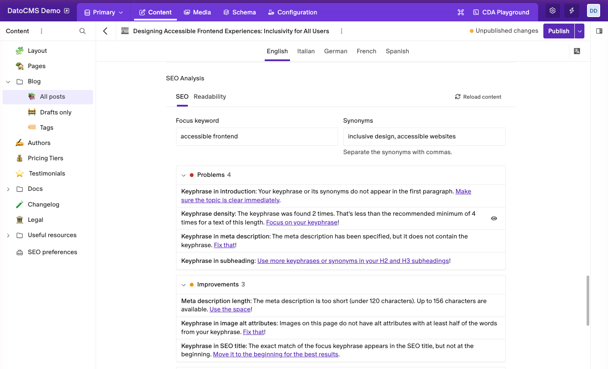
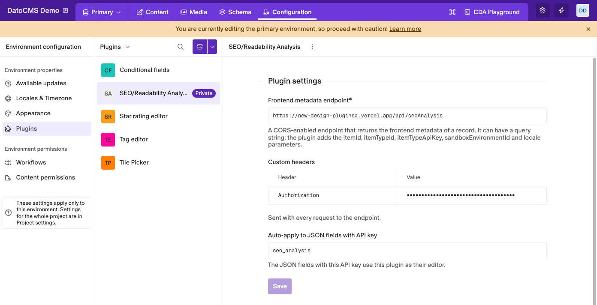
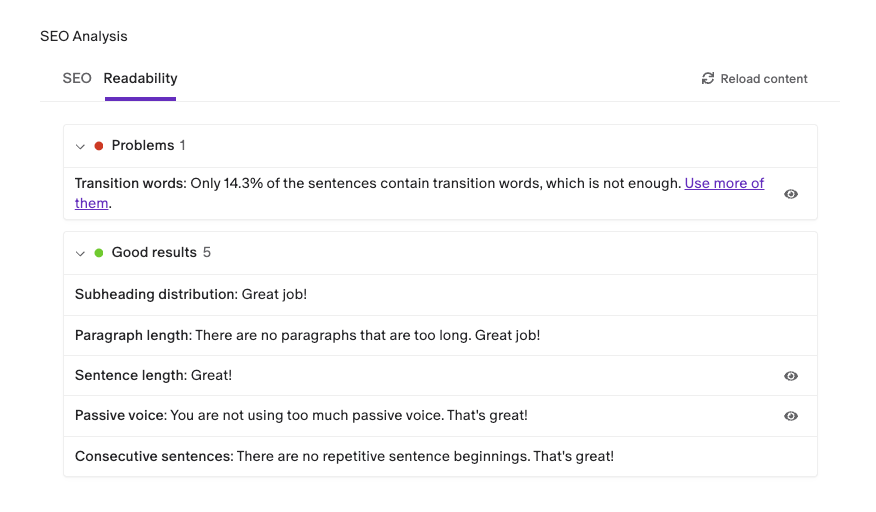
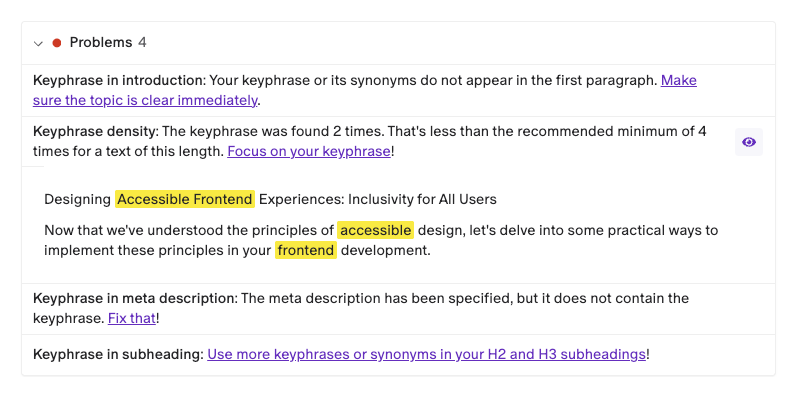

# SEO/Readability Analysis

See how well a record's page is written for search engines and for readers while you edit it. The plugin runs [YoastSEO.js](https://github.com/Yoast/wordpress-seo/tree/trunk/packages/yoastseo) on the page your website renders for the record, and lists what to fix.



- **SEO checks** for a focus keyword, its synonyms and any related keywords: keyword density, title, slug, meta description, links and more.
- **Readability checks**: sentence and paragraph length, passive voice, transition words, subheadings.
- **Grouped results**: Problems, Improvements and Good results, each with a link to fix it.
- **The text behind a result**: the sentences it's about, with the keyword highlighted.
- **Your real page, drafts included**, through an endpoint on your website.

> **This plugin needs an endpoint on your website.** It returns the page of a record, and the plugin analyzes it. See [The frontend metadata endpoint](#the-frontend-metadata-endpoint).

## Installation

1. Install the plugin.
2. In its settings, enter your **Frontend metadata endpoint**.
3. If the endpoint needs a secret, add it under **Custom headers**, for example as an `Authorization` header.
4. Use the plugin on a **JSON** field. Either pick **SEO/Readability Analysis** as the field editor in the field's **Presentation** tab, or enter the field's API key under **Auto-apply to JSON fields with API key**.



## Check a record's SEO

Open a record and go to the field. On the **SEO** tab:

1. Type a **Focus keyword**: the phrase people search for to find this page.
2. Add **Synonyms** if the page uses other words for it, separated by commas.
3. Read the results below. They update as you type.

To check more phrases, add them under **Related keywords**. Each one gets its own results under the table. The field saves the keywords with the record.

## Check readability

The **Readability** tab needs no keyword. It checks how easy the page is to read.



## Understanding the results

| Group | What it means |
|---|---|
| **Problems** | Fix these first: they hurt the page the most. |
| **Improvements** | The page passes, but could do better. |
| **Good results** | Checks the page passes. The group starts closed. |

Each result starts with the name of the check: click it to read Yoast's explanation. The link at the end tells you how to fix it.

When a result has an eye button, click it to see the sentences the result is about, with the words that count highlighted.



The analysis reads the page of the last saved version. It runs again when you save the record or switch locale, and **Reload content** fetches the page again at any time.

## The frontend metadata endpoint

The plugin sends a GET request to the endpoint, with these query string parameters:

```
<ENDPOINT_URL>?itemId=89274&itemTypeId=544589&itemTypeApiKey=blog_post&sandboxEnvironmentId=main&locale=en
```

- `itemId`: the ID of the record
- `itemTypeId`: the ID of the record's model
- `itemTypeApiKey`: the API key of the record's model
- `sandboxEnvironmentId`: the environment of the record
- `locale`: the locale the editor is looking at

The endpoint answers `200` with the page of the record, in its latest version (unpublished changes included):

```json
{
  "locale": "en",
  "slug": "hello-world",
  "permalink": "https://www.yourwebsite.com/blog/hello-world",
  "title": "This is the SEO title of the page",
  "description": "This is the SEO description of the page",
  "content": "<p>This is the main content of the page/article</p>..."
}
```

The plugin runs in the browser, so the endpoint must allow CORS requests. A custom header makes the browser ask first with an `OPTIONS` request: answer it, and list the header in `Access-Control-Allow-Headers`. Keep secrets in a custom header rather than in the endpoint URL, which ends up in server logs.

For a Next.js implementation, see the [official Next.js Starter Kit](https://github.com/datocms/nextjs-starter-kit): the [endpoint](https://github.com/datocms/nextjs-starter-kit/blob/main/src/app/api/seo-analysis/route.tsx) and the routes that turn [Draft Mode](https://www.datocms.com/docs/next-js/setting-up-next-js-draft-mode) [on](https://github.com/datocms/nextjs-starter-kit/blob/main/src/app/api/draft-mode/enable/route.tsx) and [off](https://github.com/datocms/nextjs-starter-kit/blob/main/src/app/api/draft-mode/disable/route.tsx). If you build one for another framework, open a pull request to share it.

## How the value is stored

The JSON field stores the keywords:

```json
{
  "keyword": "food shows",
  "synonyms": "cooking shows, culinary demonstrations",
  "relatedKeywords": [{ "keyword": "food", "synonyms": "" }]
}
```

## Good to know

- **Return only the content of the page.** The analysis reads everything in `content`: a site header or footer counts too, for example in the check of the introduction.
- **Words match as written.** "accessible" doesn't match "accessibility", so use the exact phrase you want to rank for.
- **New records** are analyzed once they're saved, because the endpoint needs the record's ID.
- **Visual editing works.** A draft page with Content Link carries invisible edit data in its texts: the plugin removes it before the analysis.

## Development

```bash
npm install
npm run dev     # serves the plugin at http://localhost:5173
npm run build
```
