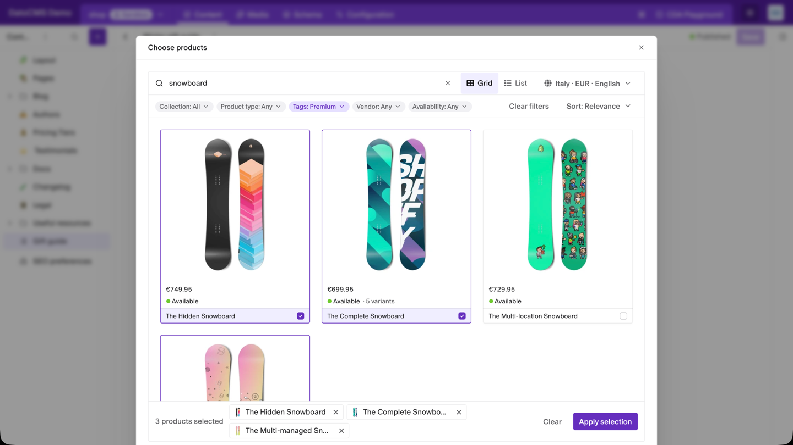
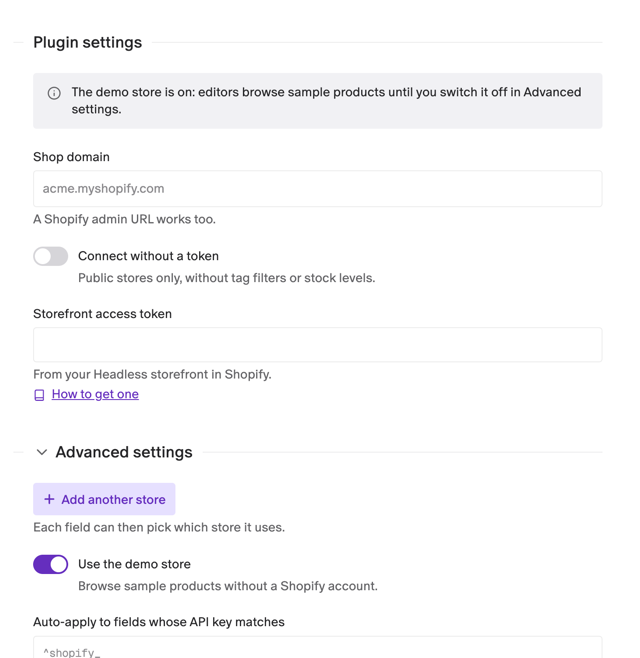
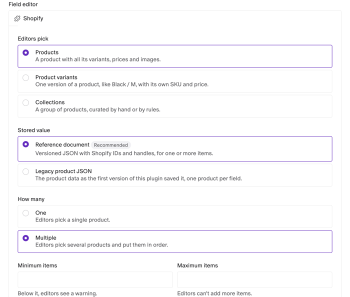
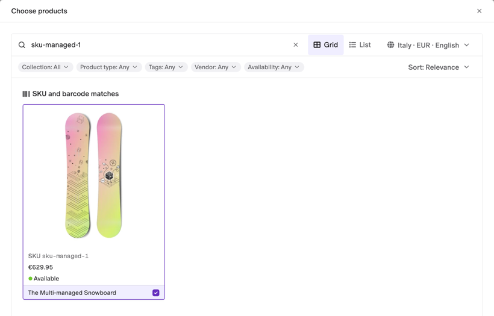
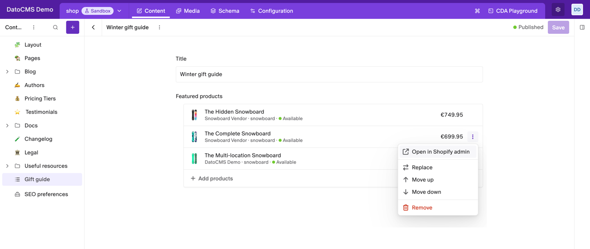

# Shopify product

Lets editors pick Shopify products, variants or collections in a DatoCMS field. The field saves a stable reference, and your frontend loads live prices, stock and images from Shopify.



- **Products, variants or collections**: one item per field, or an ordered list.
- **A picker built for catalogs**: search by title, SKU or barcode, filter by collection, product type, tag, vendor or availability, and switch between grid and list.
- **Live details in the record**: each item shows its image, price and availability.
- **The format your frontend needs**: a reference document on JSON fields, or a handle or Shopify ID on string fields.
- **Safe for existing content**: the field never changes a saved value on its own, and 1.x fields keep working.
- **Try it without a store**: a demo store with sample products is one switch away.

## Connect your store

Install **Shopify product** from **Configuration → Plugins**. To try it without a store, open **Advanced settings** in the plugin settings, turn on **Use the demo store** and click **Save**. Editors then browse sample products until you switch it off.



To connect your own store, you need the public Storefront API token of a Headless storefront:

1. In your Shopify admin, install the free [Headless](https://apps.shopify.com/headless) channel (it needs the **Apps and channels** staff permission), open it and click **Create storefront**.
2. Copy the storefront's **Public access token**. The plugin refuses private and Admin API tokens (`shpat_…`), because every editor can read its settings.
3. Next to **Storefront API permissions**, click **Edit** and allow reading products, variants and collections. Reading product tags (for the Tags filter) and product inventory (for stock levels) is optional.
4. Publish the products and collections editors should pick to that storefront. A new Headless storefront starts empty.
5. In the plugin settings, enter the **Shop domain** (`acme`, `acme.myshopify.com` or a Shopify admin URL) and the **Storefront access token**, then click **Save**. The plugin tests the connection before saving.

Once connected, the settings show the store's connection, which optional permissions the token has, and a **Default country** and **Default language** for prices and titles. If you change the permissions in Shopify later, click **Re-check** and save again. Storefront API tokens from custom apps created before 2026 also work.

A public store can also connect with **Connect without a token**, without tag filters or stock levels. **Advanced settings** lets you add more stores (each field then picks which one it uses) and auto-apply the plugin to fields whose API key matches a regular expression.

## Add a Shopify field

Add a **JSON** or **Single-line string** field and choose **Shopify** as the field editor in its **Presentation** tab. Then choose:

- **Editors pick**: products, product variants or collections.
- **Stored value**: a **Reference document** on JSON fields (recommended), the **Handle** or **Shopify ID** on string fields, or the **Legacy product JSON** of 1.x.
- **How many**: one item, or several in order, with an optional minimum and maximum.
- **Include a display snapshot**: also stores each item's title, image and price, so frontends can render without calling Shopify.
- **Limit choices**: only show items from a collection, product type, vendor or tag, or only products available for sale.

**Stored value example** shows exactly what the field will save.



## Pick products

In the record, click **Browse Shopify** (or **Add products** on a multiple field). The picker opens on your catalog:

- Type in the search box to search titles. A full SKU or barcode shows its exact match first, under **SKU and barcode matches**.
- Narrow the results with **Collection**, **Product type**, **Tags**, **Vendor** and **Availability**, and change the order with **Sort**.
- Switch between **Grid** and **List**, and pick the country and language that prices and titles are shown in.
- On a multiple field, click several items, then **Apply selection**. On a variant field, open a product to choose one of its variants.



## In the record

Each item shows its image, title, vendor, product type, availability and price. Drag items to reorder them, or use the **⋮** menu to **Replace** an item, move it, remove it, or open it in Shopify admin.



The field never changes a saved value on its own. When an item is unpublished or deleted, its handle changes, or the field's stored format changes, it shows a warning with an action to fix it.

## For developers

A reference document stores each item's Shopify ID and handle in the editor's order (variants also store `productId` and `productHandle`):

```json
{
  "version": 1,
  "shop": "acme.myshopify.com",
  "kind": "product",
  "references": [
    { "id": "gid://shopify/Product/10080752009562", "handle": "the-complete-snowboard" }
  ]
}
```

Query the field from DatoCMS, then load live data with the Storefront API `nodes(ids:)` query. The [developer guide](https://github.com/datocms/plugins/blob/master/shopify-product/docs/developer-guide.md) covers every stored format, with frontend and Hydrogen examples and a list of [error messages](https://github.com/datocms/plugins/blob/master/shopify-product/docs/developer-guide.md#connection-and-request-errors).

## Upgrading from 1.x

Existing fields keep storing the handle or the 1.x product JSON, so your frontend keeps working. To move a field to a new format, update your frontend to read both, then change the field's settings. Each record switches when an editor opens it and clicks **Convert** on the field. Fields auto-applied by API key keep the 1.x defaults.

If your code followed the 1.x README, `id` in the legacy product JSON is a Shopify GID (sometimes base64-encoded), not a numeric ID. See [Migrating from 1.x](https://github.com/datocms/plugins/blob/master/shopify-product/docs/developer-guide.md#migrating-from-1x).

## Good to know

- **Only what the storefront can see:** drafts, archived and scheduled products, and anything not published to the token's storefront, can't be picked or displayed.
- **Limits guide editors:** field limits show warnings in DatoCMS but don't block saving, and the Content Management API and imports bypass them.
- **Filters inside a collection** need the matching filters enabled in Shopify's Search & Discovery app.
- **No server:** the plugin can't sync products into records or react to Shopify webhooks.

## Development

```sh
npm ci
npm run dev
npm run harness
npm test
npm run lint
npm run build
```

## Changelog

### 2.0.1

Shorter README.

### 2.0.0

A rebuild adding variants, collections, lists, new stored formats, a new picker and multiple stores. Existing fields keep working as before; see [Upgrading from 1.x](#upgrading-from-1x).

### 1.0.10

New selections save the full-size `imageUrl` plus a 200x200 `previewImageUrl`. Existing values aren't rewritten.
