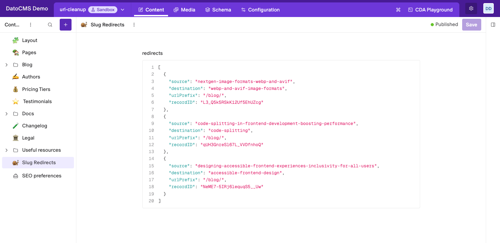
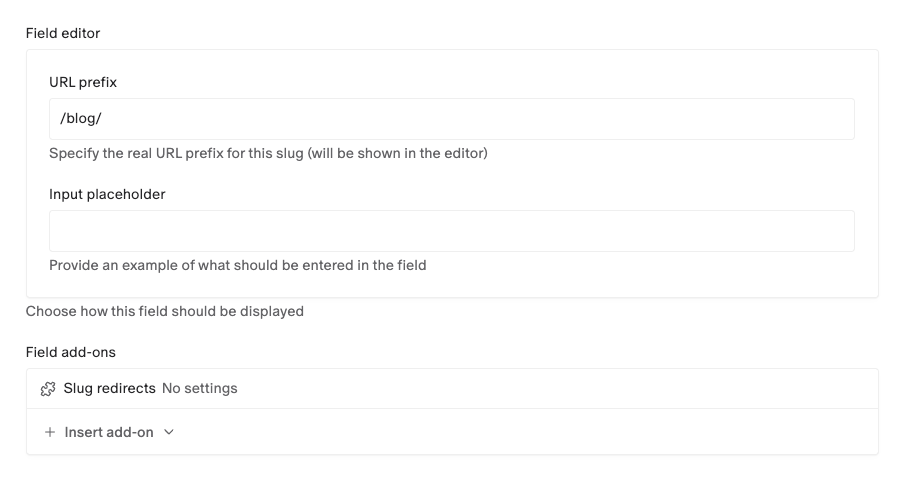

# Slug Redirects

Keep old links working when editors change a URL. Each time a slug changes, the plugin adds a redirect rule, from the old slug to the new one, to a "Slug Redirects" record that your website can read.



- **Automatic**: editors change slugs as usual, and the rules are added on save.
- **One place for every rule**: a single record holds the whole list, ready for your website or hosting.
- **With the URL prefix**: each rule keeps the prefix of the slug field, like `/blog/`, and the ID of the record.
- **Nothing new in the form**: the plugin adds no buttons or panels for editors.

## Installation

1. Install the plugin from the marketplace and grant it permission to act on behalf of the logged-in user. It uses that access to create its model and to update the list of rules.
2. Right after installation, the plugin creates a single-instance model called **🐌 Slug Redirects** (API key `slug_redirect`), with one JSON field, **redirects**, holding an empty list.
3. Open the slug field you want to track. In its **Presentation** tab, under **Field add-ons**, click **Insert add-on** and pick **Slug redirects**, then **Save field**.



The add-on has no settings. It reads the **URL prefix** of the field editor, if you set one, and stores it with each rule.

## How it works

Open a record, change its slug and save. The plugin compares the new slug with the one saved before and adds a rule at the end of the list:

```json
{
  "source": "code-splitting-in-frontend-development-boosting-performance",
  "destination": "code-splitting",
  "urlPrefix": "/blog/",
  "recordID": "qUH3GnreSl67L_VVDfnhoQ"
}
```

Saves that don't change the slug add nothing, and neither does creating a record. The rules live in the **Slug Redirects** record under **Content**, where you can review or edit them like any JSON field.

## Use the rules on your website

The Slug Redirects record is part of your content, so you can read it like any other. With the Content Delivery API:

```graphql
query {
  slugRedirect {
    redirects
  }
}
```

Join each rule's `urlPrefix` with its `source` and `destination` to get full paths, then turn them into redirects in your framework or hosting, for example at build time.

## Good to know

- **Every change adds a rule, and none is removed.** If a slug changes twice, you get a chain (`a` to `b`, then `b` to `c`). Point old paths to the final one, and skip rules that send a page back to an earlier slug.
- **Editors need access to the model.** Rules are written with the permissions of the person saving the record. Let their roles edit the Slug Redirects model, or their changes won't be recorded.
- **Use one slug field, not localized.** The plugin recognises the slug by its API key, so a slug field with the same API key in another model is tracked too, and gets the URL prefix of the field with the add-on.
- **Leave "Add redirect rules only on publish" off.** The plugin settings have this one switch. In this version, turning it on stops new rules from being added.

## Development

```bash
npm install
npm run dev     # local dev server, to use with a private plugin pointed at it
npm run test
npm run build
```

See the [DatoCMS plugin SDK docs](https://www.datocms.com/docs/plugin-sdk) to learn how plugins are built.
