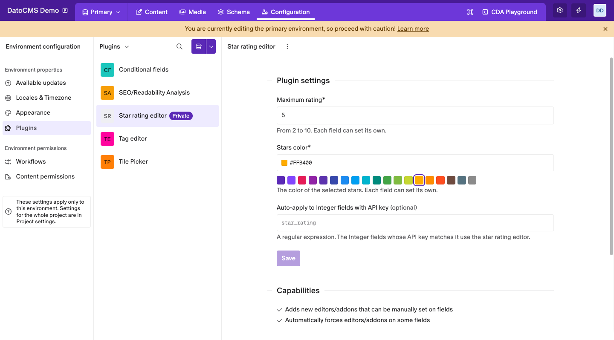
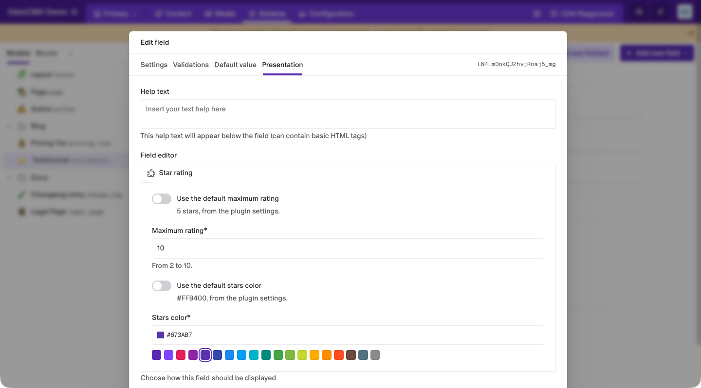

# Star rating editor

Show Integer fields as a row of stars: editors rate a record with a click, and the field stores the number of stars.

## Getting started

Add an **Integer** field to any model or block, and under its **Presentation** tab change the field editor to **Star rating**. Editors then click a star to set the value, from 1 to the field's maximum rating. Pointing at the stars previews the rating before the click, and the arrow keys change it from the keyboard.

The field stores a plain integer, so filtering and sorting by it work like for any other Integer field.

## Plugin settings

Under **Configuration › Plugins › Star rating editor**, set the defaults for every star rating field:

- **Maximum rating**: how many stars a field shows, from 2 to 10.
- **Stars color**: the color of the selected stars. Pick a preset, or type any CSS color.
- **Auto-apply to Integer fields with API key**: a regular expression. Every Integer field whose API key matches it uses the star rating editor, with no setup on the field. For example, `rating$` matches `rating` and `support_rating`.

## Field settings

Each field can change the defaults in its **Presentation** tab. Turn off **Use the default maximum rating** or **Use the default stars color** to give the field its own value. A field that keeps the defaults follows any later change to the plugin settings.

Fields that get the editor through the auto-apply pattern always use the defaults.
