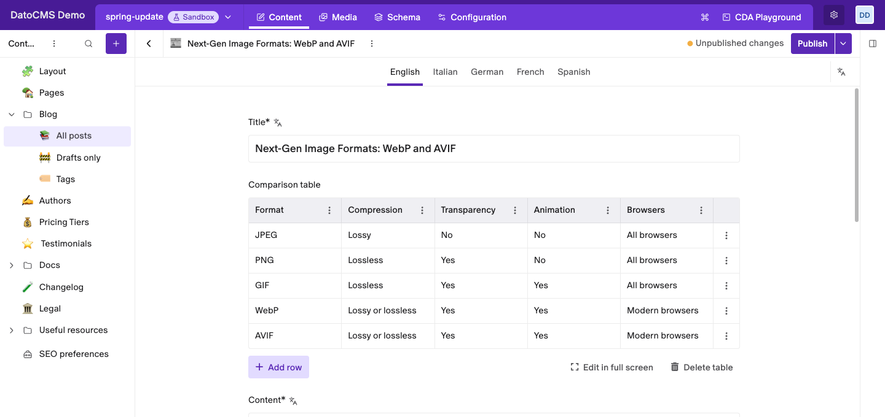
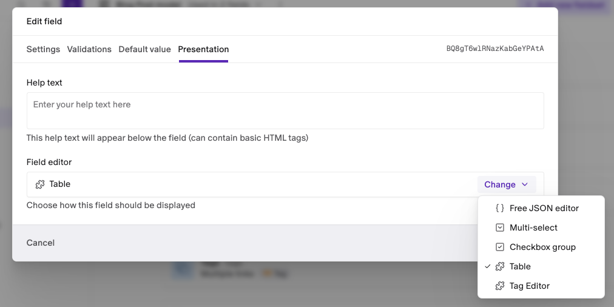
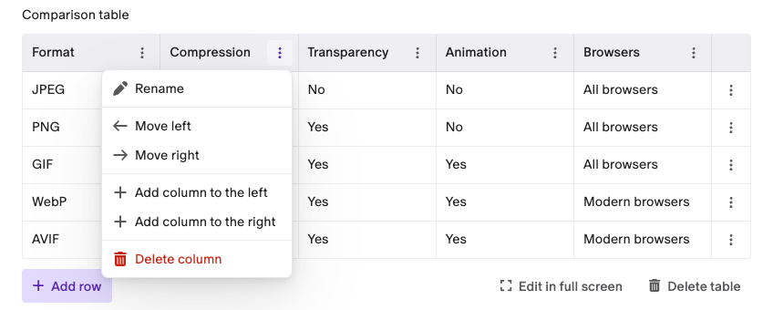
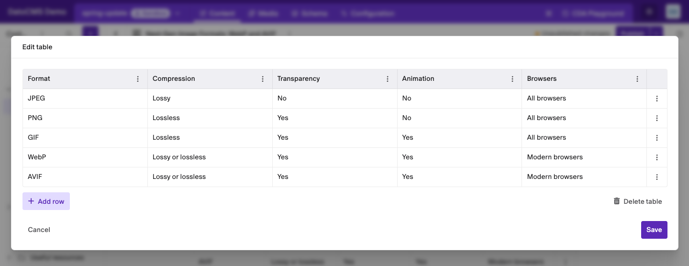

# Table Editor

Show JSON fields as an editable table: editors fill in cells, add and move rows and columns, or paste a table straight from a spreadsheet, and the field stores the table as JSON.



- **Spreadsheet-like editing**: type in any cell, and long text wraps inside it.
- **Paste whole tables**: copy cells from Excel, Google Sheets, Numbers or a web page, and they fill the table.
- **Column and row menus**: rename, move, add and delete columns and rows.
- **Full screen**: give a wide table the whole window.
- **Plain JSON output**: column names and rows of text, easy to render on your website.

## Getting started

Add a **JSON** field to any model or block. In its **Presentation** tab, under **Field editor**, click **Change** and pick **Table**.



The plugin has no settings.

## Editing a table

An empty field shows **No table yet**. Click **Add table** to start with two columns, **Column A** and **Column B**, and one empty row.

- **Type in a cell** to change it. The row grows to fit its text.
- **Paste cells** copied from a spreadsheet or an HTML table: they fill the table from the cell you paste into, rightwards and downwards. Missing rows are added; cells beyond the last column are left out, so add the columns first.
- **Click Add row** to add an empty row at the bottom.
- **Drag the edge of a column header** to make the column wider or narrower while you edit. The width isn't saved.

### Columns

Click the **⋮** in a column header to **Rename** the column, **Move left** or **Move right**, **Add column to the left** or **to the right**, or **Delete column**. New columns are called "New Column", and column names must be unique.



### Rows

Click the **⋮** at the end of a row to **Move up**, **Move down**, **Add row above**, **Add row below** or **Delete row**.

### Full screen

Click **Edit in full screen** to open the table in a dialog as wide as the window. Click **Save** to bring the changes back to the field, or **Cancel** to drop them.



### Deleting the table

**Delete table** asks for confirmation, then empties the field.

## How the value is stored

The field holds an object with the column names, in order, and one object per row, keyed by column name. Every cell is a string:

```json
{
  "columns": ["Format", "Compression", "Transparency"],
  "data": [
    { "Format": "JPEG", "Compression": "Lossy", "Transparency": "No" },
    { "Format": "WebP", "Compression": "Lossy or lossless", "Transparency": "Yes" }
  ]
}
```

An empty field is `null`. Read `columns` for the header and the column order, and `data` for the rows.

## Good to know

- **Text only:** cells hold plain text. There's no formatting, links or merged cells.
- **Values from elsewhere:** if a field already holds JSON in another shape, the editor doesn't change it. It shows "The table editor can't read this value" until you fix the value or switch the field back to the **Free JSON editor**.
- **Read-only fields:** when the field is disabled, editors see the table without the menus and buttons.

## Development

```bash
npm install
npm run dev     # serves the plugin at http://localhost:5173
npm run build
```

See the [DatoCMS plugin SDK documentation](https://www.datocms.com/docs/plugin-sdk) for how plugins work.
