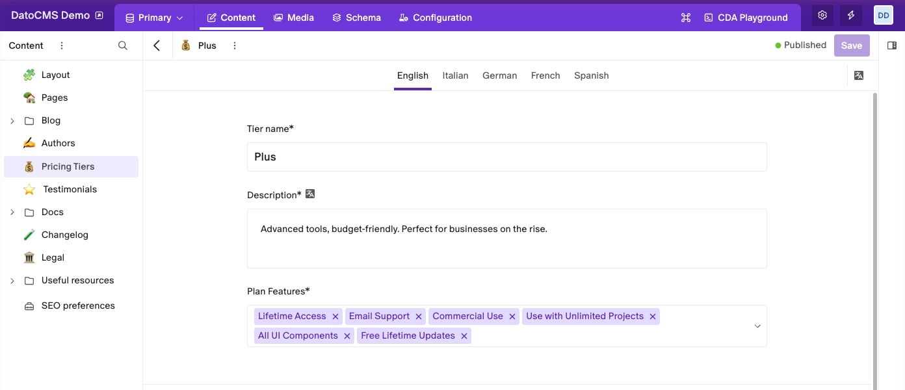
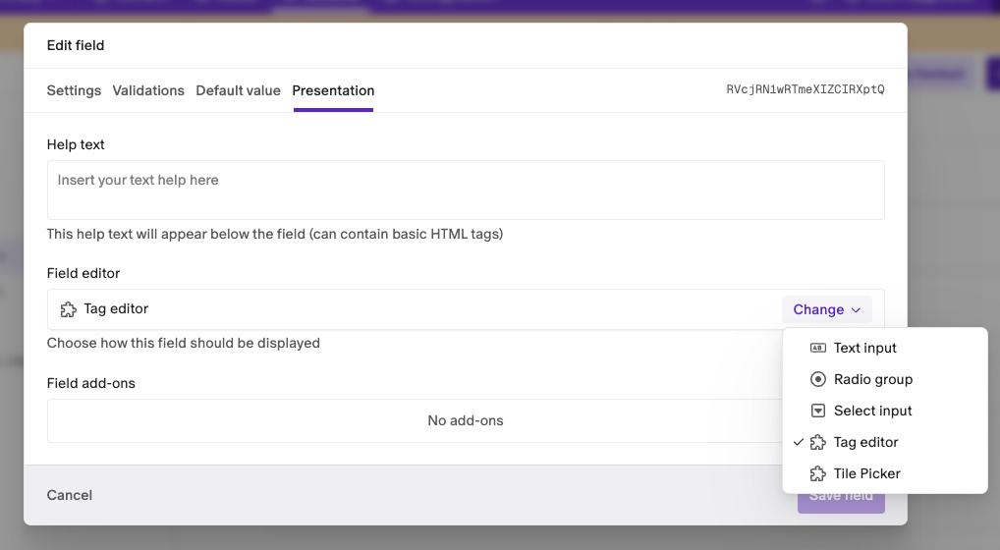
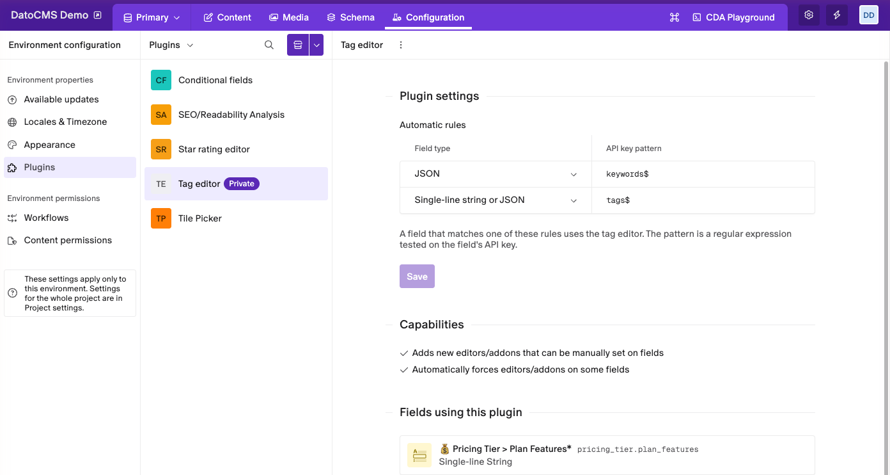

# Tag editor

Show Single-line string and JSON fields as a list of tags: editors type a tag and press Enter, and the field stores the list.

## Getting started

Add a **Single-line string** or **JSON** field to any model or block. In its **Presentation** tab, under **Field editor**, click **Change** and pick **Tag editor**.

To turn the editor on for many fields at once, use [automatic rules](#automatic-rules) instead.

## Adding and removing tags

- **Type a tag and press Enter.** Clicking the field reminds you how.
- **Paste a list** to add several tags at once: each line, or each cell copied from a spreadsheet, becomes a tag.
- **Click a tag's ×** to remove it.

Tags are trimmed, and a tag that's already in the field, in any letter case, isn't added again. New tags go at the end of the list.

## How the value is stored

| Field type | Stored value |
|---|---|
| Single-line string | The tags separated by a comma and a space: `Email Support, Commercial Use` |
| JSON | An array of strings: `["Email Support", "Commercial Use"]` |

If a field already holds a value in another shape, like a JSON object, the editor doesn't touch it: it shows the value and the format it expects instead of the tags.

## Automatic rules

Under **Configuration › Plugins › Tag editor**, add rules that turn on the editor for every matching field, with no setup on the field. Each rule has:

- **Field type**: Single-line string, JSON, or both.
- **API key pattern**: a regular expression tested on the field's API key. For example, `tags$` matches `tags` and `product_tags`.

A field that matches a rule uses the tag editor whatever its **Presentation** tab says.

## Good to know

- In a Single-line string field, commas separate the tags, so a tag can't contain one. Use a JSON field if your tags need commas.
- Tags keep the order they were added in. To change the order, remove a tag and add it again.
