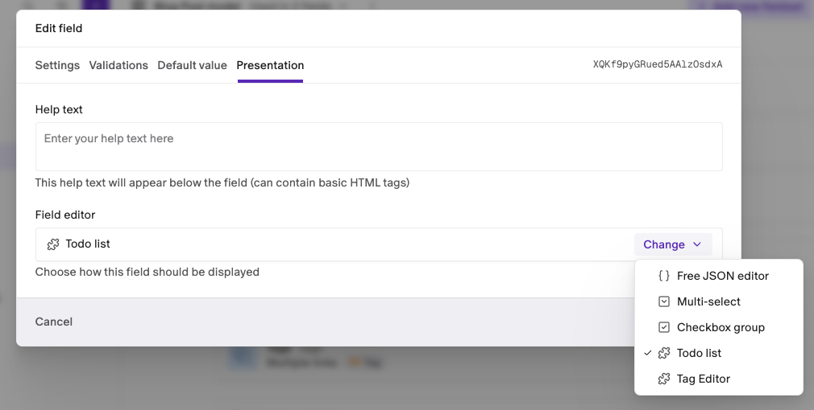
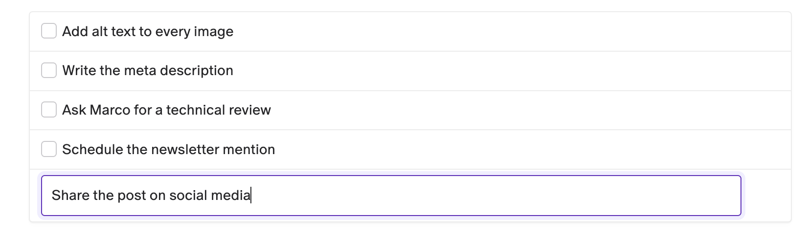
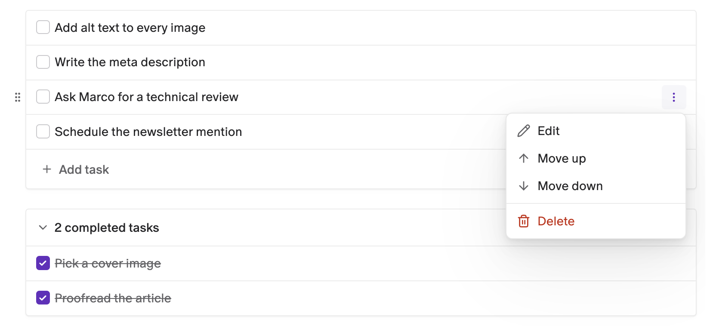

# Sidebar Todo lists

Give each record its own checklist. The plugin turns a JSON field into a to-do list in the record form, so editors can see what's still left before they publish.


- **Tick tasks off**: done tasks move to a completed list you can open and close.
- **Edit in place**: add, rename and delete tasks right in the field.
- **Drag to reorder**: grab a task and drop it where it belongs.
- **Same tasks for every record**: start new records with a ready-made checklist through the field's default value.
- **Saved with the record**: the list is plain JSON in the field, with the date each task was done.
- **No configuration**: the plugin has no settings and needs no permissions.

## Getting started

1. Install the plugin from the marketplace.
2. Go to **Schema**, open the model and add a **JSON** field, for example "Publishing checklist". Leave **Enable localization on this field?** off.
3. In the field's **Presentation** tab, under **Field editor**, click **Change** and pick **Todo list**.
4. Click **Save field**.



## Using the list

The open tasks sit in one card, each with a checkbox. An empty field shows **No tasks yet**, and once every task is done it shows **All tasks done**.

- **Mark a task done**: click its checkbox or its text. The task moves to the completed tasks.
- **Add a task**: click **Add task** under the list, type its name and press Enter. Escape cancels.
- **Reorder**: point at a task, grab the grip that appears on its left and drag the task to its new place.
- **Rename, move or delete**: point at a task and open its **⋮** menu: **Edit**, **Move up**, **Move down** or **Delete**. **Edit** turns the text into an input: Enter saves, Escape keeps the old name.





Every change is part of the record, like any other field: click **Save** to keep it.

### Completed tasks

Done tasks go to a second card under the list, **2 completed tasks** (with the current count). Click its header to open or close it. Completed tasks are struck through; clear a task's checkbox, or click its text, to reopen it: it goes back to the end of the open tasks.

## Start every record with the same tasks

Put the checklist in the field's **Default value** tab, and every new record starts with it:

```json
{
  "incomplete": [
    { "todo": "Proofread the article", "completedAt": null },
    { "todo": "Add alt text to every image", "completedAt": null },
    { "todo": "Write the meta description", "completedAt": null }
  ],
  "complete": []
}
```

When you add a new field with a default value, DatoCMS also fills it in on the existing records.

## How the value is stored

The field holds the open tasks in `incomplete` and the done ones in `complete`, each in its own order:

```json
{
  "incomplete": [
    { "id": "3f0c…", "todo": "Write the meta description", "completedAt": null }
  ],
  "complete": [
    { "id": "9a41…", "todo": "Proofread the article", "completedAt": "2026-11-15T16:05:12.000Z" }
  ]
}
```

`completedAt` is the date and time the task was ticked off. Tasks written without an `id`, like the ones in a default value, get one automatically.

## Good to know

- **Not localized, not in blocks:** the editor reads the field straight from the record, so use a non-localized field on the model itself. In a localized field or inside a block, the list always shows up empty.
- **Initial To-Dos:** earlier versions had an **Initial To-Dos** setting for this. It's no longer read; use the field's default value instead.

## Development

```bash
npm install
npm run dev     # serves the plugin at http://localhost:5173
npm run build
```

See the [DatoCMS plugin SDK documentation](https://www.datocms.com/docs/plugin-sdk) for how plugins work.
