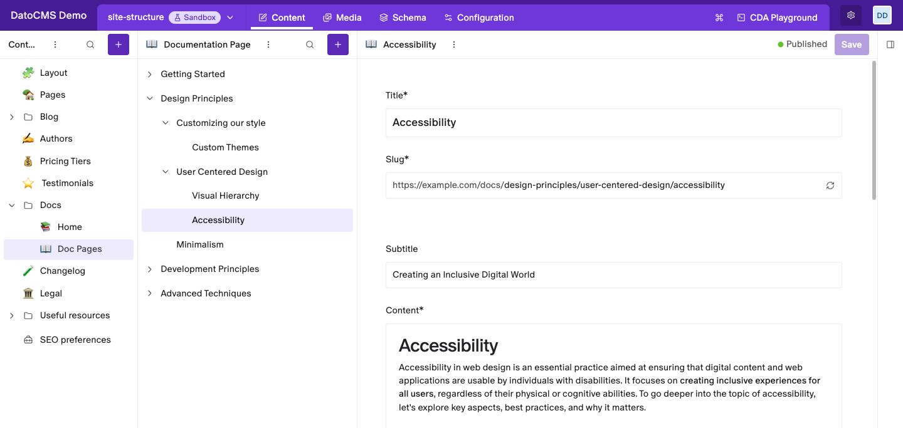
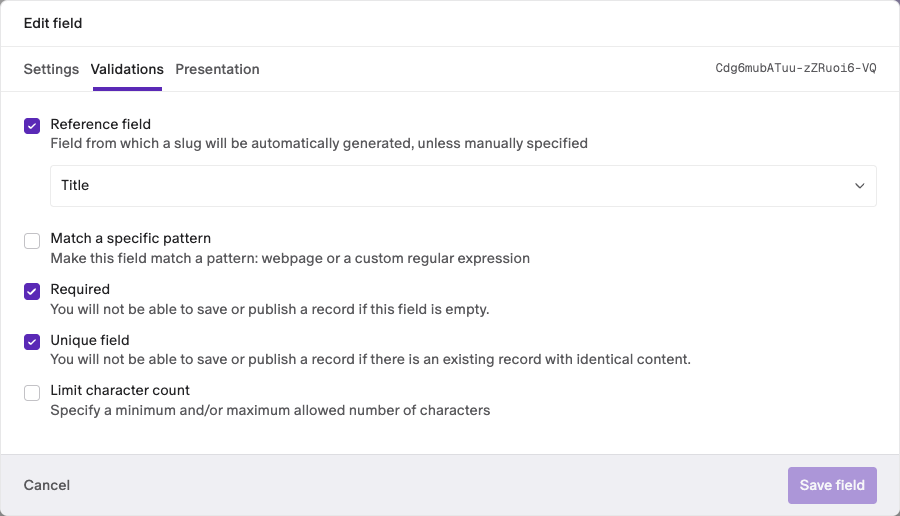
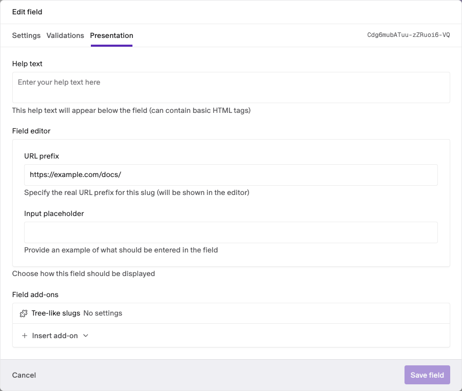

# Tree-like Slugs

Give the pages of a tree the URLs their place in it suggests. In a model with hierarchical sorting, each record's slug starts with its parent's slug, and when you change a parent's slug, every page below it follows on save.



- **Paths that follow the tree**: `design-principles/user-centered-design/accessibility` instead of a flat `accessibility`.
- **Every level**: children, grandchildren and further down are updated in one save.
- **Only the slug changes**: the other fields of the records below are left as they are.
- **Localized slugs**: each locale follows the parent's slug in that locale.
- **Nothing new in the form**: the plugin adds no buttons or panels for editors.

## Installation

1. Install the plugin from the marketplace and grant it permission to act on behalf of the logged-in user. It uses that access to update the slugs of the records below the one you save.
2. Use it on a model whose records form a tree: in **Edit model → Presentation**, **Default collection ordering** is **Hierarchical sorting**.
3. Open the model's slug field. In **Validations**, turn off **Match a specific pattern**: the plugin puts a `/` between the slugs, and the webpage slug pattern rejects it.



4. In the field's **Presentation** tab, under **Field add-ons**, click **Insert add-on**, pick **Tree-like slugs** and click **Save field**.



The add-on has no settings and draws nothing in the form. The plugin settings repeat these steps.

## How it works

Open a record, change its slug and save. Before the save goes through, the plugin goes down the tree and rewrites the slug of every record below it: each one keeps its own last part and takes its parent's slug in front.

Changing the Design Principles slug from `design-principles` to `design` gives:

```
design
├── design/customizing-our-style
│   └── design/customizing-our-style/custom-themes
├── design/user-centered-design
│   ├── design/user-centered-design/visual-hierarchy
│   └── design/user-centered-design/accessibility
└── design/minimalism
```

Saves that don't change the slug leave the tree alone. The records below are updated with the permissions of the editor who saved, and each gets a new version like any other edit. In a model with drafts, their new slugs are unpublished changes until you publish them.

### Starting from flat slugs

If the records already exist with flat slugs, change the slug of each top-level record once and save it (you can change it back afterwards). Its whole branch then gets the full paths.

## Good to know

- **The record you edit keeps the slug you type.** The plugin doesn't add the parent's slug to it. For a record that isn't at the top of the tree, type the full path, like `design/minimalism`.
- **New records start with a flat slug.** A new child gets the slug made from its title. Add its parent's path in front of it.
- **Moving a record doesn't update its slug.** After dragging a record under another parent, edit its slug so it starts with the new parent's slug, and save: the records below it follow.
- **The reset button drops the path.** The slug field's reset icon makes a new slug from the title, without the parents' part.
- **A failed update blocks the save.** If a record below can't be updated, the plugin shows why and the record isn't saved. The records already updated keep their new slug. The same happens if the save is then blocked for another reason, like a validation error.
- **Empty slugs stop a branch.** If a record below has no slug (or none in a locale), the records under it keep their slugs.
- **Large trees take a while.** Each record below is updated on its own, so keep the tab open until the save finishes.

## Development

```bash
npm install
npm run dev     # local dev server, to use with a private plugin pointed at it
npm run check   # lint, typecheck, tests and build
```

See the [DatoCMS plugin SDK docs](https://www.datocms.com/docs/plugin-sdk) to learn how plugins are built.
