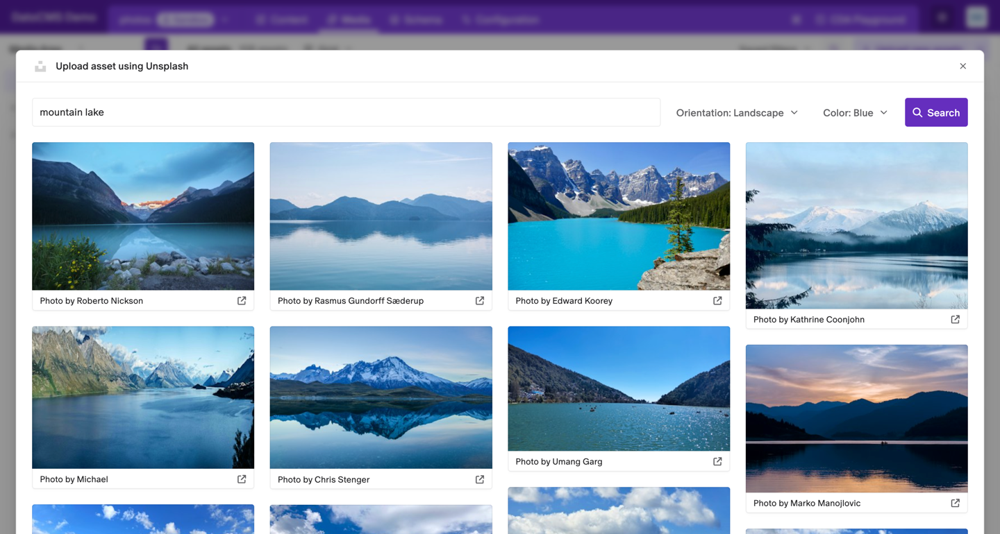
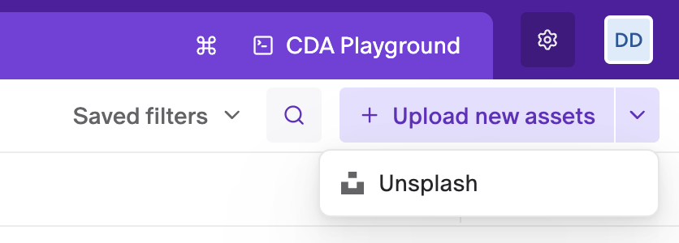
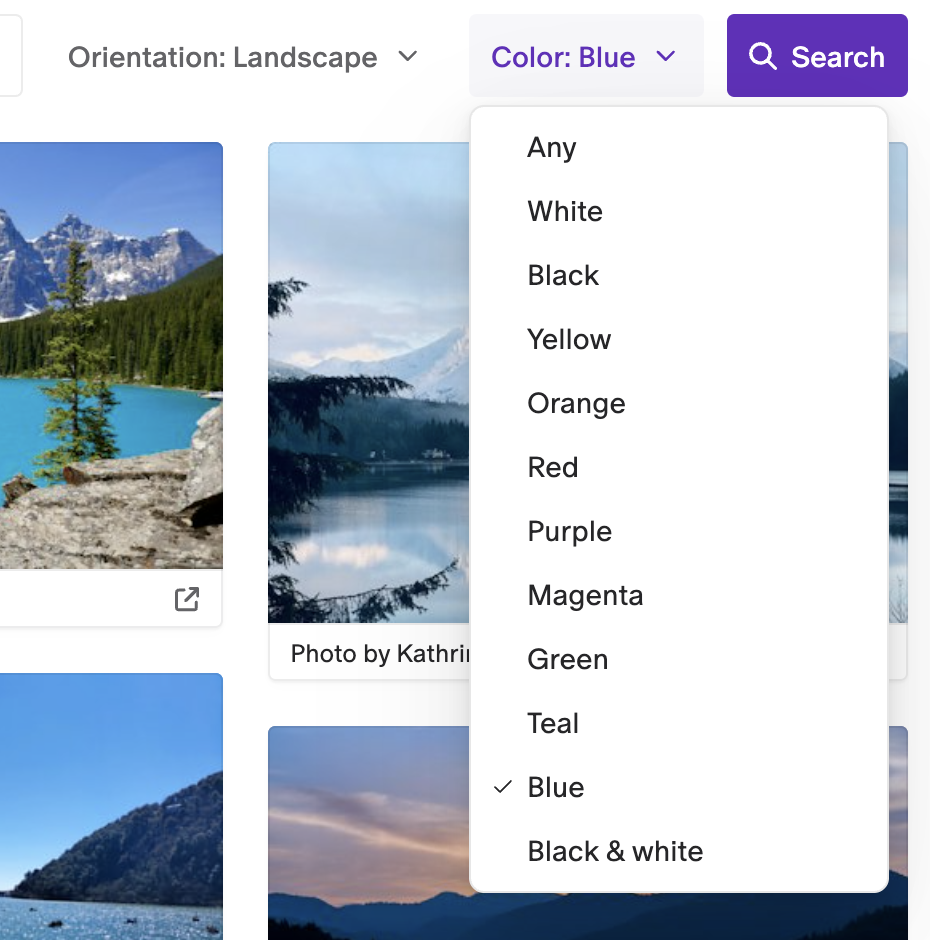
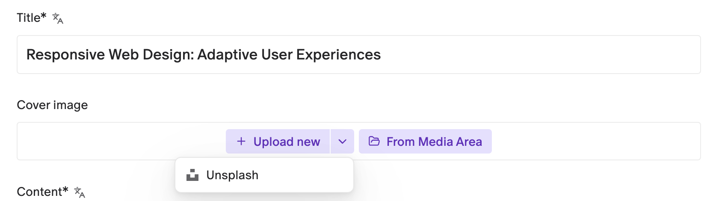
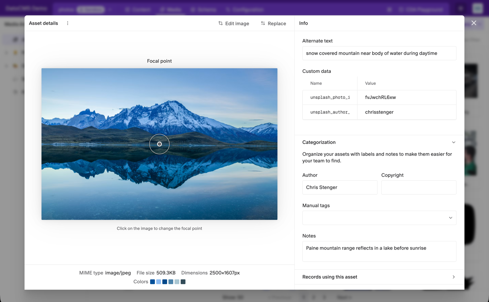

# Unsplash asset source

Search free, high-resolution photos on [Unsplash](https://unsplash.com) and add them to your DatoCMS project in one click, without leaving the dashboard.



- **Search millions of free photos**: start from Unsplash's popular photos, or search by keyword.
- **Filter by orientation and color**: landscape, portrait or square, and 11 colors or black & white.
- **One click to import**: the photo is uploaded to your Media Area at up to 2,500 px wide.
- **Credits come along**: the photographer's name, the photo's description and its alt text are filled in for you.
- **No API key, no settings**: searches go through DatoCMS's own Unsplash connection.

## Installation

Install the plugin from the marketplace. There is nothing to configure: the plugin has no settings and needs no Unsplash account or API key.

## Add a photo from the Media Area

1. In the **Media Area**, click the arrow next to **Upload new assets** and choose **Unsplash**.
2. Type what you're looking for and press **Search** (or Enter). The search also runs on its own a second after you stop typing.
3. Click a photo. The dialog closes and the photo is uploaded to the Media Area.



The dialog opens on Unsplash's popular photos. Results come 30 at a time: scroll to the bottom and click **Load more** for the next ones. The icon next to a photographer's name opens their Unsplash profile in a new tab.

### Filter the results

Once you've typed a search, narrow it with **Orientation** (Any, Landscape, Portrait or Square) and **Color** (Any, White, Black, Yellow, Orange, Red, Purple, Magenta, Green, Teal, Blue, or Black & white). The results update as soon as you pick a filter. Clearing the search resets both filters, because popular photos can't be filtered.



## Add a photo from a record

Unsplash is also available in asset fields. Open the arrow next to **Upload new** and choose **Unsplash**: the photo you click is uploaded to the Media Area and put in the field.



## What gets saved

Each imported photo is a regular asset in your Media Area, with these details filled in:

| Asset field | Value |
|---|---|
| File name | The start of the photo's alt description, or its Unsplash ID |
| Author | The photographer's name |
| Notes | The photographer's description of the photo, when there is one |
| Alternate text (English locales) | The photo's alt description |
| Custom data (English locales) | `unsplash_author_username` and `unsplash_photo_id` |



Use the custom data to credit the photographer on your website, with a link to `https://unsplash.com/@<unsplash_author_username>`. Unsplash photos are free to use under the [Unsplash License](https://unsplash.com/license); credit isn't required, but photographers appreciate it.

## Good to know

- **English only for alt text:** the alt text and custom data are set for every project locale that starts with `en` (`en`, `en-US` and so on). Other locales get empty default metadata, so add their alt text yourself.
- **Image size:** photos are imported as JPEG, at most 2,500 px wide. Smaller originals keep their size.
- **Download tracking:** each import is reported to Unsplash as a download, as the Unsplash API guidelines ask.
- **When Unsplash can't be reached**, the dialog says the photos could not be loaded and offers **Try again**.

## Development

```bash
npm install
npm run dev     # serves the plugin at http://localhost:5173
npm run build
```

See the [DatoCMS plugin SDK documentation](https://www.datocms.com/docs/plugin-sdk) for how plugins work.
