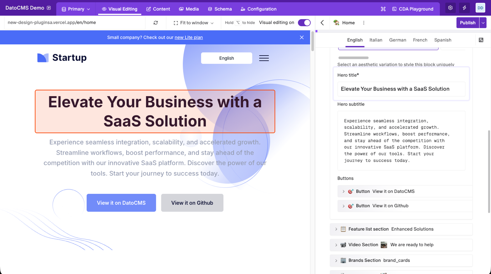
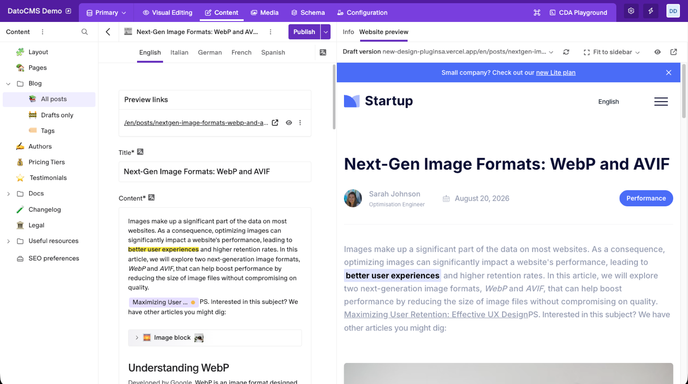
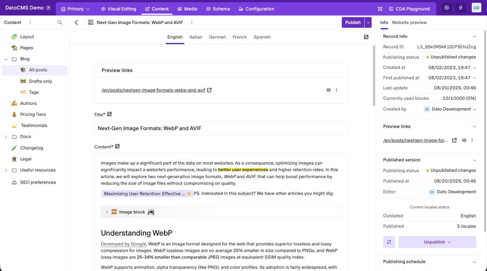

# Web Previews

Web Previews shows your website inside DatoCMS. Editors see the page of the record they're editing next to its form, and can click anything on the page to edit it.



- **Visual Editing tab**: browse your website in draft mode and click any text or image to open the record and the field behind it.
- **Website preview tab**: the page of a record next to its form, at the size of a phone, a tablet or a desktop.
- **Preview links**: the pages of a record, at the top of its form and in its sidebar.
- **Several frontends**: production, staging or several websites, each with the features you choose.

> **Your website needs some setup.** Preview links come from an endpoint on your website, and Visual Editing needs a route that turns on draft mode. A developer adds them once: see [The Preview Links API endpoint](#the-preview-links-api-endpoint) and [The Enable Draft Mode route](#the-enable-draft-mode-route).

## Installation

1. Install Web Previews from the marketplace.
2. In its settings, click **Add frontend** and give it a name, like "Production".
3. Turn on what your website supports:
   - **Enable Preview Links for this frontend**: enter the **Preview Links endpoint URL**, and any **Custom headers sent to the endpoint**.
   - **Enable Visual Editing for this frontend**: enter the **Draft mode URL**. The **Start page** is the page the Visual Editing tab opens first (`/` when empty).
4. Click **Save**.

A frontend can offer Preview Links, Visual Editing or both. **Hide this frontend from editors** keeps its settings but removes it from the editors' screens.

### Where editors find it

Under **Display**, choose the places that show Web Previews. They're all on by default.

| Setting | What it adds |
|---|---|
| **Show the Visual Editing tab in the main navigation** | The Visual Editing tab, when a frontend has Visual Editing |
| **Show Preview Links in a record sidebar panel** | The Preview links panel of the record sidebar. **Start with the panel expanded** opens it on every record |
| **Show Preview Links at the top of the record form** | The Preview links card above the fields of a record |
| **Show the Website preview tab in the record sidebar** | The Website preview tab. **Default tab width** sets its first width (900 px) |

**Viewports** are the sizes in the size menus of the previews: Mobile, Tablet and Desktop until you add your own, each with a name, a width, a height and an icon. **Iframe permissions** sets the `allow` attribute of the preview, for a website that needs the camera or the microphone.

## Edit on the page: the Visual Editing tab

1. Click **Visual Editing** in the main navigation. Your website opens in draft mode, next to the list of the **Records on this page**.
2. Move the pointer over the page. The text and images you can edit get an outline.
3. Click one. Its record opens on the right, at the field to change.
4. Edit the field and save the record.

Point at a record in **Records on this page** to scroll the page to it and outline it, and click it to open it.

Above the page, type a path to open another page, refresh it, or pick a size: **Fit to window**, a viewport or a **Custom size**. Turn off the **Visual editing** switch to use the page as a visitor (links, menus) without the outlines, or hold Alt (⌥ on a Mac) to hide them for a moment. With several frontends, a menu at the left switches websites.

## Preview a record: the Website preview tab



Open **Website preview** in the sidebar of a record to see its page next to the form. Its bar lets you:

- pick one of the record's links, like the draft or the published version;
- refresh the page, or pick a size: **Fit to sidebar**, a viewport or a **Custom size**;
- open the page in the Visual Editing tab (the eye) or in a new browser tab.

Drag the edge of the tab to resize it. A new record shows its preview after its first save.

## Open a page: preview links



The **Preview links** card at the top of the form and the panel in the sidebar list the pages of the record, one row per frontend. Click a link to open the page in a new tab. The eye opens it in the Visual Editing tab, and the **⋮** menu holds the record's other links, like **Open Published version**.

## Good to know

- **Nothing is guessed:** every link and page comes from your website's endpoint and draft mode route. The plugin never builds URLs itself.
- **A blank preview** usually means the website doesn't allow framing: see [Content Security Policy](#content-security-policy).
- **Another environment:** when the page shows content from another DatoCMS environment, the Visual Editing tab says so instead of listing its records.
- **No outlines on a page** means the website doesn't load DatoCMS Content Link yet. The Visual Editing tab tells the editor to ask a developer.

## Development

```bash
npm install
npm run dev     # serves the plugin on http://localhost:3000
npm run build
```

## Content Security Policy

⚠️ If your website sends a [Content Security Policy `frame-ancestors` directive](https://developer.mozilla.org/en-US/docs/Web/HTTP/CSP), side-by-side previews require it to allow both `https://plugins-cdn.datocms.com` and the exact origin from which editors access your DatoCMS project. This is normally `https://<PROJECT-SUBDOMAIN>.admin.datocms.com`; use your custom DatoCMS admin origin instead if your project has one.

Browsers check every ancestor in the nested iframe chain, so allowing only the plugin CDN is not sufficient. For example, replace `your-project` below with your project's actual subdomain:

```
Content-Security-Policy: frame-ancestors 'self' https://your-project.admin.datocms.com https://plugins-cdn.datocms.com;
```

If your website does not send a `frame-ancestors` directive, no CSP change is required for Web Previews.

## The Preview Links API endpoint

Each frontend must implement a CORS-ready JSON endpoint that, given a specific DatoCMS record, returns an array of preview link(s).

The plugin performs a POST request to the Preview Links API endpoint URL, passing a payload that includes the current environment, record and model:

```json
{
  "item": {…},
  "itemType": {…},
  "currentUser": {…},
  "siteId": "123",
  "environmentId": "main",
  "locale": "en",
}
```

- `item`: [CMA entity](https://www.datocms.com/docs/content-management-api/resources/item) of the current record
- `itemType`: [CMA entity](https://www.datocms.com/docs/content-management-api/resources/item-type) of the model of the current record
- `currentUser`: CMA entity of the [collaborator](https://www.datocms.com/docs/content-management-api/resources/user), [SSO user](https://www.datocms.com/docs/content-management-api/resources/sso-user) or [account owner](https://www.datocms.com/docs/content-management-api/resources/account) currently logged in
- `siteId`: the ID of the current DatoCMS project
- `environmentId`: the current environment ID
- `locale`: the locale currently active on the form

The endpoint is expected to return a `200` response, with the following JSON structure:

```json
{
  "previewLinks": [
    {
      "label": "Published (en)",
      "url": "https://mysite.com/blog/my-article"
    },
    {
      "label": "Draft (en)",
      "url": "https://mysite.com/api/preview/start?slug=/blog/my-article"
    }
  ]
}
```

The plugin will show all the preview links that are returned. If you want to make sure that a preview's URL is reloaded after each save, you can include an extra option (please be aware that because of cross-origin iframe issues, maintaining the scroll position between reloads will not be possible):

```json
{
  "label": "Draft (en)",
  "url": "https://mysite.com/api/preview/start?slug=/blog/my-article",
  "reloadPreviewOnRecordUpdate": { "delayInMs": 100 }
}
```

If a preview already updates itself when the record changes (e.g. a draft page using [real-time updates](https://www.datocms.com/docs/real-time-updates-api/listening-to-queries)), set `realtimeUpdates` to hide the refresh button in the Website preview tab for that link. Without it, the button is shown:

```json
{
  "label": "Draft (en)",
  "url": "https://mysite.com/api/preview/start?slug=/blog/my-article",
  "realtimeUpdates": true
}
```

## The Enable Draft Mode route

When Visual Editing is enabled, your frontend must implement a route that enables draft/preview mode and redirects to the requested page. This route is called whenever the Visual Editing iframe needs to load a page in draft mode.

The plugin takes the Enable Draft Mode route URL from your configuration and adds a `redirect` query parameter to it:

- `redirect`: The relative path to redirect to after enabling draft mode (e.g., `/blog/my-article`, `/products/shoes`)

**Important:** The plugin preserves any existing query parameters in your configured URL. For example, if you configure the route as `https://yourwebsite.com/api/draft?token=secret123`, the plugin will call `https://yourwebsite.com/api/draft?token=secret123&redirect=/blog/my-article`. This allows you to include authentication tokens or other parameters in your configured URL.

The `redirect` parameter contains the path to load, NOT the full URL. Your route should validate that it's a relative path to prevent open redirect vulnerabilities.

### Expected behavior

1. **Validate authentication** (if needed) — If you included a token or other auth parameters in your configured URL, verify them
2. **Validate the redirect path** — Ensure the `redirect` parameter is a relative URL (not an absolute URL) to prevent open redirect attacks
3. **Enable draft/preview mode** — Set the appropriate cookies or session data to enable your framework's draft mode
4. **Redirect to the requested path** — Redirect the user to the path specified in the `redirect` parameter

### Example

If you configure the Enable Draft Mode route as:
```
https://yourwebsite.com/api/draft?token=your-secret-token
```

And Visual Editing opens with the path `/blog/my-article`, the plugin will make a request to:
```
GET https://yourwebsite.com/api/draft?token=your-secret-token&redirect=/blog/my-article
```

Your route should:
1. Validate the token matches your environment variable
2. Verify `/blog/my-article` is a relative path
3. Enable draft mode (set cookies, etc.)
4. Redirect to `/blog/my-article`

The browser will then load `/blog/my-article` with draft mode enabled, showing unpublished content in the Visual Editing iframe.

## Implementation examples

If you have built alternative endpoint implementations for other frameworks/SSGs, please open up a PR to this plugin and share it with the community!

### Next.js

We suggest you look at the code of our [official Starter Kit](https://github.com/datocms/nextjs-starter-kit):

* Route handler for the Preview Links API endpoint: [`app/api/preview-links/route.tsx`](https://github.com/datocms/nextjs-starter-kit/blob/main/src/app/api/preview-links/route.tsx)
* Enable Draft Mode route (and optional disable route) for Next.js [Draft Mode](https://www.datocms.com/docs/next-js/setting-up-next-js-draft-mode): [`app/api/draft-mode/enable/route.tsx`](https://github.com/datocms/nextjs-starter-kit/blob/main/src/app/api/draft-mode/enable/route.tsx) and [`app/api/draft-mode/disable/route.tsx`](https://github.com/datocms/nextjs-starter-kit/blob/main/src/app/api/draft-mode/disable/route.tsx)

The preview link URLs also include a `token` query parameter that the plugin would send to the API endpoint, like `https://www.mywebsite.com/api/preview-links?token=some-secret-ish-string`. The `token` is a string of your choice that just has to match in both the plugin settings and [in your frontend's environment variables](https://github.com/datocms/nextjs-starter-kit/blob/main/src/app/api/preview-links/route.tsx#L31-L34). While not encryption, this token is an easy way to limit access to your preview content.

### Nuxt

We suggest you look at the code of our [official Starter Kit](https://github.com/datocms/nuxt-starter-kit):

* Route handler for the Preview Links API endpoint: [server/api/preview-links/index.ts](https://github.com/datocms/nuxt-starter-kit/blob/main/server/api/preview-links/index.ts)
* Enable Draft Mode route (and optional disable route): [`server/api/draft-mode/enable.ts`](https://github.com/datocms/nuxt-starter-kit/blob/main/server/api/draft-mode/enable.ts) and [`server/api/draft-mode/disable.ts`](https://github.com/datocms/nuxt-starter-kit/blob/main/server/api/draft-mode/disable.ts)

The preview link URLs also include a `token` query parameter that the plugin would send to the API endpoint, like `https://www.mywebsite.com/api/preview-links?token=some-secret-ish-string`. The `token` is a string of your choice that just has to match in both the plugin settings and [in your frontend's environment variables](https://github.com/datocms/nuxt-starter-kit/blob/main/server/api/preview-links/index.ts#L42-L44). While not encryption, this token is an easy way to limit access to your preview content.

### SvelteKit

We suggest you look at the code of our [official Starter Kit](https://github.com/datocms/sveltekit-starter-kit):

* Route handler for the Preview Links API endpoint: [`src/routes/api/preview-links/+server.ts`](https://github.com/datocms/sveltekit-starter-kit/blob/main/src/routes/api/preview-links/%2Bserver.ts)
* Enable Draft Mode route (and optional disable route): [`routes/api/draft-mode/enable/+server.ts`](https://github.com/datocms/sveltekit-starter-kit/blob/main/src/routes/api/draft-mode/enable/%2Bserver.ts) and [`routes/api/draft-mode/disable/+server.ts`](https://github.com/datocms/sveltekit-starter-kit/blob/main/src/routes/api/draft-mode/disable/%2Bserver.ts)

The preview link URLs also include a `token` query parameter that the plugin would send to the API endpoint, like `https://www.mywebsite.com/api/preview-links?token=some-secret-ish-string`. The `token` is a string of your choice that just has to match in both the plugin settings and [in your frontend's environment variables](https://github.com/datocms/sveltekit-starter-kit/blob/main/src/routes/api/preview-links/%2Bserver.ts#L34-L36). While not encryption, this token is an easy way to limit access to your preview content.

### Astro

We suggest you look at the code of our [official Starter Kit](https://github.com/datocms/astro-starter-kit):

* Route handler for the Preview Links API endpoint: [`src/pages/api/preview-links/index.ts`](https://github.com/datocms/astro-starter-kit/blob/main/src/pages/api/preview-links/index.ts)
* Enable Draft Mode route (and optional disable route): [`src/pages/api/draft-mode/enable/index.ts`](https://github.com/datocms/astro-starter-kit/blob/main/src/pages/api/draft-mode/enable/index.ts) and [`src/pages/api/draft-mode/disable/index.ts`](https://github.com/datocms/astro-starter-kit/blob/main/src/pages/api/draft-mode/disable/index.ts)

The preview link URLs also include a `token` query parameter that the plugin would send to the API endpoint, like `https://www.mywebsite.com/api/preview-links?token=some-secret-ish-string`. The `token` is a string of your choice that just has to match in both the plugin settings and [in your frontend's environment variables](https://github.com/datocms/astro-starter-kit/blob/main/src/pages/api/preview-links/index.ts#L33-L35). While not encryption, this token is an easy way to limit access to your preview content.


