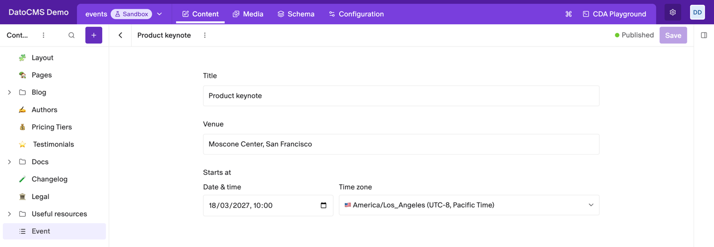
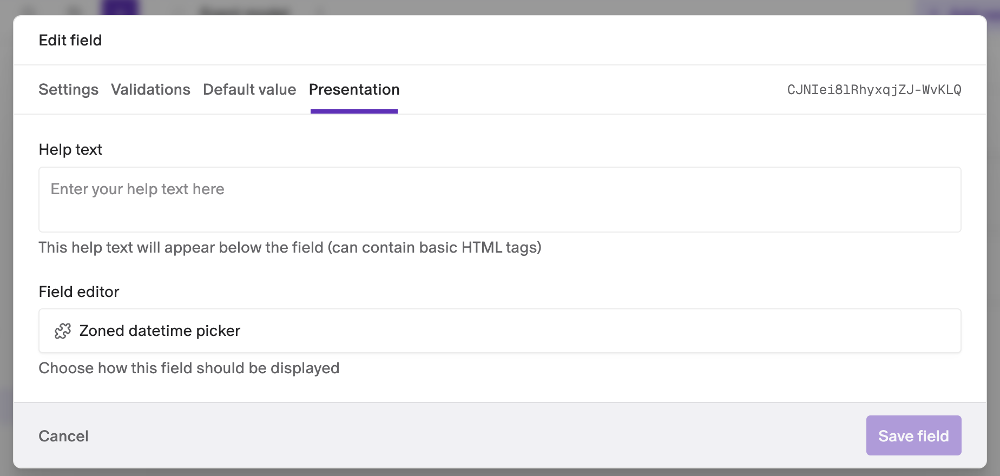
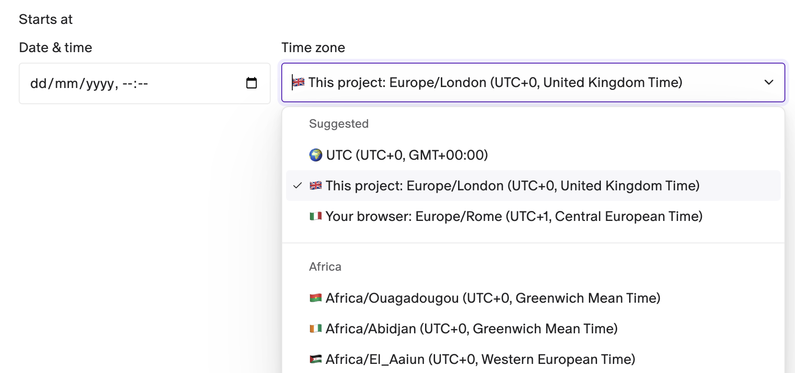
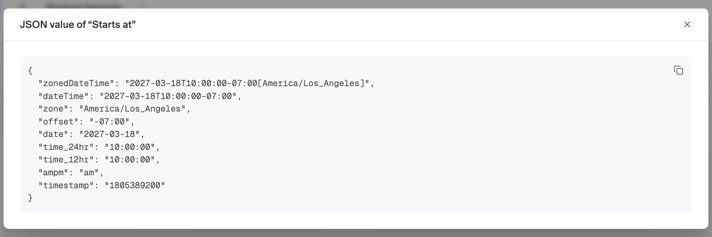

# Zoned DateTime Picker

Store a date and time together with the time zone it belongs to. Editors pick a date, a time and an IANA time zone, and a JSON field saves the moment with its zone, its UTC offset and ready-made date and time strings.



- **Keeps the original time zone**: the zone and offset you pick stay as entered, for every editor and every API.
- **Every IANA time zone**: grouped by region, with flags, current offsets and local names, and a search box.
- **Daylight saving time handled**: the stored offset is the one in force on the chosen date.
- **Ready-to-use JSON**: an [RFC 9557](https://datatracker.ietf.org/doc/rfc9557/) (IXDTF) string, an ISO 8601 string, the zone, the offset, the date, the time and a Unix timestamp.
- **No configuration**: add it to any JSON field.

## Why not the built-in DateTime field?

DatoCMS stores a DateTime field as a single instant and forgets the time zone it was typed in. The dashboard then shows it in each editor's own time zone, and the APIs return it in the environment's time zone. An event entered as 10:00 in Los Angeles reads 17:00 for an editor in London and comes back as 18:00+01:00 from an API set to Rome.

That's fine when everything happens in one time zone. When an event belongs to a place, your website needs to know that place's time zone to show "10:00 Pacific Time" to every visitor. An offset like `-07:00` isn't enough: it doesn't tell `America/Los_Angeles` (which moves between -08:00 and -07:00) from `America/Phoenix` (always -07:00). This plugin saves the IANA zone next to the offset, so nothing is lost.

## Getting started

Add a **JSON** field to any model or block. In its **Presentation** tab, under **Field editor**, click **Change** and pick **Zoned datetime picker**.



The plugin has no settings.

## Picking a date, time and time zone

1. Set **Date & time** with your browser's date and time picker, or type it in.
2. Open **Time zone** and pick the zone the date and time belong to.

The list starts with three suggestions: **UTC**, **This project** (the time zone set in the environment's **Locales & timezone** settings) and **Your browser**. Then come all the IANA time zones, grouped by region and sorted by UTC offset. Type to search: the search matches the zone ID, the offset and the zone's name, so "pacific", "rome" or "utc+9" all work.



The offsets and names in the list are today's. The saved offset is the one in force on the date you picked: a 10:00 event in Los Angeles in March is saved with `-07:00`, even if the list shows UTC-8 today.

## What gets saved

The field stores a JSON object like this one:

```json5
{
  zonedDateTime: "2027-03-18T10:00:00-07:00[America/Los_Angeles]", // RFC 9557 / IXDTF, works with Temporal
  dateTime: "2027-03-18T10:00:00-07:00", // ISO 8601 with the offset
  zone: "America/Los_Angeles", // IANA time zone
  offset: "-07:00", // UTC offset on that date
  date: "2027-03-18",
  time_24hr: "10:00:00",
  time_12hr: "10:00:00", // without AM/PM
  ampm: "am",
  timestamp: "1805389200", // Unix time in seconds, as a string
}
```

To check a field's value from the record, open the field's **⋮** menu and choose **Show JSON value**.



On your website, use `zone` to show the time where the event happens, for example with [`Intl.DateTimeFormat`](https://developer.mozilla.org/en-US/docs/Web/JavaScript/Reference/Global_Objects/Intl/DateTimeFormat):

```js
const { dateTime, zone } = event.startsAt;
new Intl.DateTimeFormat('en-US', { dateStyle: 'full', timeStyle: 'short', timeZone: zone })
  .format(new Date(dateTime)); // "Thursday, March 18, 2027 at 10:00 AM"
```

## Languages

The labels and the time zone names follow the editor's DatoCMS interface language: English, Italian, German, French, Czech, Dutch, Portuguese and Spanish, with English for any other language. The date and time input is your browser's own, so its format follows your browser's language settings.

## Good to know

- **Pick the time zone yourself:** the field is saved only once it has both a date and time and a chosen time zone. Until you pick one, the list shows the project's time zone, but nothing is stored.
- **Clearing the date** empties the field.
- **Older values still work:** values saved by earlier versions of the plugin are read and kept as they are until you change the field.
- **Values from elsewhere:** if the field holds JSON the plugin can't read, it shows the raw value with a warning and doesn't overwrite it.
- **Read-only fields:** when the field is disabled, editors see the date and time zone but can't change them.

## Development

```bash
npm install
npm run dev     # serves the plugin at http://localhost:5173
npm run build
```

See the [DatoCMS plugin SDK documentation](https://www.datocms.com/docs/plugin-sdk) for how plugins work.
